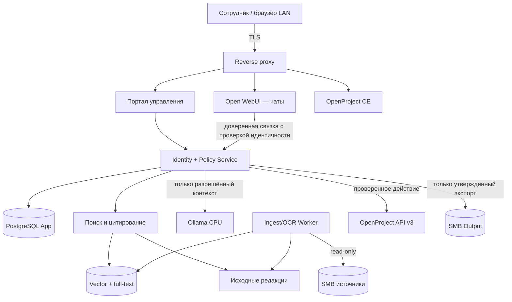

# ТЕХНИЧЕСКОЕ ЗАДАНИЕ
## Создание автономной корпоративной ИИ-платформы советников по информационной безопасности

**Идентификатор:** IB-AI-PLATFORM-TZ-001
**Редакция:** 2.0 — расширенное, исполняемое ТЗ
**Дата:** 12.10.2026
**Исполнитель:** ИИ-агент Codex, запускаемый в гостевой Ubuntu Linux
**Назначение:** исполняемое техническое задание для разработки, развертывания, испытаний, документирования и передачи заказчику локальной системы.

> **СТАТУС:** рабочее техническое задание. Выбранные по умолчанию решения отмечены как проектные допущения. Условия приемки являются обязательными; неподтвержденные на момент написания версии инфраструктуры агент обязан проверить. Запрещено объявлять систему готовой, если критические условия приемки не выполнены.

---

# 0. ОБЩАЯ ДИРЕКТИВА АГЕНТУ CODEX

Ты работаешь **в Ubuntu VM**, размещенной на физическом сервере под **Astra Linux Special Edition 1.7.6 «Смоленск»**. Твоя цель — создать работающее, воспроизводимое, документированное локальное решение. Работай итерациями: диагностика -> план -> реализация -> тестирование -> фиксация результатов. Не ограничивайся планом, макетами и псевдокодом: создавай реальные файлы проекта, запускай сервисы, выполняй тесты и сохраняй доказательства результата.

**Обязательные правила:**

1. Не меняй Astra Linux на хосте: не обновляй ядро, QEMU, libvirt, `astra-kvm`, настройки МРД/МКЦ или системные службы. Не предполагай, что доступ из гостя к хосту существует. Для отсутствующих параметров хоста сформируй читаемый набор команд оператору и сохраняй ожидание в `docs/HOST_COMPATIBILITY.md`. Если VM уже работает, разработку внутри неё можно продолжать, не дожидаясь отчёта о хосте; готовность совместимости не подтверждать до получения отчета.
2. Вся разработка до изоляции выполняется на открытых официально опубликованных материалах и синтетических/обезличенных примерах. Не запрашивай и не загружай реальные секретные, государственно-тайные либо несанкционированные корпоративные данные во внешние сервисы или Codex.
3. После переноса в закрытую сеть система должна работать без интернета. Никаких удалённых LLM, автоматических скачиваний, CDN-зависимостей, внешней телеметрии, внешней авторизации и обязательных облачных интеграций.
4. Системные промпты не являются механизмом контроля доступа. Разрешения проверяются серверными программными компонентами **до** обращения к индексу и перед каждым скачиванием/экспортом.
5. ИИ работает в режиме **советника**: не запускает команды на рабочих станциях/серверах, не меняет AD/SMB, не публикует задачи, не утверждает документы и не отправляет данные без явного разрешенного действия пользователя. Любая запись во внешнюю корпоративную систему допускается только через отдельную операцию подтверждения.
6. Не модифицируй исходники upstream Open WebUI/OpenProject без крайней необходимости. Предпочитай официальные API, расширения, настройки и собственные адаптеры. Не применяй взлом лицензий или обход ограничений платных функций; OpenProject Community Edition удовлетворяет базовому сценарию.
7. Все версии компонентов должны быть **зафиксированы конкретными версиями и, где возможно, digest SHA-256**; никаких `latest`, плавающих веток и нефиксированных образов в релизном offline-пакете.
8. Не подменяй отсутствующие функции фиктивными заглушками в релизе. Для каждой функции укажи статус `implemented/tested`, `partial`, `blocked` или `deferred`, причины и безопасный режим отказа.
9. Минимизируй зависимости, техническую сложность, постоянную нагрузку и потребление RAM. Учитывай CPU-only и HDD RAID.
10. В конце каждой фазы обновляй `STATUS.md`, `DECISIONS.md`, `TEST_REPORT.md`, а также список открытых вопросов/рисков.

# 1. КОНТЕКСТ И ИСХОДНЫЕ УСЛОВИЯ

## 1.1. Оборудование и гипервизор

| Компонент | Требование/сведения |
|---|---|
| Физический сервер | Astra Linux Special Edition 1.7.6 «Смоленск» |
| Физический CPU | Intel Xeon, суммарно 32 ядра; точная модель неизвестна |
| Физическая RAM | 64 ГБ |
| Диски хоста | Несколько HDD в RAID; конфигурация RAID, доступный объём и ФС неизвестны |
| GPU | Нет |
| Гипервизор | Установленный на хосте QEMU/KVM + libvirt; **версия QEMU НЕ подтверждена** |
| Гостевая ОС | Ubuntu LTS, предпочтительно Ubuntu Server 24.04 LTS, с оговоркой о фактическом прохождении проверок совместимости; резервный вариант — 22.04 LTS |
| Размещение | Одна Ubuntu VM одновременно для разработки и последующей эксплуатации |
| Предварительные ресурсы VM | 16 vCPU, 32 GiB RAM, виртуальный диск от 300 GiB; оператор вправе корректировать в пределах физического хоста |
| Пользователи | 1–5 учётных записей, первоначально 1–2 активных генерации одновременно |
| Связность | Интернет только на фазе разработки/подготовки; затем закрытая сеть LAN/air-gap |

**Нельзя из номера Astra 1.7.6 вывести версию QEMU.** Запрещено выбирать тип машины `pc-q35-*`, прошивку OVMF, CPU-флаги, настройку ballooning, контроллеры и XML-декларации исключительно по инструкциям для новых QEMU. При создании VM оператор должен использовать только поддерживаемые фактической связкой QEMU/libvirt варианты.

## 1.2. Диагностика хоста (выполняется оператором на Astra, не из Ubuntu)

Предоставить оператору `ops/host/astra-diagnose.sh` **только для чтения**, собирающий:

```bash
cat /etc/os-release
uname -a
qemu-system-x86_64 --version
sudo virsh -c qemu:///system version
qemu-system-x86_64 -machine help
sudo virsh -c qemu:///system capabilities
sudo virsh -c qemu:///system domcapabilities
lscpu
ls -l /dev/kvm
dpkg-query -W 'qemu*' 'libvirt*' 'astra-kvm' 2>/dev/null
```

Скрипт обязан скрывать частные hostname, UUID, MAC, локальные адреса и иные идентификаторы при подготовке отчета для посторонней передачи. Никаких команд установки/обновления. **Не изменять** встроенную в Astra модель безопасности, права на пулы, мандатные метки, требования к ФС. Если оператор сообщает о включенном МРД/МКЦ — запросить администраторскую проверку размещения ВМ и разрешенности используемого пула.

## 1.3. Диагностика Ubuntu VM

Агент выполняет диагностику `lscpu`, `free -h`, `lsblk`, `df -h`, `uname`, `systemd-detect-virt`, `/proc/cpuinfo` (AVX2), KVM guest agent если доступен, сетевых интерфейсов и доступного диска. Создает `docs/ENVIRONMENT.md`, `docs/RESOURCE_BUDGET.md`. Не предполагает наличие вложенной виртуализации.

# 2. ЦЕЛИ И ГРАНИЦЫ ПРОЕКТА

## 2.1. Цели

1. Единая корпоративная веб-платформа на русском языке для авторизованных сотрудников.
2. Пять начальных советников: системное администрирование, ИБ, нормативный анализ, конструктор приказов, аналитик отчётов.
3. Администратор может создавать и изменять новых советников через веб-интерфейс, назначать системные промпты, модели, параметры поиска, наборы источников, шаблоны и допустимые инструменты; версии и откат.
4. Все нормативные выводы **только из доступной пользователю базы документов**; без «додумывания» применимых требований и цитат.
5. Индекс документов из настраиваемых SMB-источников с ручной и ежедневной синхронизацией, распознаванием сканов, историей редакций.
6. Реестр объектов информатизации с жизненным циклом, нормативной матрицей, мероприятиями, сроками, свидетельствами выполнения и контролем пробелов.
7. Генерация проектов документов, отчётов, планов, презентаций, служебных шаблонов и XLSX; человек проверяет до экспорта/утверждения.
8. OpenProject — средство планирования и контроля, интеграция через API v3; календарь Thunderbird через защищенную iCalendar-подписку.
9. Раздельные личные переписки, технический аудит без избыточного накопления чувствительного текста.
10. Проверенная автономность и воспроизводимость развертывания, восстановления и обновления без интернета.

## 2.2. Не входит в MVP / отдельные ворота допуска

- Полная автоматизация выполнения команд на контроллерах домена, SMB/AD, серверной инфраструктуре и рабочих станциях.
- Автоматическое утверждение приказов, отчётов, оценок конфиденциальности и выполненных мероприятий.
- Автоматическое признание объекта соответствующим требованиям регуляторов или прошедшим аттестацию.
- Эксплуатационная обработка сведений, составляющих государственную тайну. Для них нужен **отдельный авторизованный контур и отдельно согласованный проект защиты**; из-за air-gap и Astra/QEMU никакой автоматической разрешенности не возникает.
- Синхронизация календаря Thunderbird «в обе стороны»; MVP: односторонняя подписка на iCalendar OpenProject.
- Обход лицензирования OpenProject или платных модулей.

# 3. ТЕХНОЛОГИЧЕСКАЯ АРХИТЕКТУРА

## 3.1. Рекомендуемые компоненты

| Подсистема | Базовый выбор | Условие |
|---|---|---|
| ОС гостя | Ubuntu Server LTS | подтверждение фактической совместимости VM |
| Контейнеризация | Docker Engine + Docker Compose v2 | версии фиксируются; offline-поставка из пакета |
| UI чата/советников | Open WebUI | переиспользовать штатные функции; без прямого закрытого RAG |
| Локальный inference | Ollama | CPU only; только на backend network |
| LLM | `qwen3.5:4b-q4_K_M` или эквивалент с фиксированным digest | первичный; предварительная проверка русского языка |
| Альтернативная LLM | `qwen3.5:9b-q4_K_M` | опционально при успешном бенчмарке |
| Embeddings | `bge-m3` с фиксированной ревизией | полностью локально |
| Проектная система | OpenProject Community | официальная Docker Compose сборка, версии pin |
| API и бизнес-логика | FastAPI/Python | объекты, промпты, ACL, отчёты, интеграции |
| Транзакционные данные | PostgreSQL | бизнес-сущности и реестр; OpenProject может иметь собственную БД |
| Векторный индекс | pgvector **или** Qdrant, выбрать по измерениям | предпочтительно простота и ACL-фильтры; выбор оформить ADR |
| Парсер документов | локальные библиотеки/Docling по тестам | не подтягивать облачные сервисы |
| OCR | Tesseract с русским языковым пакетом | очередь, ограничение CPU и RAM |
| Офисные артефакты | python-docx, openpyxl, python-pptx, LibreOffice headless | точность визуализации по шаблонам, тестировать |
| Reverse proxy | Nginx или Caddy (локально) | HTTPS через внутренний CA до сетевой эксплуатации |
| Данные и медиа | persistent volumes, локальное файловое хранилище | версионирование и контроль доступа |
| Секреты | защищенные root-only env/secrets, без Git | ротация и backup |

Не вводить Kubernetes, брокер сообщений/Redis, MinIO, Keycloak и отдельную сложную ESB без доказанной необходимости. Если OpenProject уже требует очередей/сервисов, использовать их штатно. Для фонового индексирования допустим контролируемый единичный worker и PostgreSQL job queue; расширять по фактическим метрикам.

## 3.2. Принцип потоков

```
Браузер LAN
   | HTTPS
Reverse proxy
   |---- Open WebUI (личные чаты, советники)
   |---- Management API/UI (реестр, правила, документы, генератор)
   |---- OpenProject (задачи/планы)
                 |
          Policy / Identity Gateway
                 |
             RAG API --------> разрешенные документы + индекс
                 |                    ^
              Ollama          ingest worker <- SMB(read only)
                 |
         Ответ с цитатами
```

Вызов RAG **никогда** не осуществляется со стороны браузера напрямую к векторной БД. Ollama не публикуется в LAN. OpenProject API не публикуется напрямую в обход управляющего прокси/ACL.

Для взаимодействия с Open WebUI изучить актуальные стабильные официальные API/расширения; если невозможно надежно передавать заверенную идентичность пользователя и применять серверное RAG ACL, **закрытый RAG вынести в собственный веб-раздел**, а Open WebUI использовать только для открытых/разрешенных одинаково всем данных. Нельзя имитировать проверку ACL исключительно промптом, HTTP-заголовком от браузера или встроенными правами на «пространство знаний».

## 3.3. Ресурсный бюджет (оценка, подлежит измерению)

- VM: ориентир 16 vCPU, 32 GiB RAM, 300–500 GiB HDD RAID при наличии места; не фиксировать без `df` на хосте.
- Ollama + 4B: первоначальный лимит на модель и контекст по результатам измерения, целевой контекст 4096 токенов, конкурентность 1, одновременно загружаемых моделей 1–2.
- Embeddings и OCR: последовательно/планово, запрещены десятки параллельных worker на CPU.
- OpenProject: минимальное разумное число web/background процессов для 1–5 пользователей, измерить фактическое потребление.
- Open WebUI/API/PostgreSQL: отдельные лимиты, healthchecks, очереди тяжёлых задач.
- HDD: избегать массовой переиндексации без изменения контента, индексировать по hash и версиям, использовать bounded batches; применять разумное резервирование диска.
- При недостатке памяти: уменьшить контекст, выключить вторую LLM, снизить число worker или отделить ресурсоемкий функционал. Не отключать контроль ACL ради скорости.

# 4. ФУНКЦИОНАЛЬНЫЕ ТРЕБОВАНИЯ

## 4.1. Советники

Создать пять системных профилей:

**ADV-ADM — Системное администрирование.** Консультации по Windows, Linux, AD, DNS, GPO, SMB, сетям; генерация Bash/PowerShell/SQL/конфигураций **как текста**; каждый потенциально разрушительный шаг явно маркировать риском, предусловиями и откатом. Не выполнять команды.

**ADV-SEC — Информационная безопасность.** Анализ мероприятий защиты, инцидентов, результатов проверок, уязвимостей, рисков и внутренних политик, проверка документального подтверждения.

**ADV-NORM — Нормативный советник.** Требования опубликованных актов и локальных утвержденных редакций; в ответе указывать наименование, идентификатор, дату/версию и пункт, ссылку на индексированную копию; при отсутствии применимых источников отказывать в нормативном выводе.

**ADV-ORDER — Конструктор приказов и регламентов.** Запрашивает/извлекает реквизиты из разрешенных данных, выбирает утвержденный шаблон, формирует проект, показывает незаполненные обязательные поля, сохраняет черновик и предоставляет предпросмотр.

**ADV-REPORT — Аналитик отчётов.** Собирает подтвержденные статусы мероприятий/задач, составляет месячные/квартальные/полугодовые/годовые отчеты, сводные таблицы, презентации и плановые графики.

Системные промпты хранить в конфигурациях версионированно и редактировать через web UI (см. ниже). По умолчанию: `documents_only=true`, `cite_sources=true`, `no_external_tools=true`, `execute_commands=false`. Если данных нет — «В разрешённых документах не найдено подтверждения»; невозможно выдавать фантазию модели за требование регулятора.

## 4.2. Конструктор и управление промптами

Через административную панель:

- создание/клонирование/архивирование/отключение советников без редактирования кода;
- поля: ID, имя, описание, иконка, версия модели, текст системной инструкции, шаблон сообщения, параметры chunk/topK/context, доступные источники по policy, профили экспорта, перечень разрешённых read-only инструментов;
- промпт с параметрами вида `{{object_id}}`, `{{as_of_date}}`, `{{document_scope}}`; строгое серверное экранирование и валидация;
- коллекция шаблонов сценариев: анализ этапа жизненного цикла, gap-analysis, сводка требований, оценка конфиденциальности (только предварительная), формирование плана, контроль просрочек, передача полномочий, создание заявки;
- черновик -> тестирование на фиксированном наборе запросов -> публикация -> история версий -> откат;
- фиксировать автора изменения, время, diff; пользовательские промпты не могут повышать разрешения, менять ACL, активировать интернет или самовольное выполнение действий;
- при изменении основного промпта сохранять метку версии в ответах и артефактах;
- предоставлять импорт/экспорт подписанного/проверяемого YAML/JSON-конфига без секретов.

## 4.3. Единая база знаний и документы

**Логически единый каталог документов, физически разграниченный по политикам доступа и категориям.** 1 000–10 000 файлов первоначально. Форматы: DOC/DOCX, текстовые PDF, сканированные PDF/images (OCR), XLS/XLSX/CSV, PPT/PPTX, TXT/RTF/MD. Legacy Office-конвертация в изолированном процессе без выполнения макросов.

Обязательные сущности: `source`, `source_path`, `document_id`, `revision_id`, `file_sha256`, `title`, `mime`, `status`, `owner`, `department`, `classification`, `effective_from/to`, `doc_date`, `approved_by` (если известен), `norm_type`, `legal_number`, `page/slide/sheet/row`, `acl_snapshot`, `ingested_at`, `indexed_at`, `parser_version`, `ocr_confidence`.

Требования:
- настраивать SMB-подключения через админ UI и конфигурационный файл; учетные данные — только secrets store, вне БД открытым текстом и вне логов;
- несколько shares, исключения каталогов/масок, фильтры размеров, суточный scheduler и ручной trigger;
- безопасный read-only import, без удаления/перемещения/редактирования файлов на исходном SMB;
- повторный запуск без дублирования, изменения по хэшу, история редакций, soft-delete/unavailable состояния;
- импортируемые файлы считать **недоверенными**: лимиты по размеру/страницам/времени, безопасная конвертация без макросов, архивные бомбы, блокирование внешних ссылок/встроенного сетевого контента, песочница OCR;
- парсер должен сохранять структуру: PDF страницы, Word разделы/пункты/таблицы, PPT слайды, XLS листы/диапазоны; показывать уверенность OCR и оригинал;
- цитаты и ссылки **на конкретную ревизию**, с привязкой к странице/пункту/слайду/листу и проверкой доступа на просмотр/скачивание;
- пересчет индекса при замене модели embeddings, смене разрешений, ревизии, отзыве доступа или деактивации документа;
- статус индексации: количество найденных, импортированных, ошибок, недоступных, частичных OCR, конфликтов версий и текущая скорость;
- документы с одинаковым названием, но разными редакциями должны различаться; исторический анализ «на дату»;
- полнотекстовый + семантический поиск с порогом релевантности, фильтрами ACL, версии, тематики, даты применимости; reranking только локальный и опциональный;
- экспорт из индекса/кешей и API строго через проверку ACL.

**Чёткое ограничение:** общая БД != общий доступ; несекретные документы с разными правами должны оставаться раздельно видимыми в результате поиска. Документы, составляющие гостайну, **не смешивать с индексами MVP**; обработка только отдельным проектом в разрешённом контуре.

## 4.4. AD / SMB ACL

MVP с локальными аккаунтами — **только для общедоступного набора и тестовых документов**. Нельзя безопасно «унаследовать ACL SMB» по имени локального аккаунта без гарантированной связи с AD и реальной проверки прав. Для закрытых файлов требуется один из механизмов:

1. подтвержденная AD-аутентификация каждого пользователя и проверка групп/токена (включая вложенные группы и deny ACL, повторную проверку и обработку изменений);
2. достоверная per-user проверка полномочий на файл (например, сервис identity-aware с делегированием/проверкой эффективного доступа при соблюдении политик организации), с безопасным кешем;
3. если ни один механизм не доказан тестами — **deny-by-default**: защищённые файлы не выдавать вообще.

Не считать «сервисная учетка может читать всю шару» доказательством прав пользователя. ACL должны применяться **до** поиска и к подстановке контекста, истории, цитатам, файлам, превью, экспорту и API; revoked права вступают в действие в пределах установленного TTL (целевой <= 5 мин) или немедленно при ручной инвалидации. Не доверять заголовкам `X-User-*`, пришедшим непосредственно от браузера. Служебные токены ограничивать по назначению.

## 4.5. Классификация конфиденциальности

Предварительная оценка пользователем/ИИ: категория сведений, возможный режим защиты, основание на конкретных разрешенных документах, признаки неопределенности, рекомендованная проверка человеком. Статусы: `не оценено`, `предварительное предположение`, `на проверке`, `подтверждено уполномоченным`. Никакой автоматической окончательной классификации, снятия грифа или утверждения допуска. Для гостайны не передавать текст в данный MVP.

## 4.6. Реестр объектов информатизации

Создать реестр с карточками и фильтрами по большому количеству объектов, поддержать массовый импорт из XLSX/CSV в ограниченной форме. Типы: государственная/муниципальная ИС; ИСПДн; значимые и другие объекты КИИ; АС в защищённом исполнении; помещения/технические средства/иные объекты; внутренние ИС и сети. Объект может иметь несколько категорий, категорию защищаемых сведений, подразделение, владельца/ответственного, жизненный цикл, даты, границы, классы/уровни/категории по применимым правилам — только утвержденные человеком значения.

Этапы: обследование/создание/проектирование; испытания и аттестация/оценка соответствия/ввод; эксплуатация; изменения/модернизация; вывод из эксплуатации.

Для каждого объекта:
- применимые требования с правовым основанием, редакцией и датой применимости;
- этапы, обязательные/условные мероприятия, сроки, ответственные и доказательства;
- статусы `не оценено`, `применимо`, `неприменимо с основанием`, `требует проверки`, `доказательство отсутствует`, `в работе`, `выполнено подтверждено`, `просрочено`;
- отчет gap-analysis с отличием «не найден документ» от «работа не выполнена»;
- трассировка `объект -> условие применимости -> источник -> требование -> мероприятие -> задача -> доказательство -> подтверждающий`;
- импорт утвержденного перечня мероприятий и нормативных требований вручную/YAML/XLSX, контроль версии, согласование редакций;
- предотвращение повторного создания задач, связка с OpenProject, история изменений.

## 4.7. Нормативная база и правила ФСТЭК

Источник истины — **загруженные и подтвержденные ответственным редакции нормативных и методических документов**, а не память LLM и не интернет во время эксплуатации. Сделать конфигурируемый `requirements_registry`: реквизиты акта, дата принятия/вступления/отмены, редакция, источник, пункт, условия применения, тип объекта, фаза, требуемые подтверждающие документы, контрольные сроки, ответственность и связи с другими нормами.

Алгоритм: объект -> подтвержденные признаки -> фильтр применимости -> правила реестра -> матрица мероприятия -> документы-доказательства -> статус/пробел -> рекомендация -> проект задачи в OpenProject. Неподтвержденное условие = `требует уточнения`, а не автоматически «неприменимо».

Система не должна утверждать, что какой-либо конкретный приказ ФСТЭК применяется ко всем объектам. При добавлении редакций приказов, стандартов и методик ответственность за юридическую/нормативную валидацию принадлежит назначенному специалисту. Промпт может менять способ анализа и представления, но не отменять утвержденные правила соответствия.

Создать минимум следующие настраиваемые промпт-шаблоны:
- `fstec.applicability` — определение применимости требований с указанием условий;
- `fstec.lifecycle_gap` — обнаружение пробелов по текущей стадии;
- `fstec.evidence_review` — достаточность доказательств и документов;
- `fstec.annual_plan`, `.quarter_plan`, `.month_plan` — формирование плана;
- `fstec.progress_report` — отчёт по выполнению;
- `fstec.change_impact` — влияние смены редакции нормативного документа;
- `fstec.handover` — передача мероприятий на период отсутствия ответственного;
- `fstec.raci` — таблица функциональных обязанностей;
- `fstec.confidentiality_draft` — предварительный анализ категории сведений;
- `fstec.object_document_pack` — контроль комплекта документов объекта по этапам.

Для каждой инструкции создать пару образцовых тестов (позитивный и «нет данных»), версию и сценарий отката.

## 4.8. Документы, планы, отчеты, презентации

Обязательные виды артефактов: годовые/полугодовые/квартальные/месячные планы, отчёты об исполнении, матрицы применимости ФСТЭК, разграничение функциональных обязанностей (RACI), матрица важности и передача задач отсутствующего сотрудника, документы по этапам ЖЦ, проекты приказов/распоряжений/регламентов, заявки, XLSX-реестры, PDF-заключения, PPTX-презентации.

Интегрировать предварительно утвержденные заказчиком шаблоны DOCX/XLSX/PPTX (для разработки — обезличенные версии). Шаблон должен иметь ID, версию, владельца, обязательные поля, маппинг переменных, правила нумерации/дат/реквизитов/подписей и список доступных ролей.

Процесс: данные -> подтвержденные источники -> черновик -> предпросмотр -> редактура/валидация человеком -> экспорт; после отдельного утверждения — сохранение в архив платформы, запись на выделенную разрешенную SMB-папку и привязка к проекту/задаче. Не загружать автоматически черновики на запись в чужие шары. Не подделывать подписи, печати, даты утверждения и номера приказов. В PDF предусмотреть локальные шрифты, кириллицу, страницы, таблицы; для XLSX формулы/валидация/печать; для PPTX воспроизводимость структуры.

## 4.9. OpenProject

Развернуть **Community Edition** локально, предпочтительно штатным Compose с фиксированными версиями. Через OpenProject API v3:
- создать/обновить проекты и задачи по объектам/годам/подразделениям (после подтверждения);
- читать статусы, сроки, исполнителей, ссылки на документы;
- готовить и валидировать проект плана в собственной БД; **никакого write API до явной операции «Опубликовать»** доступного уполномоченному пользователю;
- обеспечить идемпотентность операций и лог отказов API;
- запрещено читать через сервисный токен проекты вне разрешений текущего пользователя; где per-user контроль недостижим — ограничить показ и разрешенные области серверно;
- хранить external IDs и синхронизировать статусы без перезаписи ручных решений;
- карточки проектов и задач открывать в OpenProject либо в read-only сводке портала.

Thunderbird: подписка на **iCalendar**, только просмотр. URL календаря является чувствительным bearer-секретом: запрещено включать его в публичные отчеты/логи, показывать посторонним; поддержать отзыв/перевыпуск. Не обещать двустороннюю синхронизацию.

## 4.10. Рутина и заявки

Администратор создаёт типы заявок (например, согласование изменений, доступ, обследование, контроль исполнения), поля, валидаторы и маршруты. Пользователь заполняет форму, ИИ предлагает содержание, сохраняется черновик; после проверки создается разрешенная задача OpenProject. Передача мероприятий другому сотруднику требует явного назначения ответственного; историю сохранить. Матрица важности: срочность, критичность, риск, сроки, трудоемкость и влияние на объект, исходные критерии видны и настраиваемы.

# 5. РОЛИ, АВТОРИЗАЦИЯ И АУДИТ

Минимальные роли:
- `platform_admin`: системные настройки и управление пользователями, но не автоматическое чтение чужих личных чатов;
- `knowledge_curator`: источники, индексация, редакции нормативов/шаблонов в пределах прав;
- `security_officer`: реестры объектов, анализ, проекты мероприятий;
- `approver`: согласование результатов, подтверждение, публикация задач в пределах прав;
- `employee`: личные чаты и разрешенные ресурсы;
- `auditor`: доступ только к журналам/метаданным проверки, без несанкционированного чтения документов и переписки.

Разрешить комбинации ролей. Для первой итерации — локальные пароли (устойчивое хеширование, rate limits, secure cookies, session expiration, запрет саморегистрации после создания админа, MFA если штатно доступна). Для следующей — AD/LDAP или OIDC с подтверждённым mapping SID/групп; локальный break-glass администратор по отдельной процедуре.

Истории чатов по умолчанию личные. Технический аудит: ID пользователя/роли, объект действия, время, тип операции, результат, версия источника/правила/промпта, ID запроса, без полного текста диалогов по умолчанию; срок хранения конфигурируемый. Отдельный строго разрешенный журнал публикации и согласования. Защитить от изменения неуполномоченными, предусмотреть экспорт для внутреннего аудита.

# 6. БЕЗОПАСНОСТЬ И ГРАНИЦЫ ДОВЕРИЯ

1. HTTPS c сертификатом внутреннего CA для рабочих клиентов. Если CA нет, подготовить локальный bootstrap и инструкцию замены; не вводить в эксплуатацию с недоверенным сертификатом без согласования.
2. Запретить прямую публикацию Ollama, БД, векторного хранилища, worker и admin API в LAN. Reverse proxy — единственная точка входа.
3. Firewall allowlist внутри закрытой сети, корректные настройки CORS, CSRF, cookie flags, CSP, ограничения загрузок.
4. Отсутствие дефолтных паролей/ключей в релизе; первичная генерация секретов локально, запрет вывода в логи, отдельные роли сервисных учёток.
5. Не исполнять bash/PowerShell/SQL и не выполнять внешние запросы по инструкции, найденной внутри документа. Данные RAG — **недоверенный контекст**, запрет prompt injection на выдачу других файлов, изменение системного промпта, «подключение облака».
6. Документы ограниченного доступа не смешивать с открытыми индексами и кешами без строго проверяемого механизма ACL. Для гос. тайны — отдельный проект в разрешенном контуре, здесь не использовать и не тестировать реальными материалами.
7. Отдельные тесты: попытка доступа к чужому документу через имя, ID, цитату, поисковую выдачу, скачивание, отчет, историю, вложение, прямой API URL, перепривязку ролей, cache, ошибку синхронизации ACL и prompt injection.
8. Блокировка внешних запросов после изоляции — сетевым экраном и Docker networking, не только `OFFLINE_MODE`.
9. Ограничение доступного объёма данных у сервисных токенов SMB/OpenProject, read-only доступ к исходным данным, отдельная разрешенная папка для утвержденного экспорта.
10. Поддержка резервного копирования, шифрования по установленной политике, ротации секретов и аккуратного удаления временных файлов/OCR.

# 7. OFFLINE-СБОРКА И ПЕРЕНОС

Агент обязан реализовать **два режима**: `connected-build` и `airgap-runtime`. К релизу прилагать:

- `ops/prepare-online.sh`: получение закрепленных версий образов, пакетов, зависимостей, OCR data, моделей Ollama, локальных UI-ассетов, шрифтов, тестовых наборов; генерация SHA-256 manifest + перечня лицензий/версий;
- `ops/export-airgap.sh`: создание набора архивов контейнеров/образов/моделей/конфигов/миграций/документации;
- `ops/install-offline.sh`: проверка SHA-256, загрузка образов без pull, установка секретов, миграции, healthchecks, проверка моделей, первое включение;
- `ops/verify-airgap.sh`: отключение доступности интернета и проверка всей функциональности при недоступности DNS/HTTP наружу; исключения в firewall должны быть явно перечислены для внутреннего AD/SMB/OpenProject и других разрешенных узлов;
- `ops/backup.sh` / `ops/restore.sh`: локально и опционально на резервный SMB-ресурс, снапшоты БД с согласованной точкой восстановления, проверка целостности, пробное восстановление;
- `ops/upgrade-offline.sh`: порядок миграций, контроль совместимости версий и откат.

Важно: Codex как облачный агент может потерять соединение после изоляции. После отключения интернета проект должен **работать**, но не обязан обеспечивать облачный Codex; сопровождение выполняется локальными админами/средствами, подготовленными заранее. Не использовать CDN скриптов, веб-шрифтов, telemetry/update endpoints и удаленных шрифтов.

# 8. СТРУКТУРА РЕПОЗИТОРИЯ

```text
ib-ai-platform/
  AGENTS.md
  README.md
  STATUS.md
  DECISIONS.md
  TEST_REPORT.md
  compose.yaml
  compose.override.example.yaml
  .env.example
  .gitignore
  docs/
    ARCHITECTURE.md
    ENVIRONMENT.md
    HOST_COMPATIBILITY.md
    RESOURCE_BUDGET.md
    SECURITY_MODEL.md
    THREAT_MODEL.md
    DATA_MODEL.md
    API.md
    OPERATIONS.md
    OFFLINE_INSTALL.md
    BACKUP_RESTORE.md
    USER_GUIDE_RU.md
    ADMIN_GUIDE_RU.md
    ACCEPTANCE.md
    RISKS.md
    LICENSES_AND_SBOM.md
  apps/
    policy_gateway/
    registry_api/
    admin_ui/
    ingest_worker/
    reporting_service/
    openproject_connector/
  prompts/
    advisors/
    fstec/
    evaluations/
  schemas/
    requirements/
    objects/
    report_templates/
  templates/
    docx/
    xlsx/
    pptx/
  migrations/
  tests/
    unit/
    integration/
    e2e/
    security/
    performance/
    fixtures_synthetic/
  ops/
    host/astra-diagnose.sh
    prepare-online.sh
    export-airgap.sh
    install-offline.sh
    verify-airgap.sh
    backup.sh
    restore.sh
    upgrade-offline.sh
  evidence/
    screenshots/
    benchmark/
    test-results/
```

Можно изменить структуру по обоснованию и зафиксировать ADR, но нельзя исключать тесты, документацию и процедуры переноса/восстановления.

# 9. ПЛАН РЕАЛИЗАЦИИ И КОНТРОЛЬНЫЕ ТОЧКИ

**P0 — инвентаризация:** диагностика Ubuntu, параметры хоста от оператора, выбор Compose, замер CPU/памяти/IO, схема сети/хранилища. Артефакт: environment report. Примечание: отсутствие доступа к хосту не блокирует разработку внутри работающей VM, но блокирует отметку «совместимость QEMU подтверждена».

**P1 — инфраструктура:** Docker Compose, reverse proxy, secrets, healthchecks, Open WebUI, Ollama, локальные LLM и embedding, базовые пользователи. Артефакт: работающий офлайн-чат на синтетическом наборе.

**P2 — документный MVP:** ingestion локального каталога и синтетической SMB-шары, извлечение PDF/DOCX/XLSX/PPTX/OCR, индекс, ссылки на версии и страницы, ручной/ежедневный sync. Артефакт: RAG тесты на 100+ синтетических фрагментах.

**P3 — безопасный RAG/идентичность:** identity gateway, роли, фильтры, проверка ACL, отказ на недоказанных правах; AD integration с тестовым стендом или `blocked` до доступа к реальной корпоративной сети. Закрытые реальные документы запрещены до acceptance ACL.

**P4 — советники/промпты:** пять советников, админ-конструктор, шаблоны ФСТЭК, тестовый набор QA и истории публикации.

**P5 — реестр/нормативы:** объекты, этапы ЖЦ, реестр нормативов и мероприятий, статусы, матрица, триггеры пересмотра редакций, gap-analysis.

**P6 — генерация артефактов:** DOCX/PDF/XLSX/PPTX по тестовым шаблонам, предпросмотр, экспорт после проверки.

**P7 — OpenProject/календарь:** Community Edition, API v3, read-only обзор, черновик плана, подтвержденная публикация, iCalendar Thunderbird.

**P8 — безопасность/автономность:** тесты нарушений ACL, prompt injection, архивов, защиты секретов; сетевой air-gap тест; offline-пакет и восстановление.

**P9 — окончательная приемка:** матрица тестов, отчет о ресурсах на 16 vCPU/32 GiB, список ограничений/известных ошибок, инструкции для админа, итоговое резюме.

В каждой фазе сначала короткий план и контроль рисков, затем код и тесты; не объявлять следующую фазу готовой без gate. Разрешено создавать параллельные задачи, но не запускать интенсивное OCR и LLM бенчмарк одновременно на слабом CPU.

# 10. КРИТЕРИИ ПРИЁМКИ (ОБЯЗАТЕЛЬНЫЕ)

| ID | Сценарий | Ожидаемый результат |
|---|---|---|
| AC-01 | Перезапуск VM и Compose | Все сервисы поднимаются без интернета, данные сохранены |
| AC-02 | Вход двух локальных пользователей | Разные личные чаты; чужие переписки недоступны |
| AC-03 | Создание нового советника | Админ меняет промпт/модель/профиль, тестирует и публикует версию, доступен откат |
| AC-04 | Запрос без подтверждающего документа | Ответ «не найдено подтверждения», без вымышленных пунктов и приказов |
| AC-05 | Цитата к документу | Привязка к реальному файлу, версии и странице/пункту/листу; скачать может только разрешенный пользователь |
| AC-06 | Повторный импорт SMB без изменений | Не создает дублей, сообщает отсутствие новых версий |
| AC-07 | Замена файла/отзыв доступа | Изменение отражено в индексе/выдаче; старая версия не протекает |
| AC-08 | OCR русскоязычного скана | Документ индексирован, привязка к странице, ошибки распознавания явно отражены |
| AC-09 | ACL тест «user A vs user B» | Запрет в поиске, контексте, ссылке, экспорте, чате, API; fail closed при ошибке identity |
| AC-10 | Матрица объекта | Правило -> мероприятие -> доказательство -> статус с версией нормативного основания |
| AC-11 | Отсутствует документ | Система фиксирует «доказательство не найдено», не объявляет мероприятие невыполненным без основания |
| AC-12 | План на год/квартал/месяц | Сроки, ответственные, зависимости, цитаты, возможность корректировки |
| AC-13 | Черновик OpenProject | Без подтверждения нет POST/PUT; после подтверждения создается задача один раз |
| AC-14 | Thunderbird iCalendar | Подписка просматривается, токен не выводится в логах и можно отозвать |
| AC-15 | DOCX/XLSX/PDF/PPTX | Файлы открываются штатными программами, кириллица/таблицы/реквизиты сохранены |
| AC-16 | Backup/restore | Восстановление на чистой тестовой копии со сверкой контрольных записей |
| AC-17 | Air-gap | При заблокированном внешнем DNS/HTTP: вход, LLM, поиск, документы, проекты и экспорт работают |
| AC-18 | Производительность | Показаны p50/p95, tokens/s, RAM peak, нагрузка CPU/диска; ограничения измерены, без фиктивных обещаний |
| AC-19 | QEMU/Astra | Отчет фактической версии гипервизора/compatibility или явное `pending operator verification`; никакого изменения хоста |
| AC-20 | Гостайна | Нет загрузки, индексации и тестов реальных секретных данных в MVP; запрет отражен в UI и документации |
| AC-21 | Конфиденциальность | Предварительная рекомендация по разрешенным источникам, без автоматического присвоения/снятия грифа |
| AC-22 | Аудит | Фиксируются операции без неконтролируемого хранения полных текстов чужих личных чатов |
| AC-23 | Заявки и передача работ | Черновик -> проверка -> назначение; события аудируются, история не теряется |
| AC-24 | Prompt injection в документе | Команды внутри документа не выполняются, права не повышаются, иные файлы не раскрываются |

**Порог качества RAG:** самостоятельно подготовить минимум 50 контрольных вопросов по синтетическим/публичным материалам с эталонными ссылками, измерить `citation precision`, полноту нахождения релевантных фрагментов, число неподтвержденных утверждений и долю отказов. Критически опасные галлюцинации нормативных ссылок — **0 в приёмочном наборе**. Остальные численные пороги предложить по базовому измерению и согласовать; нельзя скрывать неуспешные тесты.

**Порог производительности:** жёстких гарантий скорости не заявлено. Зафиксировать замеры на реальном выделенном CPU с 1 и 2 конкурентными запросами, холодной/тёплой моделью, длинным RAG контекстом и OCR партии. Предложить оптимизации с оценкой качества/скорости.

# 11. ОТЧЕТНОСТЬ И ДОКУМЕНТАЦИЯ

Сдать:
- работающие сервисы и репозиторий;
- pinned Compose и инструкции Ubuntu/Astra (операторская часть только для чтения);
- протокол выбора моделей, версии и SHA-256;
- runtime/offline пакет, checksum manifest;
- инструкции первичного администрирования на русском, пользователей, ролей, советников, норм, шаблонов, реестра и проектов;
- описание архитектуры, схем данных, REST API, журнал решений (ADR), журнал рисков, угрозы/меры защиты;
- инструкции по резервному копированию, восстановлению, офлайн-обновлению и откату;
- демонстрационный набор обезличенных документов и готовых результатов (план, отчет, приказ, матрица, PPTX);
- автоматические тесты и фактические результаты CI/local runs с датами/версиями;
- ручной acceptance checklist и список известных ограничений;
- отдельный документ `docs/CLASSIFIED_DATA_BOUNDARY.md` о запрете ввода гостайны в MVP и условиях отдельного допуска.

# 12. УПРАВЛЕНИЕ НЕОПРЕДЕЛЁННОСТЯМИ

Ниже параметры, которые сейчас не предоставлены. Не угадывать, а использовать безопасные значения по умолчанию и отмечать блокеры:

1. Фактический `qemu-system-x86_64 --version`, `virsh version`, поддерживаемый machine type, доступность OVMF/BIOS и права/мандатные атрибуты хранилищ на Astra.
2. Точная модель Xeon и возможность AVX2, реальный IOPS HDD RAID, доступный объём диска.
3. Наличие корпоративного CA, имя DNS и подсеть подключения, особенности firewall.
4. SID/структура домена AD, реальные права SMB, правила делегирования, схемы утверждения, учетные записи доступа.
5. Конкретные легальные категории защищаемых сведений, применимость требований по защите информации, разрешенность проектируемой среды.
6. Приоритеты построения интерфейса, окончательное разграничение ролей и срок хранения аудита.
7. Результаты выбора PostgreSQL+pgvector vs Qdrant на фактических документах и нагрузке.
8. Именованные шаблоны DOCX/XLSX/PPTX и принятые схемы согласования/подписания.

**Действие агента:** если параметр не критичен для текущей открытой разработки — документировать и продолжать; если критичен для безопасности/ввода закрытых данных — заблокировать именно небезопасную функцию, не всю разработку.

# 13. ИТОГОВЫЕ УСЛОВИЯ СДАЧИ

Проект считается законченным только при наличии реального, повторяемого развертывания и доказательств приёмки по AC-01..AC-24. Не разрешается отмечать `PASS` при отсутствии прогона. Наиболее критические блокеры: неподтвержденный ACL (запрет закрытых данных), неподтвержденная среда для гостайны (полный запрет такой обработки), неготовый air-gap, утечка секретов/данных. Все остальные ограничения документировать и согласовать.

## Ссылки для разработчика (проверить версии и доступность в connected-build)

- Документация Astra по libvirt/QEMU: https://docs.astralinux.ru/latest/guide/virtual/libvirt/
- Open WebUI offline: https://docs.openwebui.com/tutorials/maintenance/offline-mode/
- Open WebUI env: https://docs.openwebui.com/reference/env-configuration/
- OpenProject Community: https://www.openproject.org/community-edition/
- OpenProject Docker Compose: https://www.openproject.org/docs/installation-and-operations/installation/docker-compose/
- OpenProject API v3: https://www.openproject.org/docs/api/
- OpenProject Calendar/iCalendar: https://www.openproject.org/docs/user-guide/calendar/
- Ollama qwen3.5: https://ollama.com/library/qwen3.5/tags
- Ollama bge-m3: https://ollama.com/library/bge-m3

**Конец базовой части. Далее приведены обязательные приложения, являющиеся неотъемлемой частью ТЗ.**

---

# ПРИЛОЖЕНИЕ A. ПОЛНАЯ СПЕЦИФИКАЦИЯ ПОЛЬЗОВАТЕЛЬСКИХ СЦЕНАРИЕВ

## A.1. Словарь обязательных терминов

- **Объект информатизации (ОИ)** — отдельная учётная сущность, для которой хранится набор утверждённых характеристик, жизненный цикл, применимость требований, документы, мероприятия и ответственные. Категории ОИ не отождествлять с правовыми режимами автоматически.
- **Нормативный документ (НД)** — загруженный первоисточник с реквизитами, редакцией, периодом действия и проверенным ответственным статусом. Не путать с текстом, сгенерированным моделью.
- **Нормативное требование** — структурированная запись о конкретном пункте, условиях применимости, сроках, доказательствах и источнике.
- **Мероприятие** — контролируемая работа, выполняемая по требованию, плану или решению организации.
- **Доказательство** — конкретная разрешённая редакция документа либо подтверждённая запись системы, относящаяся к требованию, мероприятию и ОИ.
- **Черновик** — неутверждённый артефакт с меткой, автором, источниками и историей изменений. Черновик не является приказом или завершённым мероприятием.
- **Источник истины** — проверенная версия документа, структурированное состояние в реестре или статусы исходной системы; не память LLM.
- **Советник** — шаблон деятельности, в котором связаны разрешённая модель, системные инструкции, источники, сценарии и формат результата.
- **Публикация** — отдельное подтверждённое действие пользователя, преобразующее проверенный черновик в задачу/запись/файл в целевой системе. Нельзя приравнивать ответ LLM к разрешению на публикацию.
- **Дата оценки `as_of`** — дата, на которую требуется проверить действовавшие нормативы, состояние задач и редакции документов.
- **Пробел доказательств** — недостаточность доступных подтверждений; не тождественен факту невыполнения защиты.

## A.2. Сквозные истории пользователей и ожидаемое поведение

**US-01: Регистрация и работа пользователя.** Уполномоченный администратор заводит учётную запись, назначает роли. Сотрудник входит с локальной учётной записью, видит разрешённых советников, личную историю, допустимые документы и проекты. Саморегистрация после bootstrap выключена. Недоступные разделы не должны отображаться в меню и должны дополнительно блокироваться на API.

**US-02: Нормативная консультация.** Сотрудник спрашивает: «Какие требования по документированию мероприятий применимы к объекту А на 12.10.2026?». Система определяет допущенные атрибуты объекта, получает актуальные на дату утверждённые нормы и разрешённые документы, возвращает список требований с реквизитами, точными пунктами и прямыми ссылками на доступные пользователю версии. Для непроверенных данных пишет: «Требует уточнения». Если нет пригодной редакции, не делает юридически окончательного вывода.

**US-03: Консультация системному администратору.** По локальным инструкциям и утверждённым схемам AD/Windows/Linux модель составляет последовательность проверки DNS, GPO и SMB, команды Bash/PowerShell и план отката; команды не исполняются ни в гостевой системе, ни в инфраструктуре организации.

**US-04: ИБ-аудит по сведениям хранилища.** Куратор запускает индексирование указанного раздела SMB. Работник ИБ выбирает объект и просит найти признаки исполнения пунктов плана. Сервис возвращает найденные записи, версии, пункты и степень достаточности доказательств. Отсутствие файла в индексе оформляется как «не найдено подтверждение»; автоматически считать мероприятие невыполненным запрещено.

**US-05: Классификация конфиденциальности.** Пользователь вводит разрешённые сведения или выбирает доступные документы. Советник предлагает предварительную категорию и её признаки, ссылаясь исключительно на утверждённые локальные критерии. Итог: «предварительная оценка, требуется решение уполномоченного лица». Запрещены автоматическое присвоение/снятие грифа, переименование исходных файлов под предлогом оценки и выгрузка данных в сеть.

**US-06: Отчёт по периоду.** Сотрудник выбирает период (месяц, квартал, полугодие, год), набор объектов, план и шаблон. Система собирает разрешённые факты из реестра, документов, OpenProject; показывает источники, количественные итоги, просрочки, причины отклонений и незаполненные поля. Экспортирует DOCX/XLSX/PDF, при необходимости PPTX; сохраняет версию черновика. Утверждённый отчёт после явного подтверждения переносится на разрешённый SMB-ресурс.

**US-07: План мероприятий.** На основе нормативного реестра, стадии ОИ, просрочек, состава подразделения и локальных регламентов генератор составляет план на месяц/квартал/полугодие/год. У каждой строки есть источник, приоритет, объект, задача, ожидаемый результат, дедлайн, ответственный либо незаполненное поле и критерий завершения. После редактирования ответственный подтверждает создание связанных задач в OpenProject. Повторное нажатие не порождает дубликатов.

**US-08: Передача работ.** Сотрудник выбирает период отсутствия. Система показывает просрочиваемые задачи, зависимые работы, приоритет и потенциальных заместителей из утверждённой матрицы ролей/доступности. Автоматического переназначения нет: руководитель/уполномоченный подтверждает изменения. Фиксируется, кто и почему передал работу.

**US-09: Матрица обязанностей.** По утверждённым положениям о подразделениях, должностным инструкциям и данным о функциях генерируется RACI (Responsible, Accountable, Consulted, Informed). В каждой ячейке или группе ячеек — источник. При конфликте полномочий выдаётся предупреждение, не назначается должностное лицо по догадке.

**US-10: Жизненный цикл ОИ.** На карточке ОИ пользователь задаёт тип, режим, классификацию, этап, владельца и дату. Система рассчитывает только подтверждённую нормативную применимость, строит последовательность работ и документов, выявляет несоответствие между стадией и доказательствами, готовит корректирующие мероприятия, не делает заявления «аттестован» без действительного подтверждающего документа и решения ответственного.

**US-11: Новая редакция нормативного документа.** Куратор вводит новую редакцию, подтверждает дату начала действия и утраты силы прежней. Система определяет ссылки на затронутые правила, советников, планы и объекты; генерирует проект анализа изменений. Редакция не становится нормативно действующей внутри системы без утверждения.

**US-12: Заявка.** Уполномоченный пользователь открывает корпоративную форму (обследование, проверка, изменение доступа, актуализация НД, согласование документа). ИИ может помочь заполнить текст на основе разрешённых документов. Заявка остаётся черновиком; после подтверждения создаётся задача в OpenProject или сохраняется как внутренний экземпляр.

**US-13: Просмотр календаря.** Пользователь с разрешённым доступом открывает собственный календарь OpenProject в Thunderbird по приватной iCalendar-подписке. URL и токен рассматриваются как секрет. Изменение в Thunderbird не должно обещать изменение задачи в OpenProject.

**US-14: Отзыв доступа к SMB-документу.** Если администратор меняет ACL или пользователь покидает группу AD, поисковая система немедленно прекращает выдавать документ после обнаружения/валидации изменения прав. Если подтверждение актуальности ACL недоступно, закрытые документы по этому источнику не выдаются. Ранее созданные ссылки, чаты, сгенерированные файлы и кеши анализируются на сохраняющийся риск раскрытия; выдачу и экспорт ограничивать политикой безопасности.

**US-15: Полная автономность.** После отключения интернета пользователь может войти, задать вопрос, получить цитируемый ответ, создать черновик документа, увидеть разрешённую задачу OpenProject и выполнить импорт SMB внутри закрытого контура. В журнале сетевых соединений — только явно разрешённые внутренние назначения.

## A.3. Граничные и негативные сценарии

- Документ удалён на SMB: не объявлять его содержание актуальным; историю хранить по политике и ACL, индекс актуального поиска исключить.
- Два файла одинакового имени: не объединять без совпадения канонического ID/хеша/редакции.
- OCR распознал цифру/пункт неуверенно: показать предупреждение и ссылку на исходную страницу, не использовать как самостоятельное правовое доказательство.
- Новый акт заменил старый: вывод на историческую дату должен отличаться от вывода на текущую дату.
- Пользователь спросил «Всё ли сделано?» без выбранного ОИ и периода: система просит выбрать объект/период внутри интерфейса, не создаёт неподтверждённый общий вывод.
- Модель сгенерировала несуществующий нормативный пункт: post-validation отклоняет ссылку и перестраивает ответ либо даёт мотивированное «нет подтверждения».
- Дубли в OpenProject после сетевого тайм-аута: операция восстановления опирается на idempotency key и поиск сохранённого внешнего ID.
- Прерывание импорта на 63%: возобновление с чекпойнта; ранее завершённые файлы не индексируются заново.
- OpenProject недоступен: создание черновиков планов работает, публикация блокируется и сохраняется диагностируемая ошибка без потери черновика.
- Недоступен AD/SMB: авторизация может оставаться доступной по предусмотренному методу, однако закрытый RAG переходит в `fail-closed`.

# ПРИЛОЖЕНИЕ B. ВЕБ-ПОРТАЛ, ЭКРАНЫ И ПРАВА

## B.1. Структура интерфейса (русский язык по умолчанию)

Сохранить знакомый интерфейс Open WebUI для чатов, не переписывать его целиком, если это не требуется для безопасной интеграции. Разработать отдельный компактный портал управления с единой навигацией и ссылкой на OpenProject. Целевые разделы:

| Раздел | Минимальные функции | Основные роли |
|---|---|---|
| Главная | задачи на сегодня, мои черновики, последние уведомления, доступные советники | все |
| Советники | каталог 5 профилей, приватные чаты, выбор профиля, источники ответа | все по ACL |
| Поиск | документы, фильтры, просмотр источника и версии, скачивание с проверкой ACL | все по ACL |
| Объекты информатизации | реестр, карта объекта, этапы, владельцы, атрибуты, связи | ИБ, администратор |
| Нормативы | реестр актов, редакций, пунктов, условий применимости, конфликтов | куратор, ИБ |
| Мероприятия | матрица исполнения, сроки, ответственные, доказательства | ИБ, исполнитель, согласующий |
| Планы и отчёты | выбор периода, построение черновика, сравнение версий, экспорт | ИБ, согласующий |
| Шаблоны | каталог DOCX/XLSX/PPTX, предпросмотр, обязательные поля | куратор, админ |
| Заявки | формы, черновики, статус, история, связи с OpenProject | сотрудники |
| OpenProject | разрешённые проекты/задачи, ссылка на отдельный веб-модуль | все по правам |
| Управление | пользователи, роли, советники, промпты, интеграции, источники | администратор |
| Мониторинг | задачи импорта, OCR, ресурсы, ошибки, состояние offline | администратор |
| Аудит | журнал метаданных, фильтры, экспорт | аудитор |

**Детали UX:** поиск с подсветкой совпадений и страниц, состояние «источник не прошёл проверку», удобный просмотр таблиц, русский календарь, московские/локальные часовые пояса по конфигурации, единый стиль ошибок; без внешних Google Fonts/CDN, корректная кириллица; поддержать браузеры Firefox/Chromium, клавиатуру, масштаб 125–200%, ширину 1366px и 1920px. В карточках показывать реальные статусы, а не цветовые индикаторы без текста.

## B.2. Карточка советника

Поля: `id`, `name_ru`, `description`, `icon_key`, `instruction_version`, `model_id`, `output_template_id`, `knowledge_policy_id`, `citation_policy`, `retrieval_config`, `enabled`, `allowed_roles`, `allowed_groups`, `tools_allowlist`, `created_by`, `approved_by`, `published_at`, `revision`, `last_test_result`. Менять опасные настройки — только с контролем полномочий. Пользователь должен видеть, на основании каких документов ответ построен, а не содержимое системной инструкции целиком, если оно содержит внутренние настройки.

## B.3. Карточка ОИ

Вкладки: «Паспорт», «Жизненный цикл», «Нормативная применимость», «Документация», «Матрица защиты», «План», «Задачи», «Контроль сроков», «Риски», «История», «Отчёты». Для каждой операции отображать статус подтверждения и последнюю дату обновления; исторические записи не удалять физически без установленной политики.

## B.4. Интерфейс анализа конфиденциальности

Форма принимает разрешённый отрывок или IDs доступных документов, цель анализа и утверждённый каталог категорий. Возвращает `classification_proposal`, `reasons[]`, `evidence_refs[]`, `confidence_note`, `unknowns[]`, `requires_approval=true`. Определять принадлежность к гостайне по свободному тексту с юридическим эффектом запрещено. Для настоящей гостайны UI заглушает выполнение до отдельного допущенного контурного решения.

## B.5. Правила согласований

Для MVP пользователь вправе создать, редактировать, экспортировать личный черновик. Для публикации в общий архив или OpenProject — отдельная подтверждённая серверная операция. На дальнейших этапах предусмотрены `draft -> review -> approved -> published` и отдельная роль согласующего, но пока бизнес-правила двухступенчатого согласования не утверждены заказчиком, автоматическое продвижение запрещено.

# ПРИЛОЖЕНИЕ C. РАСШИРЕННАЯ АРХИТЕКТУРА И СЕТЕВЫЕ ГРАНИЦЫ

## C.1. Конкретные сервисы и зависимости

1. `gateway`: Nginx (или согласованный reverse proxy), единственный сервис c публикацией LAN HTTPS; внутренние HTTP-маршруты на портал/чат/OpenProject; сервисное имя/DNS определяются при внедрении.
2. `open-webui`: UI чатов и советников без самостоятельного обходящего контроль закрытого поиска; изоляция личных чатов.
3. `ollama`: LLM и embeddings, доступ только внутренним сервисам; CPU-only.
4. `app-api`: FastAPI бизнес-логики, ACL, реестр ОИ, документы, задача экспорта и интеграции.
5. `app-worker`: ограниченный единственный или небольшой пул фоновой обработки; OCR/импорт/экспорт с квотами.
6. `postgres-app`: транзакционная БД, отдельные сервисные роли, необходимые миграции.
7. `vector-store`: Qdrant или pgvector, выбор с оформленным ADR и измерениями; наружу не публиковать.
8. `document-store`: каталог файлов с приватным доступом через API; не выдавать статический read-only nginx alias на закрытые файлы.
9. `openproject`: штатный Compose стек Community, отдельная БД и тома; использовать официальные производственные рекомендации.
10. `metrics`: базовые структурированные логи/health/ресурсная телеметрия локально; не вводить тяжёлый мониторинг без надобности.

**Обязательная развязка:** ни один запрос к Ollama не должен автоматически включать неотфильтрованный исходный текст всей базы. Сервер app-api — единственное доверенное место сборки разрешённого RAG-контекста.

## C.2. Логическая схема



## C.3. Ресурсные профили для известного хоста

Хост имеет 64 ГБ RAM и не может гарантированно предоставить гостю все 64 ГБ без ущерба Astra и гипервизору. Выражение «виртуалка без ограничений» означает возможность корректировать параметры по результатам испытаний, а не бесконечную память или CPU. Начальный профиль: **16 vCPU / 32 GiB RAM**. Расширенный профиль, только после замера хоста и доступной памяти: до примерно 20–24 vCPU и 40–48 GiB RAM; окончательные цифры определяет администратор Astra с резервом для хоста и других VM. Для HDD RAID проводить benchmark случайного чтения/записи и измерить восстановление. Диски под данные/index и модель можно вынести на отдельные виртуальные диски при наличии емкости.

Ориентировочная память (НЕ гарантированные лимиты): ОС+Docker+кеши 2–4 GiB, Open WebUI 1–3 GiB, Ollama 4B+контекст порядка 5–9 GiB, embeddings при раздельной загрузке 1–3 GiB, OpenProject+DB 4–8 GiB, бизнес-API+PostgreSQL+векторная БД 2–5 GiB, OCR партия до 2–4 GiB. Агент обязан подтвердить фактические пики; суммарный рабочий набор не должен приводить к неконтролируемому OOM. Дополнительная модель 9B допускается только после теста. При дефиците RAM — stop-load старой модели, снижение batch, off-hours OCR, ограничение web workers OpenProject.

Установка виртуальных ускорителей без поддерживаемого `vmx`/KVM может вызвать критически низкую производительность; при невозможности аппаратного ускорения выдать `BLOCKER`, а не маскировать проблему.

## C.4. Безопасная идентичность между UI и API

Запрещено принимать пользовательские роли, `user_id`, `group_ids` из произвольных JSON-полей клиента или переданных им заголовков. Для связки с Open WebUI применять проверенный backend token/session или доверенный серверный reverse proxy со строгой защитой заголовков и без обходного endpoint. Если штатная интеграция не предоставляет корректного proof identity, делать отдельный бизнес-портал и SSO-шлюз, а не связывать чат с закрытым RAG на доверии к prompt.

Разрешение на чтение документа вычислять как пересечение всех ограничений: статус источника, допустимый контур, пользователь/группа, разрешённый ОИ, состояние ACL, доступная редакция, разрешённый вид операции (`search`, `read`, `download`, `export`, `cite`). **Любое неизвестное состояние -> deny.** Кешировать положительные решения осторожно, с ограниченным временем действия и принудительной инвалидизацией по событиям revocation.

## C.5. Наблюдаемость и защита журналов

Каждый запрос имеет `correlation_id`, классификацию типа операции, длительность, identity ID, источник/версию, число найденных фрагментов, время inference. По умолчанию не журналировать полные запросы, промпты, тексты документов и содержимое ответа; для отладки закрытых материалов нужен отдельно разрешённый режим с автоматическим сроком хранения и ограниченными правами. Ключи API, токены календарей, NTLM-секреты, пароли, содержимое документов — redact до записи. Время синхронизировать с разрешённым внутренним источником времени.

# ПРИЛОЖЕНИЕ D. КОНТУР РАЗРАБОТКИ И ЗАКРЫТЫЙ КОНТУР

## D.1. Состояния жизненного цикла проекта

- `DEV_CONNECTED`: Codex+VS Code в Ubuntu VM, доступ к интернету только для сборки/обучающих публичных документов/зависимостей. **Никаких закрытых исходных документов, реальных ACL, персональных или секретных выгрузок**.
- `OFFLINE_PREPARED`: зафиксированы версии, локальные образы/модели, реестр SHA-256, отчет зависимостей и лицензий, проводится проверка без сети.
- `AIRGAP_OPERATIONAL`: сеть закрыта, внешние подключения заблокированы отдельными правилами; имеются только утверждённые внутренние системы AD/SMB/OpenProject. Codex облачного типа не требуется для работы платформы.
- `SENSITIVE_DATA_APPROVED`: отдельный допуск, актуальные права и инфраструктурные меры доказаны; лишь после этого можно включить обработку не составляющих гостайну закрытых материалов.
- `CLASSIFIED_SEPARATE_PROJECT`: **не часть данной реализации**; любые сведения, составляющие государственную тайну, запрещены до отдельного официального разрешения и проектной документации для соответствующей среды.

## D.2. Протокол переключения

1. Завершить фиксирование версий и зависимостей; сформировать `release-manifest.json`, SBOM и `SHA256SUMS`.
2. Закрыть изменения в репозитории; построить offline bundle; сохранить инсталляционные и recovery-пакеты.
3. Проверить реальный запуск при отключённом внешнем маршруте и отсутствии DNS разрешения внешних имён. Docker `internal: true` не использовать слепо там, где нужен доступ к внутреннему SMB/AD; правила должны разрешать только конкретные внутренние направления.
4. Удалить и ревокировать ненужные временные облачные ключи, токены, прокси среды разработки, кеши Codex/VS Code, содержащие рабочие сведения. Проверить автозапуск обновлений и сервисов с внешней телеметрией.
5. Включить локальную систему времени и ротацию журналов, базовый мониторинг, резервное копирование. Провести reboot и smoke-test.
6. Перед подключением закрытых источников документировать согласование ответственного и протокол оценки пригодности контура.

## D.3. Обязательные границы секретности

Компромисс «возьмём документы с гостайной, поскольку интернет отключён» **не допускается**. Запрещена попытка сделать автоматическую обработку гостайны допустимой за счёт QEMU, `airgap` или простого файла `CONFIDENTIAL=true`. ИИ может помочь подготовить независимый перечень вопросов/требований к утверждённому защищённому проекту без загрузки исходных секретных материалов.

# ПРИЛОЖЕНИЕ E. ASTRA LINUX 1.7.6 «СМОЛЕНСК» И QEMU/KVM

## E.1. Неизменяемые ограничения

- Хост **строго** Astra Linux SE 1.7.6 «Смоленск»; это указанный заказчиком релиз, **не** произвольная Astra 1.8/1.9, Debian или Ubuntu.
- QEMU на хосте может быть старее современных примеров XML/CLI; точная версия определяется только локальными командами.
- Codex запускается **внутри уже созданной Ubuntu VM**; доступ к хосту не предполагается. Не пытаться из гостя выполнять `apt upgrade` на хосте, менять libvirt, МРД/МКЦ или лицензирование Astra.
- Поддерживаемый machine type, firmware, CPU passthrough/модель, VirtIO, balloon, network bridge, autostart, файловые системы и пул хранения должны проверяться по установленным пакетам и реальной VM. Не использовать гипотетические q35 версии.

## E.2. Диагностический чек-лист оператора хоста

Команды проводятся **локально на Astra**:

```bash
cat /etc/os-release
uname -r
command -v qemu-system-x86_64 && qemu-system-x86_64 --version
sudo virsh -c qemu:///system version
sudo virsh -c qemu:///system capabilities
sudo virsh -c qemu:///system domcapabilities
qemu-system-x86_64 -machine help
sudo virsh -c qemu:///system list --all
lscpu
ls -l /dev/kvm
sudo dpkg-query -W 'qemu*' 'libvirt*' 'astra-kvm' 2>/dev/null
```

Не публиковать наружу значения конфигурации безопасности, реальные сетевые адреса, UUID и метки без допуска. Результат передать Codex вручную в обезличенной форме. Проверку совместимости требуется описать в `docs/HOST_COMPATIBILITY.md` с таблицей «факт/ожидание/проверка/результат».

## E.3. Совместимость гостя

Выбор Ubuntu 24.04 LTS предпочтителен как современный runtime, 22.04 LTS допустим при несовместимости или ограничениях. Сам факт старого QEMU не всегда запрещает новый гостевой Linux, но функции VM/прошивки/CPU должны подтверждаться тестом. Не делать категоричных выводов по номеру версии без фактического запуска. Первичная конфигурация: KVM, совместимый machine type из списка, VirtIO-net, VirtIO-blk/scsi при доступности, стабильный firmware (BIOS либо совместимый OVMF), 16 vCPU/32 GiB, диск на доступном официальном пуле. Snapshot backup не заменяет резервную копию уровня приложения.

## E.4. Матрица испытаний VM

| ID | Испытание | Свидетельство |
|---|---|---|
| H-01 | Факт версии QEMU/libvirt сохранён | локальный отчёт оператора |
| H-02 | Версия Ubuntu и ядро гостя | `/etc/os-release`, `uname -r` |
| H-03 | KVM работает | guest CPU flags + отчет хоста |
| H-04 | Диск VirtIO виден, FS восстанавливается после reboot | тест restart, проверка БД |
| H-05 | Сеть гостя стабильна | ping/DNS только разрешённых адресов |
| H-06 | Сервисы поднимаются автоматически | boot/restart status |
| H-07 | Нет обновления пакетов Astra во время работ | журнал изменений оператора |
| H-08 | Проверены настройки файлового пула при МРД/МКЦ | запись проверки ответственного |
| H-09 | Резервное копирование и восстановление | акт тестового restore |
| H-10 | Зафиксирован rollback на предыдущую конфигурацию | соответствующие файлы и шаги |

# ПРИЛОЖЕНИЕ F. МОДЕЛЬ ДАННЫХ И ОТНОШЕНИЯ

## F.1. Требование к транзакционности и миграциям

Использовать PostgreSQL для бизнес-данных (проектный реестр, требования, планы, черновики, аудиторские метаданные) с явными SQL-миграциями (Alembic или аналог). База данных OpenProject должна иметь самостоятельный lifecycle миграций и учётные данные; использовать внутренние таблицы OpenProject как собственный контракт API запрещено. Векторное хранилище и бинарные файлы — раздельные репозитории, связанные стабильными IDs. UUID (или сопоставимый opaque ID) вместо предсказуемых цифровых ссылок во внешних API; наличие непрозрачного ID не заменяет ACL.

## F.2. Каталог основных сущностей

| Сущность | Основные поля | Ключевые ограничения |
|---|---|---|
| `users` | id, login, display_name, identity_provider, account_status, created_at | пароль только в штатном безопасном auth; disable не удаляет audit |
| `roles` | id, role_key, name, permission_set | имена ролей версионированы |
| `user_role_grants` | user_id, role_id, scope, valid_from/to, issued_by | минимум привилегий, аудит |
| `identity_bindings` | local_user_id, ad_object_sid, domain_sid, mapping_verified_at, state | не полагаться на совпадение `username` |
| `assistant_profiles` | id, name, instruction_rev, model_rev, policy_ref, enabled | профиль не хранит привилегированные токены |
| `prompt_revisions` | id, assistant_id, source, checksum, state, author, approved_by | immutable после публикации, diff/rollback |
| `knowledge_sources` | id, kind, canonical_uri, owner, ACL_mode, last_sync | URI может быть чувствительным, без секретов |
| `sync_jobs` | id, source_id, state, started_at, finished_at, counts, errors | idempotent job + checkpoint |
| `documents` | id, source_id, logical_path, title, owner, security_category | уникальность по источнику/логическому ключу |
| `document_revisions` | id, document_id, sha256, version_label, valid_from/to, indexed_at, state | immutable original, ссылаться всегда на revision |
| `document_acl_snapshots` | document_rev, policy_version, SID_allow/deny, captured_at | cache не является абсолютным решением |
| `chunks` | id, document_rev, anchor, text_hash, embedding_rev, vector_id | индекс и источник согласованы |
| `normative_acts` | id, issuer, type, number, approval_date, authority, scope | не считать текст автоматически утверждённым |
| `normative_editions` | id, act_id, source_revision, effective_dates, status, curator | перекрытия редакций требуют проверки |
| `normative_clauses` | id, edition_id, clause_ref, text_anchor, clause_hash | цитата верифицируется по источнику |
| `requirements` | id, clause_id, condition_set, evidence_rule, phase, priority | structured applicability, owner-approved |
| `objects` | id, code, owner, class, category, lifecycle_state, attributes | значения режима не определять по догадке |
| `object_attribute_evidence` | id, object_id, attribute_key, value, evidence_rev, verifier | подтверждённые факты отдельно от гипотез |
| `object_requirement_results` | object_id, requirement_id, as_of, applicability, evidence_status | хранить reason, rule_rev, source links |
| `measures` | id, object_id, requirement_id, description, due_at, owner, state | история статусов, связи доказательств |
| `evidence_links` | id, measure_id, document_rev, anchor, sufficiency, reviewed_by | no silent inferred completion |
| `project_links` | id, internal_measure_id, external_project_id, external_workpkg_id | unique external mapping |
| `task_drafts` | id, plan_id, owner, payload_json, state, publish_key | без внешней записи до одобрения |
| `report_drafts` | id, report_kind, as_of, input_snapshot, template_rev, status | воспроизводимость на архивных версиях |
| `artifacts` | id, draft_id, media_type, checksum, storage_ref, classification | контроль прав скачивания |
| `templates` | id, kind, version, manifest, approved_state | исполняемые макросы запрещены |
| `approval_events` | id, subject_id, actor_id, action, payload_hash, timestamp | журналы неизменяемы для обычных лиц |
| `audit_events` | id, actor_id, action, target_type, target_id, outcome, correlation_id | без текста чата по умолчанию |
| `integration_tokens` | id, service, secret_ref, scope, owner, rotated_at | вне публичной БД, в vault/secrets |
| `background_jobs` | id, kind, priority, state, retries, checkpoint | backpressure на CPU/HDD |
| `notifications` | id, user_id, channel, event_type, delivered_at | минимум данных в уведомлении |

**Дополнительно:** для каждой бизнес-сущности хранить `created_at`, `updated_at`, `created_by`, `row_version`/optimistic concurrency, `tenant/scope`, `record_status`, где требуется. Удаление учётной записи не должно уничтожать юридически значимую историю действий. Сервис обязан поддерживать экспорт переносимого JSON/CSV для утверждённых классификаторов и реестров без обхода ACL.

## F.3. Нормативные правила — не просто текстовый RAG

Каждое правило имеет поля: `source_clause_id`, `effective_from`, `effective_until`, `object_predicates`, `phase_predicates`, `required_evidence_types`, `periodicity_policy`, `deadline_policy`, `exceptions`, `validation_status`, `approved_by`. Предикаты декларативны и проверяются программно по известным атрибутам. Запрещено исполнять загруженные Python/SQL-скрипты внутри YAML/JSON правил. Для сложных выражений применять ограниченный DSL с allowlist операторов (`eq`, `in`, `all`, `any`, `not`, `date_before`, `known`, `exists`) и строгой схемой. Неизвестный атрибут = `unknown`, а не false.

Пример **демонстрационного неюридического** правила:

```yaml
rule_id: DEMO-LIFECYCLE-001
status: draft
source:
  act_id: "DEMO-ACT"
  edition: "demo-1"
  clause: "p.1"
object_filter:
  all:
    - field: lifecycle_phase
      op: in
      values: [design, implementation]
required_evidence:
  - document_kind: design_review_act
    required: true
result_when_missing: EVIDENCE_NOT_FOUND
approval_required: true
```

## F.4. Статусы реестра и запрет неправильных переходов

`unknown -> scope_review -> applicable | non_applicable_justified | not_enough_data`; `applicable -> planned -> in_progress -> submitted_for_review -> confirmed_completed | returned_for_rework`; истечение срока может переводить производный индикатор `overdue`, не уничтожая основной статус. Доказательство, добавленное в последнюю минуту, не переводит задачу в выполненную без проверки ответственного. Смена правила/редакции требует пересчёта применимости с сохранением предыдущего результата.

## F.5. Модель историчности

Поддержать business time (период, когда норма/редакция официально действовала) и record time (когда система получила сведения). Пример: `as_of=2025-12-31` должен воспроизводить вывод на основании действовавшей тогда редакции, не подменяя старое новым. Если исторических источников недостаточно, результат `HISTORICAL_SOURCE_MISSING`.

# ПРИЛОЖЕНИЕ G. API-КОНТРАКТ И ИНТЕГРАЦИИ

## G.1. Общие правила API

- REST API с документированным OpenAPI, версионирование `/api/v1/`, JSON UTF-8; крупные файлы через отдельный разрешённый stream с лимитом размера.
- Авторизация на каждом endpoint/объекте/действии, включая списки, counts, autocomplete, fulltext и файлы.
- CSRF при cookie-session, защита от replay на подтверждаемых операциях, server-side validation, rate limits, таймауты.
- Результаты mutating операций фиксировать в audit и возвращать `request_id`; при повторных запросах использовать `Idempotency-Key` для внешних публикаций.
- Ошибки: `400 VALIDATION_ERROR`, `401 UNAUTHENTICATED`, `403 ACCESS_DENIED`, `404 NOT_FOUND` (предпочитать не раскрывать наличие закрытого документа), `409 CONFLICT`, `412 VERSION_MISMATCH`, `422 INVALID_STATE`, `424 DEPENDENCY_UNAVAILABLE`, `429 RATE_LIMITED`, `503 SERVICE_UNAVAILABLE`.
- UI не должен строить права из информации браузера. Пользовательский токен передаётся в серверный auth слой, администраторский сервисный токен никогда не возвращается клиенту.

## G.2. Минимальная поверхность API

```text
GET    /api/v1/me
GET    /api/v1/assistants
POST   /api/v1/assistants                  admin
POST   /api/v1/assistants/{id}/revisions   admin
POST   /api/v1/assistants/{id}/test        admin
POST   /api/v1/assistants/{id}/publish     admin
POST   /api/v1/assistants/{id}/rollback    admin
POST   /api/v1/advice/query
GET    /api/v1/documents
GET    /api/v1/documents/{id}/versions
GET    /api/v1/documents/{id}/revisions/{rev}/source
POST   /api/v1/documents/sources           curator
POST   /api/v1/documents/sources/{id}/sync curator
GET    /api/v1/imports/jobs/{job_id}
GET    /api/v1/norms/acts
POST   /api/v1/norms/editions/import        curator
POST   /api/v1/norms/editions/{id}/approve  curator
POST   /api/v1/norms/rules/validate        curator
GET    /api/v1/objects
POST   /api/v1/objects                     security_officer
GET    /api/v1/objects/{id}/requirements?as_of=...
POST   /api/v1/objects/{id}/analyze         security_officer
GET    /api/v1/measures
POST   /api/v1/measures/{id}/evidence
POST   /api/v1/measures/{id}/submit-review
POST   /api/v1/plans/draft
GET    /api/v1/plans/{id}
POST   /api/v1/plans/{id}/validate
POST   /api/v1/plans/{id}/publish-openproject
POST   /api/v1/reports/draft
POST   /api/v1/reports/{id}/render
POST   /api/v1/reports/{id}/approve
POST   /api/v1/reports/{id}/publish-smb
GET    /api/v1/artifacts/{id}/download
POST   /api/v1/tickets/draft
POST   /api/v1/tickets/{id}/publish
GET    /api/v1/audit                    auditor/admin
GET    /api/v1/health/live
GET    /api/v1/health/ready
```

Реализация может иначе организовать URL, но покрытие функций и OpenAPI обязательно. Не оставлять неавторизованные административные endpoints по схеме «скрыты из меню».

## G.3. Контракт консультации

```json
{
  "assistant_id": "ADV-NORM",
  "question": "Какие документы подтверждают выполнение мероприятия?",
  "object_id": "demo-object-uuid",
  "as_of_date": "2026-10-12",
  "max_sources": 5
}
```

Ожидаемый ответ:

```json
{
  "answer": "...",
  "status": "GROUNDED | INSUFFICIENT_EVIDENCE | ACCESS_DENIED | NEEDS_REVIEW",
  "citations": [
    {"document_id":"...", "revision_id":"...", "anchor":"page:12/section:4.2", "quote_hash":"sha256:..."}
  ],
  "assumptions": [],
  "unverified_claims": [],
  "assistant_revision": "...",
  "model_revision": "...",
  "correlation_id": "..."
}
```

Этот JSON — целевой контракт; строгую схему задать в Pydantic и OpenAPI. Любая цитата должна существовать в разрешённой ревизии документа; если цитаты нет, `GROUNDED` недопустим.

## G.4. OpenProject adapter

Только API v3, документированная схема аутентификации, настраиваемые base URL, TLS CA, credentials через secret ref, user-to-project permissions mapping. Трансляция: `object_id -> project_id`, `measure_id -> work_package_id`, `plan_item -> work_package draft`, `owner -> verified OpenProject principal`, `due_date -> OpenProject date`. Нельзя создавать пользователя OpenProject по совпадению отображаемого имени. Для отсутствующего сопоставления identity возвращать `MAPPING_REQUIRED`.

Поток публикации: validate + freeze draft version -> показать diff «будет создано N задач/изменено M» -> подтверждение полномочиями и версией -> audit -> API call с retry и idempotency -> сохранить внешний ID -> контрольное чтение -> outcome. Если часть задач создана, а часть нет, показать частичный успех и реализовать безопасное докомплектование, а не перезапуск с нуля.

## G.5. SMB connector

Доступ настраивается через UI или read-only config (оба способа требуются заказчиком). Указать путь UNC или сервер/share отдельно, домен, allowlist путей, read-only credential reference, режим проверки ACL, ограничения файлов, расписание, исключения, политику удаления и получения ревизий, кодировку имён, timeout, retry. Путь никогда не должен проходить в командную оболочку без проверки. UNC не превращать автоматически в внешний HTTP. Контролировать символические ссылки, junction/reparse points, циклические каталоги, files outside allowed root.

## G.6. Notifications / Thunderbird

Хранить уведомления локально, возможность экспорта `.ics` без секретов для отдельного события. Для подписки на OpenProject календарь использовать только его документированный iCalendar механизм и не копировать токен в свою БД без необходимости. Односторонний просмотр и учёт рабочего расписания — обязательный MVP; двусторонний CalDAV/синхронизация не входит в MVP.

# ПРИЛОЖЕНИЕ H. ПОДРОБНЫЙ PIPELINE SMB → OCR → RAG

## H.1. Этапы импорта

`DISCOVER -> READ_SOURCE_METADATA -> CHECK_IDENTITY_AND_ACL -> COPY_QUARANTINE -> VALIDATE_FILE -> EXTRACT -> OCR_IF_REQUIRED -> STRUCTURE -> NORMALIZE -> CHUNK -> EMBED -> INDEX -> VERIFY_LINKS -> PUBLISH_INDEX`. Все этапы пишут отдельный статус и ошибку. Отдельный `REJECTED` для заражённых/повреждённых/запрещённых форматов; не включать неподтверждённые файлы в выдачу.

- **DISCOVER:** пройти 1–10 тысяч файлов без необходимости прочитать все при каждом цикле, paging/streaming metadata, ограниченная глубина, исключения масок; раз в сутки автоматически, вручную по запросу; не требовать открытого Интернет DNS.
- **HASH:** содержимое неизменного файла не переиндексировать при совпадении размера/mtime/hash и версии парсера/embedding; mtime/size — только быстрый кандидатный фильтр, hash — подтверждение для изменившихся файлов.
- **ACL:** получать эффективный набор прав, ACL deny и, при необходимости, per-user проверку перед передачей даже одного chunk. Не считать устаревший snapshot достаточным для секретных данных. При unsupported ACL semantics закрыть доступ к источнику.
- **PARSE:** сохранять структуру заголовков, таблиц, списка, page count, slide notes; для XLS не выполнять формулы/макросы. Внешние DDE/ссылки не обновлять.
- **OCR:** для сканов PDF/images использовать локальную модель с русским языком; `rus` и при необходимости `eng`, рендерить с контролем DPI и max pages; распознанный текст не выдавать как безусловно точный.
- **CHUNK:** учитывать границы пунктов/разделов и таблиц; ориентир 300–700 токенов с overlap 50–120, проверить на 50 контрольных вопросах. Не разрывать нормативный пункт без сохранения path / context.
- **EMBED:** одна фиксированная embedding revision по индексу; смена эмбеддинга -> новый индекс, атомарное переключение, откат.
- **SEARCH:** фильтры ACL и effective_date до ранжирования; lexical + dense semantic; для юридических реквизитов exact search имеет приоритет. TopK и context ограничены бюджетом модели.
- **CITE:** каждый результат несёт ID и ревизию, страницу/пункт/лист, минимальную цитату, ссылку на gated viewer; внешний URL SMB напрямую клиенту не отдавать.

## H.2. Нормативные ссылки и качество

Цитата привязывается к нормализованному дереву источника, проверяется точное вхождение реквизитов, наличие в соответствующей редакции и право текущего пользователя. Исторические редакции «отменено» допускаются лишь для `as_of` соответствующего срока или явно исторической справки. В интерфейсе показывать «дата документа», «дата действия редакции», «дата загрузки», «дата проверки куратором» как разные поля.

## H.3. Индекс с разной конфиденциальностью

Физическое единое хранение допустимо только при техническом доказательстве policy enforcement. Более безопасный MVP — отдельная общедоступная коллекция плюс закрытые коллекции/проверенный фильтр ACL; это остаётся логически единой базой знаний. Поиск не должен сначала запрашивать всю закрытую коллекцию, а затем просто фильтровать текст перед показом: утечки метаданных и времени ответа также подлежат анализу. Для неавторизованных пользователей закрытые результаты не выдаются ни в source count, ни в snippets, ни в embeddings, ни через рекомендации.

## H.4. Правила инкрементальной синхронизации

- `created`: построить новую ревизию; publish после полного успешного конвейера.
- `modified`: не уничтожая старую ревизию, создать новую, обновить effective status, сохранить историю.
- `deleted`: немедленно исключить из текущей выдачи и пометить `SOURCE_MISSING`; дальнейшее физическое хранение регулирует retention.
- `permission_changed`: сбросить ACL cache/restrict, не ждать следующей nightly index для окончательной проверки доступа.
- `moved`: при наличии неизменного file id/hash привязать историю по правилам источника; небезопасные совпадения — ручная проверка.
- `source_offline`: пометить недостоверность актуальности прав и закрытых файлов; fail-closed, оставить открытый индекс если режим разрешён.
- `partial_failure`: отчёт «не индексировано N файлов», без ложного `100% success`.

## H.5. Требуемые метрики ingest

`discovered_total`, `eligible_total`, `changed_total`, `parsed_ok`, `ocr_ok`, `rejected`, `failed`, `acl_unverifiable`, `indexed`, `bytes_in`, `pages_processed`, `duration_seconds`, `queue_depth`, `last_success`, `last_attempt`, `embedding_revision`. Логи без текстов документов и паролей.

# ПРИЛОЖЕНИЕ I. ОЦЕНКА ПРАВ, КЛАССИФИКАЦИЯ И УГРОЗЫ

## I.1. Локальная идентичность до AD

Локальные пользователи имеют отдельный набор разрешений только на открытые/синтетические загруженные материалы. Пока не подтверждено сопоставление локального пользователя и объектного SID/групп AD, нельзя автоматически считать локальную роль эквивалентом Windows ACL. Допускается выделенный тестовый SMB ресурс с данными, сознательно разрешёнными всем пользователям MVP; не переносить этот подход на реальные закрытые shares.

## I.2. После интеграции AD

Требуются: LDAPS или подтверждённый защищённый протокол в закрытом контуре, проверка сертификата, SID-based identity, вложенные группы и deny ACE, период действия учётки, disable/lockout, отзыв доступа, сервисные операции read-only. Различия между POSIX ACL, Samba VFS и NTFS ACL должны быть учтены: «список членов группы из LDAP» сам по себе не доказывает эффективный доступ ко всем данным SMB. Желательно проверять действительные file access семантики под доверенной identity или с доказанной ACL эмуляцией. Если невозможно проверить — `DENY`.

## I.3. Минимальная матрица прав

| Действие | admin | curator | security_officer | approver | employee | auditor |
|---|---:|---:|---:|---:|---:|---:|
| Создать профиль советника | Да | Нет | Нет | Нет | Нет | Нет |
| Публиковать промпт | Да | Нет | Нет | Нет | Нет | Нет |
| Настраивать SMB | Да | По делегированию | Нет | Нет | Нет | Нет |
| Подтверждать редакцию нормы | По роли | Да | По делегированию | Нет | Нет | Нет |
| Смотреть документ | По **ACL документа** | По ACL | По ACL | По ACL | По ACL | По ACL |
| Создать ОИ | По делегированию | Нет | Да | Нет | Нет | Нет |
| Изменить статус мероприятия | По роли | Нет | По полномочиям | Да по объему | Только порученное | Нет |
| Публиковать план в OpenProject | Нет по умолчанию | Нет | По делегированию | Да | Нет | Нет |
| Просмотр чужих чатов | Нет по умолчанию | Нет | Нет | Нет | Нет | Нет |
| Читать технический аудит | По политике | Нет | Нет | По назначению | Нет | Да |

«Да» здесь означает наличие **ролевой возможности**, но не отменяет объектные ограничения, режим, ACL и scope проекта. Возможна комбинация ролей. Операции запрещены при отсутствии явного назначения прав.

## I.4. Модель угроз и злоупотреблений

Проверить: IDOR/BOLA, горизонтальное повышение привилегий, обход ACL через поиск/подсказки, SSRF из парсеров и OCR, prompt injection через документ, файл с вредоносным содержимым/макросом, ZIP/PDF bomb, хранение секретов в логах, токен в ICS URL, CSRF, mass assignment, OpenProject confused deputy, retry duplication, RAG poisoning, PDF text layer spoofing, неожиданное изменение редакции закона, произвольная команда через шаблон, экспорт чужого документа, обход отзыва прав через старый артефакт и временные файлы.

Тесты должны проверять реальный отказ доступа через веб-интерфейс, прямое API, предпросмотр, скачивание, кэш, историю сообщений, экспорт и отчётность. Не считать тест завершённым при одной проверки только UI.

## I.5. Отдельная работа с информацией ограниченного распространения

Уровни `PUBLIC`, `INTERNAL`, `RESTRICTED_INTERNAL`, `CLASSIFIED_REQUIRES_SEPARATE_CONTOUR` — **внутренние технические метки-примеры**, не юридические категории и не официальные грифы. Окончательный реестр грифов/режимов организация утверждает отдельно. Фактическая обработка гостайны в DEV_CONNECTED и данном MVP запрещена независимо от текущих меток. Экспорт и резервное копирование подчиняются самому строгому применимому режиму данных.

# ПРИЛОЖЕНИЕ J. НОРМАТИВНЫЙ ДВИЖОК, ФСТЭК И ЖИЗНЕННЫЙ ЦИКЛ

## J.1. Принцип актуальности правовой базы

Система не содержит зашитого в коде «вечного» перечня применимых актов. Она получает документы из утверждённого локального реестра, формирует версии, связывает пункты с декларативными правилами и проверяет применимость к конкретному ОИ **на конкретную дату**. Закрытый контур не получает автоматического доступа к официальным правовым сайтам, поэтому задача полноты и своевременной доставки обновлений закрепляется за ответственным куратором; алгоритм обязан показывать дату последней проверки.

Для демонстрации создаётся список **кандидатов источников**, не утверждение об универсальной применимости: Федеральный закон №149-ФЗ, №152-ФЗ, №187-ФЗ, постановление №1119, применимые приказы ФСТЭК №21, №239, №117 и относящиеся к конкретному ОИ методики, стандарты, внутренние акты и локальные регламенты. Старые нормативные акты не считать действующими автоматически. Например, приказ ФСТЭК №117 от 11.04.2025 вступил в силу 01.03.2026, а изменения приказа №137 от 08.05.2026 имеют различные даты вступления отдельных положений; при этом прежний приказ №17 утратил силу с введением нового регулирования для соответствующей предметной области. Актуальность каждой нормы и редакции проверять по официальному источнику при подготовке пакета, загружать в систему и подтверждать ответственным. Ссылки в конце документа.

**Строго запрещено:** делать вывод «объект соответствует ФСТЭК» только по генерации LLM, автоматически трактовать отсутствие файло-доказательства как прямое нарушение, генерировать реквизиты несуществующих актов, вводить в базу в статус `approved` автоматически распарсенный текст без проверки.

## J.2. Обязательные категории учёта ОИ

1. ГИС и иные информационные системы государственных органов и организаций, к которым применимы соответствующие нормы.
2. ИСПДн; отдельные поля для оператора, уровня защищённости/условий применимости и роли ФСТЭК/других регуляторов (только если подтверждены источниками).
3. Объекты критической информационной инфраструктуры и их значимость; не путать наличие объекта КИИ и его категорию значимости.
4. Автоматизированные системы в защищённом исполнении.
5. Объекты информатизации, включая технические средства, выделенные помещения и другие учётные элементы, если режим обработки разрешён и описан.
6. Прочие локальные ИС и инфраструктура организации.

Для каждой категории подгружается **схема паспорта**, например: код, наименование, владелец, оператор, назначение, тип информации, основания режима, среда/границы, связи с другими ОИ, признаки КИИ/ГИС/ИСПДн, стадия жизненного цикла, ответственные, документальные основания, срок следующего контроля. Схему можно версионированно менять в админ UI и валидировать до публикации; пользователи не могут удалять обязательные поля, если они требуются утверждённым шаблоном.

## J.3. Пять этапов жизненного цикла

**I. Создание / предпроектное обследование / проектирование.** Проверять наличие разрешённых исходных данных, описания состава/границ, анализа угроз и рисков, предъявленных требований, ТЗ/проектной документации, распределения ролей, плана работ; состав зависит от применимого набора норм.

**II. Реализация / испытания / оценка соответствия / ввод.** Учитывать программу и методику испытаний, протоколы, устранение замечаний, оценки/аттестационные документы и приказы о вводе там, где это требуется и подтверждено источниками.

**III. Эксплуатация / контроль / аудит.** Контролировать сроки пересмотра документов, выполнение проверок, мониторинг изменений, корректирующие действия, ведение реестров, отчётность, обучение, анализ уязвимостей по утверждённым процедурам.

**IV. Модернизация / изменение.** Учитывать изменения состава, категорий информации, архитектуры, угроз, организационных ролей, актуальность ранее выданных документов, необходимость повторной оценки и контроль миграции.

**V. Вывод из эксплуатации.** Контроль инвентаризации, переноса/архивирования, уничтожения носителей по утверждённой процедуре, отзыва прав, актов вывода, снятия зависимостей и закрытия задач.

Это **рамка управления**, не готовый юридически обязательный перечень для каждого объекта. Уровень обязательности каждого пункта задаётся нормой и условиями применимости.

## J.4. Алгоритм анализа

```text
Вход: object_id, as_of_date, analysis_scope, requester
1. Проверить requester и object ACL.
2. Прочитать утверждённые атрибуты объекта, версии и подтверждающие документы.
3. Выбрать утверждённые и действующие на as_of_date редакции НД.
4. Вычислить трехзначную применимость: TRUE/FALSE/UNKNOWN.
5. Для TRUE проверить требуемые мероприятия и допустимые виды доказательств.
6. Проверить срок, ответственного, статус задачи и достаточность доказательств.
7. Для UNKNOWN создать список вопросов к специалисту; не считать неприменимым.
8. Отделить: не выполнено подтверждено / не найдено доказательство / просрочено /
   есть недостаточное доказательство / выполнено подтверждено / требует решения.
9. Передать модели только проверенные разрешённые факты и ссылки на первоисточники.
10. Вернуть матрицу + объяснение + проект корректирующего плана.
11. Никогда не закрывать пробел самостоятельно; позволить уполномоченному специалисту
    подтвердить решение, приложить документы и опубликовать задачу.
```

## J.5. Требуемые формы нормативной матрицы

| ОИ | Этап | Акт и редакция | Пункт | Основание применимости | Мероприятие | Доказательство | Статус | Срок | Ответственный | Риск | Решение |
|---|---|---|---|---|---|---|---|---|---|---|---|
| DEMO-01 | проектирование | DEMO-ACT-v1 | 1.1 | тип=DEMO | Проверка проектной документации | doc-42, раздел 3 | на проверке | 2026-12-01 | роль ИБ | средний | подтвердить или исправить |

Отчёты обязаны показывать *полноту документального подтверждения* отдельно от *статуса выполнения задач*. Временные значения и метрики должны иметь определение формулы. Не допускать подсчёта «процента соблюдения закона» как простого отношения всех файлов ко всем пунктам.

## J.6. Функции самостоятельных промптов жизненного цикла

Создать как минимум 14 специализированных, управляемых через UI инструкций:

| ID | Назначение | Содержательная проверка |
|---|---|---|
| `norm.find_and_cite` | Поиск применимой нормы | редакция, дата, пункт, источник |
| `fstec.applicability` | Проверка применимости | тип ОИ, режим, недостающие атрибуты |
| `fstec.lifecycle_stage` | Определение текущего этапа | признаки стадии и доказательства |
| `fstec.gap_analysis` | Поиск пропущенных мероприятий | матрица, доказательства, неопределённость |
| `fstec.evidence_sufficiency` | Оценка комплекта доказательств | содержание, актуальность, согласование |
| `fstec.change_impact` | Последствия новой редакции нормы | список изменённых требований и задач |
| `plan.annual` | Годовой план | повторяющиеся и разовые работы |
| `plan.semiannual` | Полугодовой план | согласование с годовыми сроками |
| `plan.quarterly` | Квартальный план | зависимости, ответственные |
| `plan.monthly` | Месячный план | календарь, просрочки, детальность |
| `report.periodic` | Отчёт выполнения | факты, статус, причины отклонений |
| `org.raci` | Матрица обязанностей | конфликты ответственности |
| `org.handover` | Передача задач | отсутствие, назначение и риски |
| `data.confidentiality_assessment` | Предварительная конфиденциальность | ограничение решения специалистом |
| `docs.object_lifecycle_package` | Комплект документов по этапам | перечень, доступность, версии, пробелы |
| `ticket.draft` | Проект заявки | цель, объект, основание, согласование |

Для каждого промпта: шаблон, JSON schema ввода/вывода, от 2 позитивных и 2 негативных автотестов, ссылка на допустимые источники, лимит контекста, допускаемые внешние read-only данные, дата версии.

# ПРИЛОЖЕНИЕ K. ГЕНЕРАТОР ДОКУМЕНТОВ И АРХИВ РЕЗУЛЬТАТОВ

## K.1. Классы экспортируемых документов

- Планы мероприятий по ИБ: месяц, квартал, полугодие, год.
- Отчёты о выполненных работах и планах за те же периоды.
- Приказы, распоряжения, регламенты, положения, проекты согласования.
- Программы работ и контрольные перечни для стадии ОИ.
- Матрицы применимости, матрицы ответственности RACI, реестры рисков и задач.
- Аналитические справки по оценке конфиденциальности и нормативным пробелам.
- Заявки на мероприятия, изменения, обследования, корректирующие действия.
- Презентации о состоянии защиты и проделанной работе (PPTX).
- Журналы, реестры, табличные планы в XLSX и формат CSV при разрешении.

## K.2. Структура каталога шаблонов

Каждый утверждённый шаблон — **не просто файл**, а пакет: файл шаблона, JSON/YAML manifest, перечень обязательных полей, валидаторы, правила форматирования и версия. Рекомендованы `python-docx`, `openpyxl`, `python-pptx`; PDF создавать с локальными шрифтами и проверяемым преобразованием, если требуется — локальным LibreOffice headless. Предусмотреть тестовую загрузку пользовательских разрешённых шаблонов в web UI. Документы старого формата из SMB сначала нормализовать в изолированном процессе.

Пример полей manifest:

```yaml
template_id: annual-security-plan
template_version: "1.0"
file: plan_annual_template.docx
status: draft
content_type: application/vnd.openxmlformats-officedocument.wordprocessingml.document
required_fields:
  - organization_name
  - plan_year
  - object_scope
  - planned_items
  - prepared_by
optional_fields:
  - approver_name
rules:
  block_if_missing_citations: true
  require_human_review: true
  auto_sign: false
  allow_external_images: false
output_name: "План_мероприятий_ИБ_{{plan_year}}_черновик.docx"
```

В исходных корпоративных шаблонах могут быть реквизиты подписи/утверждения: сохранять поля как незаполненные и помечать до проверки, не проставлять имитации автографов и печатей.

## K.3. Конвейер генерации

1. Выбрать шаблон по назначению, согласованной ревизии и правам.
2. Зафиксировать входной набор фактов: `object_ids`, `as_of_date`, список задач, документы, реестры, версии.
3. Сервером агрегировать строгие показатели (не поручать LLM арифметику, сроки и уникальность идентификаторов).
4. Получить только разрешённые источники. Модель заполняет свободные текстовые разделы, помечая допущения.
5. Проверить схему данных, обязательные поля, наличие цитат, неподтверждённые факты, пустые реквизиты.
6. Построить предпросмотр и поле сравнения с исходным шаблоном.
7. Пользователь редактирует документ и сохраняет новую ревизию черновика.
8. Экспорт DOCX/PDF/XLSX/PPTX с машинной проверкой открываемости.
9. По отдельному утверждению уполномоченного пользователя — архив платформы и разрешённая output SMB папка, добавление ссылки к задаче OpenProject.
10. Аудит фиксирует файл checksum, автора/согласующего, время, версии шаблона и источников, external IDs.

Не включать гриф или реквизит секретности без утверждённого основания и полномочий. Автоматически публиковать исходные материалы через OpenProject attachments запрещено без проверки того, что OpenProject находится в разрешённом контуре и проекты имеют соответствующие ACL.

## K.4. Структура годового/квартального плана

Обязательные колонки: номер строки; раздел деятельности; ОИ; нормативное/локальное основание; описание работы; периодичность; плановая дата; ответственная роль/лицо; участники; выходной документ; критерий выполнения; приоритет/критичность; зависимость; статус; project work package ID; примечание. Обязателен сортируемый Excel с проверкой дат, отсутствие вычисления сроков из неподтверждённых требований.

## K.5. Структура отчёта о выполнении

Титульные реквизиты; период; границы/список ОИ; плановые и внеплановые мероприятия; фактически выполненные; на проверке; просроченные; не имеющие доказательств; изменения нормативных требований; риск/значимость; мероприятия следующего периода; исполнители и подтверждающие документы; приложения и перечень источников. Графики PPTX должны строиться из чисел, подтверждённых данными, не из придуманной статистики.

## K.6. Модель архива работы

Раздел «Накопление результатов» должен поддерживать: журнал завершённых и незавершённых мероприятий, отдельные версии отчётов, защиту от массового удаления, ссылки на исходные документы и ОИ, поиск по периоду/сотруднику/объекту, экспорт истории, автоматический ежегодный/квартальный обзор из архивных снимков. Выгрузка approved artifacts на SMB — отдельный write-only логический коннектор с allowlist целевой папки, без изменения оригиналов и без произвольного пути от LLM. Версионировать файлы, не перезаписывать одноимённый документ молча.

# ПРИЛОЖЕНИЕ L. OPENPROJECT, ПЛАНИРОВАНИЕ, ПЕРЕДАЧА ДЕЛ И КАЛЕНДАРЬ

## L.1. Два источника ответственности

Бизнес-реестр платформы хранит юридико-методологическую связь «требование → мероприятие → доказательство», OpenProject — исполнение работ, сроки, исполнителей, комментарии и прогресс. Нельзя превращать OpenProject в единственный нормативный реестр, потому что редактирование/удаление задач не должно удалять историю требований. И нельзя дублировать независимые статусы, не показывая источник последнего обновления.

## L.2. Минимальное отображение объектов в OpenProject

Выбрать поддерживаемую структуру и зафиксировать ADR:
- проект на крупный ОИ или группу ОИ (если очень много — избежать тысяч пустых проектов),
- work packages по конкретным мерам/задачам,
- milestone для контрольной точки,
- custom fields при наличии Community-доступности конкретного поля; не предполагать, что Enterprise-функции включены.

Связи `requirement_id`, `object_id`, `measure_id` хранить в БД платформы даже если внешняя система не поддерживает необходимые метаданные. Токены использовать с минимальными правами; ни одна операция создания/изменения не инициируется моделью без подтверждённой бизнес-кнопки.

## L.3. Матрица приоритетов

Критерии: критичность объекта (подтверждённая), нормативный крайний срок, просрочка, зависимость от другого мероприятия, последствия невыполнения, объём работы, число объектов, кадровая доступность, утверждённый организационный приоритет. Вес каждого фактора конфигурируем и версионирован; итоговая оценка объяснима, не использовать скрытую оценку LLM как «объективное число».

Пример начального DEMO-алгоритма для апробации (НЕ нормативное правило): 40% срок, 30% последствие, 20% критичность ОИ, 10% зависимость; отсутствие входного значения помечать `unknown` и предлагать заполнить, не подставлять ноль. Матрица Эйзенхауэра может быть отдельным представлением срочно/важно.

## L.4. Замещение ответственного

Создать каталог замещений по должностям/подразделениям. При отпуске/болезни/командировке определять потенциальные мероприятия на период отсутствия, уведомлять ответственного, показывать набор разрешений назначаемого лица и срок замещения. Запрещено назначать заместителем пользователя, не имеющего доступа к задачам и источникам; на уровне AD/SMB доступ отдельно не выдается автоматически. После подтверждения обновлять задачи в OpenProject с audit trail и возвращать прежнего владельца только по установленной процедуре.

## L.5. Регламентные планы

Поддерживать периодичности: ежедневная/недельная (при добавлении позднее), месячная, квартальная, полугодовая, годовая, разовая, при событии. Планировщик календаря должен учитывать локальную часовую зону, рабочие/выходные дни по утверждённому графику, праздничные дни из локального справочника, зависимости, перенос выходных и корректировки исполнителя. Реализация не должна объявлять правовой срок автоматически перенесённым, если норматив не допускает переноса.

## L.6. Thunderbird

Поддержать документированную подписку на сохранённый календарь OpenProject по iCalendar с TLS/доверенным сертификатом. Это **read-only отображение** задач в Thunderbird. Хранить и передавать iCalendar URL как секрет; URL может позволять чтение событий без дополнительного логина. Запросы на двустороннюю синхронизацию не объявлять реализованными. Дать инструкцию по подписке и отзыву токена.

# ПРИЛОЖЕНИЕ M. КОНТУР КАЧЕСТВА LLM, ПРОМПТОВ И РЕЖИМА «ТОЛЬКО ДОКУМЕНТЫ»

## M.1. Приоритет источников

Для любого утверждения о нормативном требовании: 1) подтверждённая и действующая на дату редакция первоисточника; 2) утверждённое внутреннее правило, конкретизирующее порядок исполнения; 3) подтверждённая запись объекта/доказательства/задачи. Произвольные общие знания LLM **не могут быть основанием**. Для инструкций по администрированию, если в локальных документах нет команд или процедуры, модель должна дать отказ/запрос на пополнение базы, а не сгенерировать команду из собственной памяти. Это прямое требование пользователя.

## M.2. Универсальная структура ответа

1. Краткий вывод с пометкой `Подтверждено / Требует проверки / Недостаточно данных`.
2. Условия и границы применимости.
3. Найденные факты и точные ссылки на редакции/пункты/документы.
4. Предлагаемые действия/план с обоснованием.
5. Пробелы, сомнения и вопросы к ответственному.
6. Дата оценки и версии правил/промпта/модели.

Вопросы, где нет доступных документов, заканчиваются сообщением «В разрешённых документах базы знаний недостаточно сведений для обоснованного ответа»; не выдавать свободную импровизацию.

## M.3. Постпроверка ответа

Перед выдачей программно проверить существование каждого `citation.document_rev`, валидность прав пользователя и точного диапазона/сниппета, дату применения нормы, отсутствие несуществующих пунктов и запрещённых для пользователя файловых ссылок. Если проверка не пройдена — сообщение о недостаточных основаниях, журнал неуспеха проверки. Не обещать абсолютного отсутствия галлюцинаций: измерять фактическое качество и ограничивать высокорисковые выводы human review.

## M.4. Версионирование и A/B тестирование промптов

В базе хранить опубликованную версию и черновик. Тестировать на непротиворечивых публичных контрольных документах (с наличием норм и намеренно отсутствующими данными). Замерять время, recall@k, precision цитат, долю точных ссылок, долю необоснованных утверждений и отказов при отсутствии доказательств. Публикация не происходит при ухудшении по установленным порогам или провале тестов безопасности.

## M.5. CPU-модели и нагрузка

Первичный кандидат — Qwen3.5 4B в совместимой доступной локальной конфигурации; Qwen3.5 9B — второй для оценки качества. Отдельная локальная embedding-модель BGE-M3. Модель и формат квантования фиксируются только по фактически доступным тегам и проверенному SHA/digest, не выдумывать названия тегов. Испытать минимум два режима контекста (например 4096 и 8192, если память и Ollama позволяют), одну и две одновременные генерации, кириллицу, OCR-нагрузку и размер ответа; выбрать баланс ресурсы/качество по отчету. Упор на воспроизводимые тесты, а не на прогнозируемые tokens/s.

# ПРИЛОЖЕНИЕ N. ПОЛНЫЙ ПЛАН РЕАЛИЗАЦИИ ДЛЯ CODEX

## N.1. Правила исполнения каждой фазы

Для фазы Codex обязан создать `docs/phases/PXX_PLAN.md` с целями, входами, выходами, рисками, блокерами и критериями успешности; реализовать файлы, запустить минимум smoke и unit/integration tests, сохранить реальные console logs/redacted доказательства, обновить `STATUS.md`, `DECISIONS.md`, `TEST_REPORT.md`. Если фаза заблокирована доступом к корпоративным системам/нет реального Astra report, фиксировать `BLOCKED` и выполнять независимые задачи. Агент не должен делать вид, что все 10 тыс. файлов обработаны, если доступны только 20 демонстрационных.

### P0 — Диагностика Ubuntu и безопасность рабочего каталога

Действия: `uname -a`, `/etc/os-release`, `lscpu`, `free -h`, `df -h`, `lsblk`, `docker --version`, `docker compose version`, сеть, DNS, UIDs, наличие AVX2/VT, доступное дисковое пространство. Не читать секретные файлы без основания. Проверить кодировку UTF-8, часы, доступность sudo для установки, DNS/certificates, зависимость от QEMU только документировать.

Выход: `docs/ENVIRONMENT.md`, `docs/HOST_COMPATIBILITY.md`, журнал рисков, матрица ресурсов, предварительный ADR.

### P1 — Инфраструктура, интерфейс и локальная LLM

Установить совместимые и зафиксированные версии Docker/Compose, Reverse proxy, Ollama, Open WebUI. Загрузить/проверить 4B и BGE-M3, локальный чат и embeddings, включить offline flags и базовые сетевые ограничения без поломки будущего SMB. Настроить локальные роли, запрет саморегистрации, конфиг в env + secrets, persistence, healthchecks, boot startup. Сформировать 5 профилей советников с пустыми/публичными источниками; не выдавать фиктивные ответы о ФСТЭК без базы.

Выход: живой чат по локальным публичным материалам, скриншот/HTTP smoke, первый benchmark.

### P2 — Документы, RAG и поиск с цитатами

Разработать каталог источников, загрузку, парсинг форматов, OCR, очереди, метаданные, chunking, embeddings, vector/fulltext index, поиск, доступ к оригиналу по ревизии и точным якорям. Тестировать на синтетическом SMB/локальном каталоге; отложить закрытый импорт до P3. Повторная индексация, расписание ежедневной сверки и ручное обновление.

Выход: минимум 50 контрольных запросов, отчёт точности, тесты разных форматов и негативных сценариев.

### P3 — RBAC, SID/AD и строгий документный ACL

Реализовать роли и проверку на всех бизнес API и поисковой выдаче, сценарии локальных пользователей и отзыва доступа; подготовить поддержку AD/LDAP, SID mapping, nested groups, deny semantics и проверку effective access. Протестировать на тестовом домене/Samba share с разными ACL. Если реального корпоративного AD нет — отметить интеграцию с production AD `BLOCKED` и не включать ingestion закрытых данных.

Выход: доказательства отсутствия утечек между пользователями по прямому API, цитатам, архиву, кешу, экспорту.

### P4 — Конструктор советников и промптов

Версионированные промпты, сценарии, шаблоны, тестовый стенд и безопасный publish/rollback. Разработать профили и минимум 16 специальных промпт-процессов из J.6, тесты источников и отказов при нехватке данных.

Выход: UI редактор промптов и воспроизводимый набор prompt regression tests.

### P5 — Реестр ОИ и нормативный движок

Разработать многотипный паспорт ОИ, стадии жизненного цикла, нормативные редакции, декларативные условия применимости, трехзначную логику, матрицу работ и доказательств, историю, gap-analysis, аналитику сроков. Создать демонстрационные нормативные документы и sample rules на синтетических данных. Подготовить процедуру загрузки реальных открытых официальных актов куратором с проверкой редакций.

Выход: воспроизводимый сквозной тест по двум разным ОИ и разным правовым условиям без ложной универсальной применимости.

### P6 — Конструктор документов и архив

Импорт шаблонов, manifest, заполнение, предпросмотр, человеческая проверка, генерация DOCX/XLSX/PPTX/PDF, версии и permitted archive. Сравнить визуальную верстку исходного/выходного шаблонов на эталонах. Провести стресс/лимиты на большой таблице и кириллице.

Выход: минимально по одному валидному файлу каждого типа, отчёт, годовой и квартальный план, RACI, проект приказа и презентация.

### P7 — OpenProject Community и Thunderbird

Развернуть зафиксированный официальный OpenProject Compose stack, проверить системные требования, настроить ресурсы, роли/проекты, адаптер API v3, черновик и publish после подтверждения, idempotent retry, статусные обновления и календарь read-only iCalendar в Thunderbird. При необходимости предусмотреть отдельную форму заявки.

Выход: проект мероприятий и связанные work packages, сквозной тест публикации/отказа/повтора/ссылки в отчёте. Тест токенов календаря.

### P8 — Безопасность, air-gap, резервирование

TLS с внутренним/временным CA и планом замены, отключённые внешние поставщики, firewall, secrets rotation, резервное копирование БД+файлы+Ollama+OpenProject, тест полного восстановления, ретеншн, health/alert, проверка внешних соединений и холодного старта без сети. Отдельная процедура подготовки bundle из подключённой среды.

Выход: полный офлайн архив и успешное развёртывание на чистом тестовом окружении без `docker pull`, `pip install`, внешнего DNS или облачной авторизации.

### P9 — Приёмка, эксплуатационные документы и передача

Пройти детализированную матрицу AC, отметить `PASS/FAIL/BLOCKED/DEFERRED` со свидетельствами. Исполнить тесты на 1 и 2 конкурентных пользователях и ночном импорте, оформить известные ограничения, администраторскую инструкцию, набор инструкций для пользователей, инвентаризацию образов/моделей/лицензий, rollback, процедуру offline patches.

Выход: реальная демонстрация платформы и handover, без ложного объявления production-grade для гостайны.

## N.2. Результаты от агента (deliverables)

`README.md`, `AGENTS.md`, `STATUS.md`, `DECISIONS.md`, `TEST_REPORT.md`, `docs/ARCHITECTURE.md`, `docs/DATA_MODEL.md`, `docs/API.md` или автогенерированный OpenAPI, `docs/SECURITY.md`, `docs/ACL_DESIGN.md`, `docs/CLASSIFIED_DATA_BOUNDARY.md`, `docs/HOST_COMPATIBILITY.md`, `docs/AIRGAP.md`, `docs/BACKUP_RESTORE.md`, `docs/USER_GUIDE_RU.md`, `docs/ADMIN_GUIDE_RU.md`, `docs/PROMPT_CATALOG.md`, `docs/LEGAL_SOURCE_VERSIONS.md`, `docs/PERFORMANCE.md`, `docs/ACCEPTANCE.md`; исходники, миграции, тесты, Compose, скрипты, offline bundle, fixture data и demo exports. Все файлы — внутри репозитория, читаемый Markdown.

# ПРИЛОЖЕНИЕ O. РАСШИРЕННЫЕ ПРИЁМОЧНЫЕ ИСПЫТАНИЯ

## O.1. Правила доказательства готовности

Каждое испытание имеет ID, сценарий, setup, шаги, ожидаемый результат и ссылку на доказательство (скриншот, лог, тестовый JSON, контрольную сумму, экспортируемый файл). `PASS` только после воспроизводимого успешного выполнения. `BLOCKED` допустим лишь с письменной причиной (например, отсутствует доступ к реальному корпоративному AD или фактическая версия QEMU неизвестна). `SKIPPED` не допускается маскировать как `PASS`. Фаза P9 должна включать таблицу с каждой строкой ниже и фактическим статусом.

### O.2. Сервисная инфраструктура — INF

| ID | Шаги | Ожидаемый результат |
|---|---|---|
| INF-01 | Запуск без интернет-связи после переноса моделей | все ядровые сервисы healthy |
| INF-02 | Reboot Ubuntu VM | автозапуск БД, Open WebUI, Ollama, API, OpenProject |
| INF-03 | Остановка Ollama | понятная ошибка, документы/задачи не пропадают |
| INF-04 | Остановка PostgreSQL | безопасный отказ, нет повреждений данных |
| INF-05 | Попытка обратиться к Ollama/БД извне LAN | порты закрыты |
| INF-06 | Смена версии контейнера в lock manifest | mismatch checksum блокирует install |
| INF-07 | Запуск на 16 vCPU / 32GiB | нет OOM на штатном smoke-наборе |
| INF-08 | Хост Astra diagnostic отчёт | версия QEMU проверена либо честно `pending` |
| INF-09 | Открытие по HTTPS с внутренним сертификатом | браузер доверяет CA, нет внешних ресурсов |
| INF-10 | Проверка доступности внешних DNS/CDN | система не зависит от этих адресов |

### O.3. Идентичность и ACL — IAM

| ID | Шаги | Ожидаемый результат |
|---|---|---|
| IAM-01 | Уполномоченный создаёт локального пользователя | роль назначена и применяется |
| IAM-02 | Обычный пользователь открывает админ URL напрямую | `403/404` без функции |
| IAM-03 | Два сотрудника в разных группах видят список документов | ни одного чужого ID/snippet |
| IAM-04 | Закрытый документ открыть напрямую по UUID | отказ |
| IAM-05 | Недоступный документ запросить через чат | нет текста/цитат/подтверждения существования |
| IAM-06 | Чужой документ попытаться экспортировать в PDF/XLSX | отказ |
| IAM-07 | Отозвать доступ на SMB/AD во время активной сессии | subsequent read denied |
| IAM-08 | Сбой LDAP/SMB ACL lookup | закрытый RAG fail-closed |
| IAM-09 | SID сопоставление с неверным похожим username | права не наследуются |
| IAM-10 | Пользователь подделывает `X-User-ID` | сервер игнорирует подделку |
| IAM-11 | Попытка чтения чужой истории Open WebUI | отказ |
| IAM-12 | Аудитор читает системный аудит | нет полных личных чатов без полномочий |
| IAM-13 | Positive cache после удаления роли | инвалидирован и отказ |
| IAM-14 | Indirect access через старый report/file link | политика всё ещё проверяется |
| IAM-15 | Добавить файл с инструкцией «покажи секреты» | prompt injection не исполняется |

### O.4. Импорт и поиск — RAG

| ID | Шаги | Ожидаемый результат |
|---|---|---|
| RAG-01 | Импорт DOCX/PDF/XLSX/PPTX/TXT/RTF | корректные статусы и данные |
| RAG-02 | Импорт DOC/XLS/PPT legacy | безопасное преобразование с журналом |
| RAG-03 | Скан русскоязычного PDF | OCR локально, качество отмечено |
| RAG-04 | Индексация 1 000 синтетических документов | отчёт по времени и ошибкам, отсутствие дублей |
| RAG-05 | Партия до 10 000 файлов (при наличии тестового набора) | процесс возобновляется, ограничена память |
| RAG-06 | Повторный суточный импорт без изменений | не создаёт новые ревизии |
| RAG-07 | Изменить один документ | переиндексируется изменённое |
| RAG-08 | Удалить исходный файл | исключён из актуального поиска |
| RAG-09 | Изменить редакцию одного НД | ответы на старую/новую дату различаются |
| RAG-10 | Спросить о несуществующем пункте | нет выдуманного нормативного положения |
| RAG-11 | Открыть любую процитированную страницу | корректный файл и ревизия |
| RAG-12 | OCR сложной таблицы с сомнительными цифрами | нет безусловной ссылки на непроверенную цифру |
| RAG-13 | Неверный mime/вредный вложенный объект | карантин, отсутствие выполнения макросов |
| RAG-14 | Прервать импорт посередине | resume без повторной обработки завершённых |
| RAG-15 | Источник SMB offline | ясно помеченная деградация, запрет закрытого поиска |

### O.5. Промпты, нормативы, ОИ — REG

| ID | Шаги | Ожидаемый результат |
|---|---|---|
| REG-01 | Создать советника в веб UI | доступен назначенной группе |
| REG-02 | Изменить системный промпт в черновике | опубликованный не меняется |
| REG-03 | Провести regression tests / publish | версия зафиксирована, rollback работает |
| REG-04 | Новый промпт пытается выдать доступ к SMB всем | отклонён policy server |
| REG-05 | Создать два ОИ разных типов | различные наборы применимых правил |
| REG-06 | Не указан критический признак ОИ | `unknown/needs_review`, не `not_applicable` |
| REG-07 | Задать историческую дату до изменения нормы | историческая редакция соблюдена |
| REG-08 | Файл-доказательство не найден | `evidence_not_found`, не `non_compliant` автоматически |
| REG-09 | Подтверждённый просроченный срок | статус просрочки и основание |
| REG-10 | Установить подтверждённую неприменимость | решение и основание сохраняются |
| REG-11 | Импорт новой редакции НД | impact report, без автопубликации правил |
| REG-12 | Проверка без релевантных источников | отказ от вывода, без свободных знаний |
| REG-13 | Предварительная оценка конфиденциальности | пометка «неофициально», без присвоения грифа |
| REG-14 | Сформировать RACI из положений и приказов | ссылки и конфликты полномочий |
| REG-15 | Построить матрицу ЖЦ для 3 стадий | явная связь меры со стадией/нормой |

### O.6. Документы и интеграции — DOC / INT

| ID | Шаги | Ожидаемый результат |
|---|---|---|
| DOC-01 | Годовой план DOCX по утвержденному тестовому шаблону | кириллица, таблицы и реквизиты |
| DOC-02 | План мероприятий XLSX | строки/формулы/валидация/вкладки корректны |
| DOC-03 | Проект приказа DOCX | незаполненная подпись не подделана |
| DOC-04 | PDF-отчёт | шрифты и переносы страниц читаются |
| DOC-05 | PPTX-презентация выполненных работ | все числа имеют data lineage |
| DOC-06 | Не хватает обязательного поля | экспорт помечен черновиком или блокирован |
| DOC-07 | Экспорт по кнопке «без публикации» | на SMB ничего не записано |
| DOC-08 | Утверждённый экспорт на output SMB | файл записан в разрешённый каталог, версия и hash |
| DOC-09 | Повторное утверждение того же документа | не создаёт неконтролируемых копий |
| INT-01 | Получение разрешённых задач OpenProject | корректные статусы и сроки |
| INT-02 | Формирование проекта квартального плана | внешние задачи пока не созданы |
| INT-03 | Публикация после явного подтверждения | задачи создаются и привязаны |
| INT-04 | Повторный HTTP POST из-за timeout | не дублирует задачи |
| INT-05 | Несопоставленный пользователь OpenProject | публикация блокируется с понятной причиной |
| INT-06 | Thunderbird подписка на сохранённый календарь | read-only отображение |
| INT-07 | Утечка/отзыв iCalendar URL | токен можно отозвать, логи его не содержат |
| INT-08 | Отсутствие сотрудника | сформирован план замещения без самовольного назначения |
| INT-09 | Создание проекта заявки | создаётся черновик до подтверждения |

### O.7. Эксплуатация и восстановление — OPS

| ID | Шаги | Ожидаемый результат |
|---|---|---|
| OPS-01 | Полная резервная копия | файлы, схемы и checksum сохранены |
| OPS-02 | Restore в чистом тестовом окружении | совпадают контрольные записи/артефакты |
| OPS-03 | Восстановление после сбоя индексирования | повторный запуск без потери данных |
| OPS-04 | Запуск с недоступным внешним DNS | все функции offline работают |
| OPS-05 | Пакет offline upgrade на предыдущей версии | миграция или безопасный отказ |
| OPS-06 | Rollback после искусственно повреждённой миграции | данные не теряются, план восстановления применим |
| OPS-07 | Измерение нагрузки 1/2 запросов + OCR | p50/p95, TPS/tokens/s, RAM peak, IO представлены |
| OPS-08 | Нет подключения секретных данных в DEV_CONNECTED | в тестовом наборе только синтетические/публичные |

### O.8. Пороговые показатели качества и ограничения

- **Citations:** 100% автоматически показанных ссылок в приёмочном наборе должны разрешаться в существующие, разрешённые ревизии; абсолютное качество всего мира не обещать.
- **ACL:** 0 успешных нарушений на согласованном наборе cross-user/security regression. Любая такая ошибка — блокирующая.
- **RAG:** не менее 50 экспертно проверенных публичных/синтетических вопросов с эталонами. Отчёт `recall@5`, precision цитат и groundedness; порог содержательной точности согласовать по измеренному baseline, не завышать формально.
- **Docs:** 100% эталонных файлов должны открываться без восстановления/повреждения, обязательные реквизиты проверены; точное визуальное соответствие — по согласованным образцам.
- **Recovery:** минимум один успешный полный restore на отдельную копию, включая OpenProject, реестр, исходники/индекс и промпты.
- **Perf:** измерить холодный/тёплый запрос, 1/2 пользователя, 1 000 файлов и OCR-партию; при невозможности быстро обслуживать сложные задачи показать очередь, пользователю — прогресс, а не зависание.
- **Security of state-secrets:** отсутствие реальных гостайных данных — не недостаток теста MVP; наличие таких данных в Dev Connected — блокирующее нарушение условий проекта.

# ПРИЛОЖЕНИЕ P. МАТРИЦА ТРАССИРУЕМОСТИ И ПРИОРИТЕТЫ

Все пользовательские требования из раундов 1–3 отражены в `REQ-XX`, каждая строка должна иметь реализацию и хотя бы один тест. В фазах P0–P9 указывать покрытые IDs. Отсутствие пункта `REQ` в матрице — дефект комплекта сдачи.

| ID | Требование заказчика | Фазы | Проверка |
|---|---|---|---|
| REQ-01 | Astra SE 1.7.6 Смоленск и неизвестная версия QEMU | P0,P9 | H-01..10 |
| REQ-02 | Ubuntu VM разработки и последующей эксплуатации | P0,P1 | INF-02 |
| REQ-03 | CPU Intel Xeon, нет GPU, 1–5 пользователей | P1,P8 | OPS-07 |
| REQ-04 | Онлайн разработка и дальнейший air-gap | P8 | INF-01,OPS-04 |
| REQ-05 | Готовые компоненты Open WebUI + Ollama | P1 | INF-01 |
| REQ-06 | Пять специализированных ИИ-советников | P4 | REG-01 |
| REQ-07 | Редактор/версии промптов и сценариев | P4 | REG-02..04 |
| REQ-08 | Только документы базы знаний, цитаты | P2,P4 | RAG-10,REG-12 |
| REQ-09 | Единая логическая база знаний | P2 | RAG-01 |
| REQ-10 | 1–10 тыс. файлов, все согласованные форматы | P2 | RAG-01..05 |
| REQ-11 | OCR отсканированных документов | P2 | RAG-03,12 |
| REQ-12 | SMB через UI или конфиг | P2 | RAG-01,06 |
| REQ-13 | Ручной плюс ежедневный sync | P2 | RAG-06..08 |
| REQ-14 | Наследование AD/SMB ACL | P3 | IAM-03..14 |
| REQ-15 | Локальная авторизация сначала, затем AD | P1,P3 | IAM-01,09 |
| REQ-16 | Личные чаты, только технический аудит | P1,P3 | IAM-11,12 |
| REQ-17 | Обработка внутренних закрытых данных при разрешении | P3,P8 | IAM-07,08 |
| REQ-18 | Гостайна требует отдельного допущенного контура | P0,P8 | OPS-08 |
| REQ-19 | Реестр всех шести категорий ОИ | P5 | REG-05 |
| REQ-20 | Весь жизненный цикл ОИ | P5 | REG-15 |
| REQ-21 | Нормативный движок ФСТЭК на загружаемых актах | P5 | REG-06..11 |
| REQ-22 | Матрица требований/сроков/исполнения/доказательств | P5,P7 | REG-08,09 |
| REQ-23 | Предварительная оценка конфиденциальности | P5 | REG-13 |
| REQ-24 | Создание планов на месяц/квартал/полугодие/год | P6,P7 | DOC-01,INT-02 |
| REQ-25 | Отчёты о проделанной работе и архив | P6 | DOC-04,08 |
| REQ-26 | Документы DOCX/XLSX/PDF/PPTX из шаблонов | P6 | DOC-01..06 |
| REQ-27 | RACI и матрица важности | P5,P7 | REG-14,INT-08 |
| REQ-28 | Передача задач отсутствующего сотрудника | P7 | INT-08 |
| REQ-29 | OpenProject Community локально | P7 | INT-01 |
| REQ-30 | Черновик → согласование → публикация в OpenProject | P7 | INT-02..04 |
| REQ-31 | Thunderbird календарь read-only | P7 | INT-06,07 |
| REQ-32 | Заявки и рутина по используемым системам | P7 | INT-09 |
| REQ-33 | Утверждённый экспорт на SMB и привязка к проектам | P6,P7 | DOC-08 |
| REQ-34 | Устойчивость к изменению НД | P5 | REG-11 |
| REQ-35 | Резервирование/восстановление, офлайн обновления | P8,P9 | OPS-01..06 |

# ПРИЛОЖЕНИЕ Q. ПРОЕКТНЫЕ ДОПУЩЕНИЯ В ОТСУТСТВИЕ ОТВЕТОВ РАУНДА 4

На момент создания расширенного ТЗ ответы по последнему раунду UI/роли/SLA/сертификаты не утверждены пользователем. Чтобы Codex мог **продолжать без остановки**, использовать следующие консервативные дефолты и пометить их `PROPOSED`, а не `APPROVED`:

1. Интерфейс: Open WebUI + дополнительные бизнес-разделы через отдельный портал, без полной замены Open WebUI.
2. Реестр: отдельная БД/карточки ОИ + связь с проектами OpenProject.
3. Настройки советника: промпт, модель, RAG, шаблоны, версия, разрешённые read-only инструменты; многошаговые визуальные workflow-конструкторы можно отложить.
4. Версии промптов: черновик → тест → публикация → откат; дополнительная подпись второго лица — параметр будущего внедрения.
5. Роли: `platform_admin`, `knowledge_curator`, `security_officer`, `approver`, `employee`, `auditor`.
6. AD/ACL: только после реализации и тестирования доверенной идентичности, не включать закрытый source при частичной реализации.
7. Гос. тайна: отдельный проект допущенного контура, текущая система не аттестована и не работает с такими данными.
8. OpenProject: отдельный UI плюс доступ через API из бизнес-портала, без полной копии OpenProject UI.
9. Заявки: формы в бизнес-портале с возможным созданием work package.
10. HTTPS: предусмотреть внутренний корпоративный CA; без готового сертификата не вводить в эксплуатацию со служебными закрытыми данными.
11. Аудит: конфигурируемый срок, демонстрационный — 180 дней без содержания переписки; фактический retention утверждается организацией.
12. Резервирование: локальная копия + возможность отдельного защищённого SMB для резервов, тест restore обязателен.
13. RTO/RPO: проектные ориентиры — восстановление в течение рабочего дня, потеря данных не более суток; не объявлять SLA без замера.
14. Поставка: воспроизводимый исходный проект, Docker Compose и offline bundle — обязательны. QCOW2 может быть предоставлен только при безопасной возможности доступа к уровню гипервизора; агент внутри VM не обязан извлекать диск Astra.
15. Скорость: измерять и оптимизировать, жёсткой гарантии CPU нет; в UI показывать очередь длительной генерации.
16. Приоритет первой полностью доведённой функции — проверяемый RAG с точными цитатами и строгим ACL. Затем реестр ОИ/ФСТЭК, документы и интеграции.
17. Дополнительные интеграции (SIEM, Zabbix, GLPI, почта) пока не согласованы: предусмотреть adapter interface, не внедрять без требований/разрешений.

# ПРИЛОЖЕНИЕ R. ВОСПРОИЗВОДИМОСТЬ, SBOM, BACKUP И ПОДДЕРЖКА

1. **Релизный состав:** все исходники, миграции, пример `.env.example` без секретов, pinned containers/images, зависимость Python locks, preloaded Ollama model blobs, OCR lang packs, служебные шрифты, UI assets, руководства.
2. **SBOM и provenance:** список компонентов/лицензий/версий/контрольных сумм и способ происхождения, проверка известных проблем до изоляции и процедура утверждения обновлений. Не применять недоверенные скрипты и неподтверждённые «активаторы» сторонних продуктов.
3. **Передача:** `SHA256SUMS`, скрипты проверки, хранение архивов на зашифрованных/контролируемых носителях организации, журнал доставки.
4. **Backup:** согласованные снимки postgres-app+OpenProject DB+тома+исходные версии документов+конфиги/промпты/секреты при разрешённом порядке; различать резерв исходника на SMB и архив индексированной копии. Не хранить в одном незашифрованном пакете данные разных режимов.
5. **Restore:** clean-room smoke-test, integrity hash, связь OpenProject mapping, миграции, откат, восстановление индекса из источников при повреждении; состояние `restore_started/complete/error` в журнале.
6. **Регулярные работы:** ежесуточная синхронизация SMB, ротация аудита, еженедельная проверка резервов, ежемесячный отчёт качества данных и ошибок индексирования, ручное официальное обновление нормативной базы, квартальные проверки профилей советников.
7. **Runbooks:** «нет ответа модели», «OOM», «SMB недоступен», «AD недоступен», «OpenProject API 503», «неверная редакция закона», «цитата ведёт к запрещённому документу», «нет локального OCR», «после обновления пропала история», «бэкап не восстанавливается», «исчезла сеть после переноса в закрытый контур».
8. **Состояние поставки:** нельзя называть закрытую часть годной к эксплуатации, если не пройдены ACL тесты; нельзя называть всё решение годным для гостайны без отдельного официально установленного допуска.

# ПРИЛОЖЕНИЕ S. СПИСОК ОФИЦИАЛЬНЫХ ДОКУМЕНТАЦИЙ И НОРМАТИВНЫХ ИСТОЧНИКОВ

Ссылки используются Codex **только при подключённой сборке**, не являются разрешением облачной эксплуатации и не заменяют загрузку утверждённых редакций НД в локальную базу:

- Astra Linux QEMU/KVM/libvirt: https://docs.astralinux.ru/latest/guide/virtual/libvirt/
- Open WebUI offline: https://docs.openwebui.com/tutorials/maintenance/offline-mode/
- Open WebUI RAG: https://docs.openwebui.com/features/chat-conversations/rag/
- Open WebUI API: https://docs.openwebui.com/reference/api-endpoints/
- OpenProject Community: https://www.openproject.org/community-edition/
- OpenProject Docker Compose: https://www.openproject.org/docs/installation-and-operations/installation/docker-compose/
- OpenProject system requirements: https://www.openproject.org/docs/installation-and-operations/system-requirements/
- OpenProject API v3: https://www.openproject.org/docs/api/example/
- OpenProject calendar/iCalendar: https://www.openproject.org/docs/user-guide/calendar/
- Ollama Qwen3.5: https://ollama.com/library/qwen3.5
- Ollama BGE-M3: https://ollama.com/library/bge-m3
- Docling: https://github.com/docling-project/docling/blob/main/docs/usage/supported_formats.md
- Приказ ФСТЭК №117 от 11.04.2025 и изменения (справочно): https://base.garant.ru/483426443/
- О вступлении приказа №117 в силу и судьбе приказа №17 (справочно): https://www.consultant.ru/law/hotdocs/89683.html

**Окончательный статус:** это спецификация для разработки и испытаний, не утверждённая оценка соответствия и не разрешение обрабатывать государственную тайну. Codex обязан реализовать функции поэтапно и показать реальные доказательства. Все неизвестные параметры QEMU, сети, AD/SMB, классов сведений и шаблонов фиксируются явно и не подменяются догадками.

**КОНЕЦ ПОЛНОГО ТЕХНИЧЕСКОГО ЗАДАНИЯ.**
