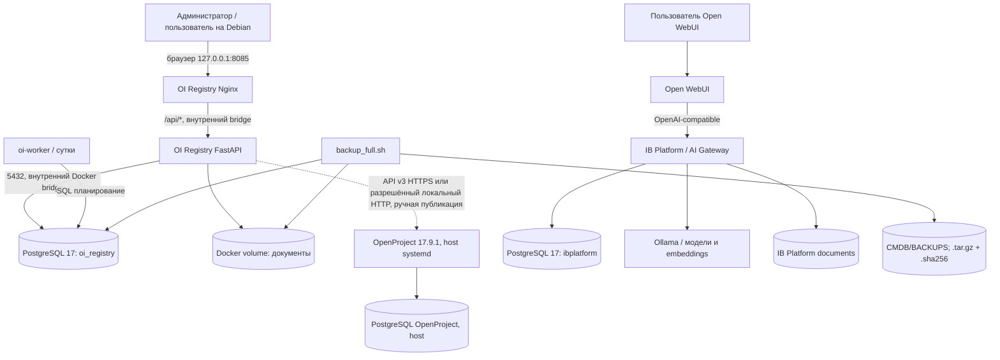

# Топология решения

Топология ниже отражает **логические соединения и известные местоположения**, не выдумывает IP-адреса или физические маршрутизаторы. Схемы доступны как исходники Mermaid и Graphviz DOT в `diagrams/`; также в пакет включены **готовые SVG**, открываемые локальным браузером без Интернета: [общая схема](diagrams/01-zgt-context.svg), [развёртывание OI Registry](diagrams/02-oi-deployment.svg).

## Фактические границы сети

| Поток | Конечные точки | Статус | Примечание |
|---|---|---|---|
| Локальный браузер → OI Web | `127.0.0.1:8085 → nginx:80` | [ИСХОДНИК], [ФАКТ] | published bind только localhost Debian |
| OI Web → OI API | `nginx → oi-api:8000` | [ИСХОДНИК] | Nginx проксирует `/api/` |
| OI API / Worker → OI PG | `oi-db:5432` | [ИСХОДНИК] | сеть `oi_internal`, без внешнего published-порта |
| IB API → IB DB | `ib-db:5432` | [ИСХОДНИК] | сеть `ai_backend` |
| IB API → Ollama | `ollama:11434` | [ИСХОДНИК] | Docker network, без требования Интернета |
| Локальный клиент → IB API | `127.0.0.1:8001` | [ИСХОДНИК] | проверить в текущих `docker ps` |
| OI API → OpenProject | `OI_OP_BASE_URL` → REST API v3 | [ОПЦИЯ, по умолчанию выключена] | URL только локально в `.env`; HTTPS предпочтительно |
| Debian → SMB файловый сервер | `TCP/445` | [ПЛАН] | не считать внедрённым до теста |

## Физическая топология и зоны доверия

- **Физический стенд:** одна тестовая Debian VM на VirtualBox. Узлы AD, SMB, внешний бэкап и пользовательские рабочие места не нанесены, пока не подтверждены.
- **Логические зоны:** хостовая зона `OpenProject/systemd`, Docker зона `oi_internal`, зона `ai_backend`, внешняя для VM зона файлового сервера/AD (только проект), зона внешнего резервного хранения (обязательная целевая, фактическое наличие неизвестно).
- **Пути доступа:** браузер Debian видит `localhost`. Браузер на *другом* физическом компьютере, открывающий `localhost`, обращается к себе; нужен согласованный проброс/NAT/reverse proxy. Не открывать порт OI в сеть без TLS, аутентификации и правил фильтрации.

## Портовая инвентаризация

На хосте: `sudo ss -lntup`; в Docker: `sudo docker ps --format 'table {{.Names}}\t{{.Ports}}'`. Заполните уточнения через локальный скрипт в `docs/local/`; не копируйте полный вывод с адресами закрытых сегментов в открытый Git.
