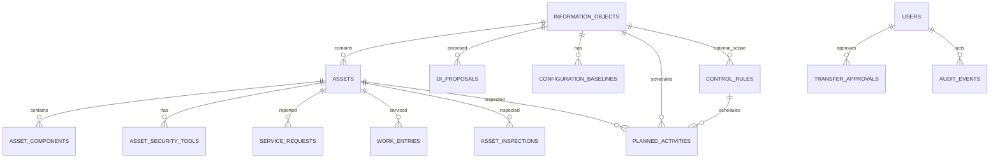

# OI Registry — схема данных и версии миграций

**[ИСХОДНИК]** PostgreSQL + SQLAlchemy + Alembic, рабочая папка `CMDB/oi-registry-v0.1/backend/`. Это концептуальное описание, **не** результат introspection рабочей PostgreSQL.

## Хронология Alembic

| Ревизия | Этап | Ключевые сущности |
|---|---|---|
| `0001_initial` | v0.1 | ОИ, СВТ, поля, документы, аудит |
| `0002_configuration` и `0003_asset_lifecycle` | v0.2 | конфигурации, компоненты, ремонт/заявки/проверки |
| `0004_governance` | v0.3 | роли, заявки, аттестации/отчёты |
| `0005_automation` | v0.4 | плановые мероприятия и OpenProject ссылки |
| `0006_control_rules` | v0.5 | `control_rules`, дополнительные данные подтверждения/ответственности у `planned_activities` |
| `0007_oi_transfer_approvals` | v0.6-alpha | одноразовое подтверждение импорта `transfer_approvals` |

По журналу 18.10.2026 **рабочий** экземпляр имел `0006_control_rules (head)`. Для **тестового** 20.10.2026 показан успешный вход через UI, но ревизия 0007 ещё требует подтверждения выводом `alembic current`.

## Ключи, история и переносимость

- `information_objects.id` и `assets.id` — внутренние SQL-ключи, не стабильный ID разных экземпляров. ZIP v0.6 использует **коды** ОИ/СВТ, а не универсальные UUID.
- `work_entries` — отдельные записи выполненных работ по СВТ; `service_requests` — обращения, не тождественные ремонту. В v0.6 оба набора экспортируются только для чтения.
- `field_assertion_revisions`/`field_evidence` связывают доказательство с **ревизией конкретного значения**. Не заменять историю редактированием задним числом.
- `transfer_approvals` — процессные записи плана и подтверждения импорта, а **не** хранение исходного ZIP с персональными данными.
- SQL-транзакции OI Registry не затрагивают отдельный OpenProject; у интеграции нет общего распределённого коммита.

## Предстоящая нормализация

Перечень помещений и смежности, отдельные должностные лица/допуски, единый реестр ТС/СрТЗИ, ПЗР/ТРД/КЗ, текстовые ОТСС/ВТСС, `Rв/Rн`, история размещения СВТ **не существуют в согласованной форме v0.6-alpha**. Эти требования зафиксированы [здесь](../requirements/OI-REGISTRY-V06-TRACEABILITY.md), SQL-таблицы требуют следующей миграции после уточнения смыслов.

## Источник истины и отказоустойчивость

ОИ и оборудование принадлежат OI PostgreSQL, оригиналы документов — отдельному Docker volume. Для восстановления нужны оба источника в согласованном состоянии. ZIP-экспорт паспорта одного ОИ **не заменяет** `backup_full.sh`, при котором формируется `database.dump` и `documents.tar.gz`. Подробности [в регламенте](../operations/BACKUP.md).

## Дополнение v0.7.0-rc1 (проектируемый к развёртыванию релиз)

`0010_oi_reviews` → `oi_reviews` (событие проверки), `oi_review_findings` (отдельные недостатки и нарушения, `resolved`/`resolved_at`/`resolved_by`).

`0011_svt_media_protection` → `asset_mni` (внутренние диски/SSD, заводской и учётный номера), `asset_zmni` (защищённые USB-носители с учётным и заводским номерами и версией ПО, текущий файл и дата выпуска контейнера), `zmni_container_history` (перевыпуски). `assets` получает `savz_name`, `savz_version`, `szi_nsd_name`, `szi_nsd_version`.

Раздельный срок эксплуатации физического ЗМНИ и трёхлетний цикл файла-контейнера — важное бизнес-правило; в текущей БД хранится дата выпуска, автоматическое уведомление не реализовано. [Подробная модель](OI-V07-MEDIA-AND-QUERIES.md).

## Полная ERD для v0.7.0-rc1

Подробный перечень всех **31 таблиц / 341 полей / 67 FK** приведён в [сборнике схем](erd/README.md). Он включает SVG для GitHub, редактируемые `.mmd`, CSV-реестры связей и колонок. Количество и типы извлечены из `models.py` релизного пакета, а не из действующей базы; физическую PostgreSQL-схему следует проверять после миграции `0011`.
