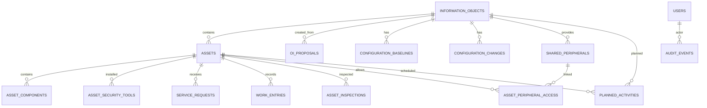

# OI Registry: модели данных, связи и источники истины

## Основные отношения

Это **концептуальная схема**, а не SQL DDL; полные ограничения заданы SQLAlchemy ORM и миграциями `0001`–`0005` в рабочем `backend/`. Поля `*_id` иногда не внешние SQL FK между разными системами (например `openproject_project_id`), поэтому проверять referential integrity на уровне приложения/API.

## История/аудит

`field_assertion_revisions` фиксирует версию утверждения о поле; `field_evidence` ссылается на **конкретную ревизию значения** и документ/страницу. `configuration_baselines` сохраняет снимок на момент формирования/утверждения (не замена юридической аттестации). `audit_events` хранит action/entity/actor/request_id/source_ip/details. Не удалять историю для «исправления ошибки»; новая запись должна объяснить корректировку.

## Оборудование

Перенос комплектующего: прежний компонент выводится из эксплуатации/снимается с даты и основанием, новый регистрируется с заводским номером. МФУ имеет собственный паспорт; разрешения на его использование и драйвер относятся к связи СВТ–МФУ. Ремонт фиксирует заявку/исполнителя/запись работ и состояние опечатывания после ремонта. Квартальная проверка содержит проверяющего, найденные нарушения, принятые меры и ссылку на доказательство.

## Консистентность и доступ

Связанные таблицы принадлежат **одной OI PostgreSQL**, но файлы оригиналов хранятся в отдельном volume, поэтому для согласованного backup останавливаются процессы записи. Внешняя OpenProject БД не участвует в OI SQL-транзакции; timeout REST может дать неопределённый результат, который требует ручной сверки.
