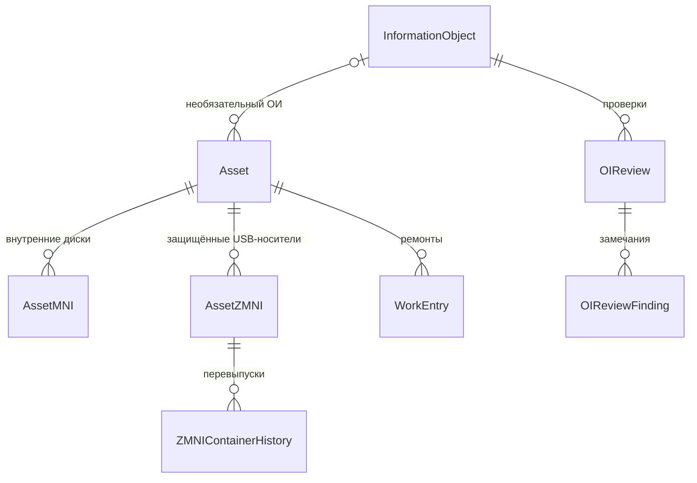

# Модель СВТ, ЗМНИ, МНИ и запросов v0.7.0-rc1

## Сущности



- `asset_mni`: `asset_id`, `serial_number`, `accounting_number`, `media_type`. По два HDD на СВТ = две строки, а не поля `drive_1`, `drive_2`.
- `asset_zmni`: `asset_id`, `serial_number`, `accounting_number`, `software_version`, `container_filename`, `container_issued_on`.
- `zmni_container_history`: архив перевыпущенных контейнеров, дата выпуска, автор и время фиксации; **нет файла-контейнера, ключей или содержимого криптосредства**.
- `assets`: `savz_name`, `savz_version`, `szi_nsd_name`, `szi_nsd_version`.
- `oi_reviews`: ссылка на ОИ, дата, проверяющий, `report_smb_path` (строка); `oi_review_findings`: `category` (`deficiency`/`violation`), `description`, `corrective_action`, `resolved`, `resolved_at`, `resolved_by`.
- МНИ и ЗМНИ **не пересчитываются** из `asset_components`, они самостоятельные реестры. Удаления или автоматического перемещения этих носителей между СВТ через v0.7 нет.

## Административные поля

`field_definitions(entity_type in oi/asset/request)` задаёт тип и обязательность, `field_values` хранит текущее значение, `field_value_revisions` и `field_assertion_revisions` — историю. Локальные поля привязаны к одной карточке (`scope_entity_id`), глобальные относятся ко всему разделу.

## Построитель запросов

`POST /api/assets/query/preview` и `POST /api/assets/query/export.csv` принимают JSON:

```json
{
  "columns": ["code", "serial_number", "savz_version", "custom:12"],
  "filters": [
    {"field": "network_segment", "op": "eq", "value": "SEG-01"},
    {"field": "savz_name", "op": "contains", "value": "Антивирус"}
  ]
}
```

Номер `custom:12` условный; возьмите реальный ID активного глобального поля из «Конструктора полей». Не более 40 колонок, 8 фильтров, 200 строк предпросмотра, 20 000 строк экспорта. Поддерживаются `eq`, `contains`, `empty`, `not_empty`; условия объединяются через AND. Экспорт защищает от CSV formula injection. Не допускаются имя SQL-таблицы, сырое SQL, произвольный JOIN.

## CSV-импорт СВТ

Исходный фиксированный CSV v0.6.1 с разделителем `;`, UTF-8, полями `code;oi_code;serial_number;inventory_number;device_type;model;os_name;os_version;network_segment;ip_address;hostname;domain_name;seal_state;status;notes` и лимитом 3000 строк. Импорт основан на **коде СВТ**, а не физическом serial. Пустой `oi_code` разрешён. `merge` блокирует конфликты, `copy` создаёт новые коды, `replace` обновляет **только совпадающие** коды без удаления отсутствующих и без стирания ремонтов. CSV-построителя — **другая** выборочная выгрузка; для импорта нужен «Полный CSV для импорта», не произвольный отчёт.

МНИ/ЗМНИ, поля САВЗ/СЗИ, журнал ремонтов и пользовательские поля **не переносятся этим CSV**; соответствующие сущности в v0.7 изменяются через свои формы/API. ZIP экспорта ОИ также не является полным аварийным бэкапом.

## Полные таблицы и ключи

Список колонок `assets`, `asset_mni`, `asset_zmni`, `zmni_container_history`, `oi_reviews`, `oi_review_findings` и остальных сущностей приведён в [ER-схеме v0.7.0-rc1](erd/README.md). Это ORM-представление, не SQL dump.
