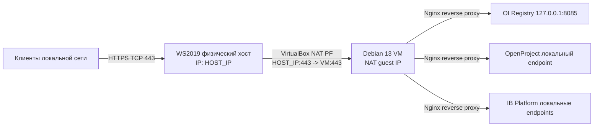
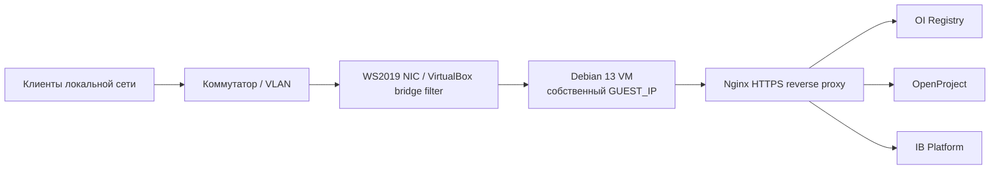

# ZGT — перенос Debian 13 VirtualBox на Windows Server 2019

Версия документа: 1.0 · 2026-10-18 · Статус: эксплуатационный проект, значения IP/DNS уточняются на площадке.

## 1. Назначение и границы

Перенести существующую виртуальную машину Debian 13 с OI Registry, OpenProject и IB Platform на физический сервер Windows Server 2019 с установленным VirtualBox, сохранив данные, конфигурацию, идентификаторы и возможность отката. Документ описывает **два альтернативных** способа публикации: NAT + проброс портов VirtualBox и Bridged Adapter. Настройка обратного прокси на Debian общая для обоих способов.

> Внимание: если WS2019 — контроллер домена, не публикуйте его службы через те же порты, не отключайте защиту Windows Firewall и согласуйте сетевую схему с администратором домена. Для изолированного контура не использовать публичные сертификаты и внешние DNS без разрешения.

## 2. Исходные компоненты и адреса

| Компонент | Известное состояние | Что проверить |
|---|---|---|
| Debian | 13, VirtualBox VM | имя VM, UUID, версия VirtualBox, режим сетевого адаптера |
| OI Registry | Docker Compose; рабочий каталог `/home/admsec/ZGT/CMDB/oi-registry-v0.1` | `docker compose ps`, bind порта 8085, миграция `0005_automation` |
| OpenProject | Пакетная установка 17.9.1, systemd `openproject-web-1`, `openproject-worker-1`, Apache | фактический `Listen`, ServerName, SSL, локальные порты |
| IB Platform | Docker Compose, API/RAG, PostgreSQL, Ollama, Open WebUI | реальные имена compose-проектов и опубликованные порты |
| Backup OI | `/home/admsec/ZGT/CMDB/BACKUPS/` | наличие свежей проверенной копии, тест восстановления |

Нельзя заранее назначить порты OpenProject и IB Platform без инвентаризации: они зависят от текущей конфигурации.

## 3. Рекомендуемая топология

Предпочтительно: **Bridged Adapter**, если Debian должен быть полноценным узлом изолированной сети, физический коммутатор допускает дополнительный MAC-адрес и политика безопасности разрешает отдельный IP. В остальных случаях: **NAT + port forwarding**. Не требуется Windows RRAS для обычного проброса VirtualBox.

### Схема A — NAT VirtualBox



Для нескольких приложений достаточно **одного** проброса 443, если маршрутизация выполнена по DNS-именам `registry.zgt.internal`, `project.zgt.internal`, `ai.zgt.internal` (или по согласованным URL-путям с учётом особенностей приложений). DNS всех трёх имён указывает на HOST_IP. При NAT гостю не нужен отдельный маршрут от клиентов.

### Схема B — Bridged Adapter



В Bridged режиме DNS указывает на GUEST_IP. VirtualBox NAT port forwarding **не используется**. Нужны правильные IP/маска/шлюз Debian, разрешение VLAN/MAC на коммутаторе и сетевые правила между клиентами и VM. При подключении к другой подсети маршрут на маршрутизаторе/межсетевом экране должен указывать на шлюз этой подсети, а не на IP WS2019 (если WS2019 не настроен отдельным маршрутизатором).

## 4. Подготовка перед переносом

1. Запланировать окно простоя; зафиксировать IP, DNS, версии, UUID, пути VM, compose-файлы, службы, конфигурации TLS.
2. Проверить свободное место на целевом диске и совместимость VirtualBox с WS2019, политиками Hyper-V/VBS и сетевым адаптером. Не включать Hyper-V/VBS ради VirtualBox; проверять совместимость отдельно.
3. Создать **согласованные резервные копии** OI Registry, OpenProject и IB Platform, а также отдельный образ VM при выключенной машине. Git не заменяет копию БД.
4. Проверить контрольные суммы копий и процедуру восстановления на отдельном стенде.
5. Выключить исходную VM (`sudo poweroff`) перед копированием виртуальных дисков. Не запускать оригинал и клон одновременно с одинаковыми IP, MAC, hostname и активными задачами синхронизации.
6. Перенести каталог VM или экспортировать OVA; на WS2019 импортировать VM через VirtualBox GUI. При импорте сверить UUID/сетевые адаптеры, порядок загрузки, SATA/NVMe контроллеры и путь к диску. Сохранить копию исходной VM для отката.

Команды инвентаризации Debian (не публиковать вывод без проверки):

```bash
hostnamectl
ip -br address
ip route
ss -lntup
sudo systemctl --type=service --state=running --no-pager
cd /home/admsec/ZGT/CMDB/oi-registry-v0.1 && docker compose ps
sudo systemctl status openproject-web-1 openproject-worker-1 apache2 --no-pager
```

## 5. Настройка Reverse Proxy в Debian

Для изолированного контура использовать локальный DNS и сертификат от доверенного внутреннего УЦ. Не публиковать PostgreSQL (5432), Docker API, Ollama и внутренние административные интерфейсы напрямую.

Пример **отдельного** HTTPS virtual host для OI Registry (сначала проверить, что 443 свободен и нет конфликта с Apache OpenProject). Если 443 уже занят Apache, либо использовать Apache как общий reverse proxy, либо перевести его за общий Nginx с согласованным локальным портом; два процесса не могут одновременно слушать один IP:443.

```nginx
# /etc/nginx/sites-available/registry.zgt.internal.conf
server {
    listen 443 ssl;
    server_name registry.zgt.internal;
    ssl_certificate /etc/ssl/zgt/registry.crt;
    ssl_certificate_key /etc/ssl/zgt/registry.key;
    ssl_protocols TLSv1.2 TLSv1.3;
    client_max_body_size 100m; # согласовать с лимитами загрузки документов
    location / {
        proxy_pass http://127.0.0.1:8085;
        proxy_http_version 1.1;
        proxy_set_header Host $host;
        proxy_set_header X-Real-IP $remote_addr;
        proxy_set_header X-Forwarded-For $proxy_add_x_forwarded_for;
        proxy_set_header X-Forwarded-Proto https;
        proxy_read_timeout 120s;
    }
}
```

Проверка перед включением: `sudo nginx -t`; после согласования архитектуры: `sudo systemctl reload nginx`. Если `nginx` отсутствует или 443 занят, **не устанавливать и не включать конфиг вслепую**. Проверить `sudo ss -lntp '( sport = :443 )'` и `sudo apache2ctl -S`. Для OpenProject настроить его публичный host/protocol и доверенные reverse proxy headers по версии приложения; для Open WebUI — WebSocket Upgrade, корректный внешний URL и cookies.

## 6. Вариант A: NAT и Port Forwarding VirtualBox

1. Выключить VM. В VirtualBox Manager на WS2019: **Settings → Network → Adapter 1 → Enable → Attached to: NAT → Advanced → Port Forwarding**.
2. Добавить правило: `Name=ZGT-HTTPS`, `Protocol=TCP`, `Host IP=HOST_IP` (адрес физического WS2019), `Host Port=443`, `Guest IP=` (оставить пустым при обычном NAT одного адаптера), `Guest Port=443`.
3. Проверить отсутствие конфликта порта 443 на WS2019: PowerShell `Get-NetTCPConnection -State Listen -LocalPort 443 -ErrorAction SilentlyContinue`. При занятом 443 согласовать другой внешний порт или изменить схему; не останавливать IIS/другие службы без анализа.
4. В Windows Firewall открыть входящий TCP 443 **только от разрешённых подсетей** (пример ниже). Внешний DNS направить на HOST_IP.
5. Проверить из другой машины `Test-NetConnection HOST_IP -Port 443`, затем открыть `https://registry.zgt.internal`.

Пример PowerShell **после подстановки согласованных значений**:

```powershell
$HostIp = '192.0.2.10'       # заменить: фактический IP WS2019
$AllowedSubnet = '192.0.2.0/24'  # заменить: сеть клиентов
New-NetFirewallRule -DisplayName 'ZGT HTTPS to Debian VM' -Direction Inbound -Action Allow -Protocol TCP -LocalPort 443 -LocalAddress $HostIp -RemoteAddress $AllowedSubnet -Profile Domain
```

Для публикации с хоста, где уже используется 443, возможно правило `HOST_IP:8443 -> VM:443`, но DNS-имя тогда требует явного `:8443`; желательно выбрать 443 на выделенном IP. Windows `netsh interface portproxy` **не нужен** для NAT PF VirtualBox. Он полезен лишь для особых случаев отдельной переадресации на уровне Windows и требует дополнительных правил и диагностики.

CLI (на WS2019, при выключенной VM, из каталога установки VirtualBox):

```powershell
& 'C:\Program Files\Oracle\VirtualBox\VBoxManage.exe' modifyvm 'ZGT-Debian13' --nic1 nat
& 'C:\Program Files\Oracle\VirtualBox\VBoxManage.exe' modifyvm 'ZGT-Debian13' --natpf1 'ZGT-HTTPS,tcp,192.0.2.10,443,,443'
& 'C:\Program Files\Oracle\VirtualBox\VBoxManage.exe' showvminfo 'ZGT-Debian13' --details
```

Заменить имя VM и `192.0.2.10`; не выполнять команды с примерным IP. Для изменения правил на работающей VM используется `controlvm ... natpf1`, но безопаснее плановое изменение в выключенном состоянии.

## 7. Вариант B: Bridged Adapter

1. Выключить VM. VirtualBox Manager → **Settings → Network → Adapter 1 → Attached to: Bridged Adapter**.
2. В `Name` выбрать **физический Ethernet NIC** WS2019, подключённый к нужной VLAN/сети. Не выбирать виртуальный Hyper-V/loopback адаптер случайно.
3. Включить `Cable Connected`; при необходимости согласовать MAC с администратором сети и портовой безопасностью коммутатора.
4. В Debian задать GUEST_IP, маску, шлюз и DNS через фактически используемый NetworkManager/systemd-networkd/ifupdown. Не переписывать сетевую конфигурацию без проверки активного менеджера сети.
5. На DNS зарегистрировать имена `*.zgt.internal` на GUEST_IP; открыть TCP 443 между клиентскими подсетями и GUEST_IP на сетевых экранах. Windows Firewall для входа непосредственно в гостя обычно не является точкой управления этим трафиком; правила Debian и сетевого оборудования обязательны.
6. Проверить `ip route`, `ping` шлюза, `curl -kI https://GUEST_IP/` (только диагностика), затем HTTPS по имени с проверкой сертификата.

CLI пример:

```powershell
& 'C:\Program Files\Oracle\VirtualBox\VBoxManage.exe' modifyvm 'ZGT-Debian13' --nic1 bridged --bridgeadapter1 'Ethernet'
```

Заменить `Ethernet` на точное имя физического адаптера из `Get-NetAdapter`. На WS2019 может потребоваться проверить установку/разрешение **VirtualBox NDIS6 Bridged Networking Driver** на этом адаптере. Если мост не работает из-за политики сети/драйвера, использовать NAT-вариант, а не отключать защиту сетевого порта.

## 8. Дополнительная схема: два адаптера

Для администрирования можно оставить **Adapter 1 = NAT** (выход/обновления при разрешении) и **Adapter 2 = Host-only** (служебный канал между WS2019 и Debian). Host-only не публикует VM в LAN. Для клиентского доступа всё равно нужны NAT PF или Bridged. Не добавлять два default gateway; в Linux должен быть предсказуемый маршрут по умолчанию.

## 9. Проверки после миграции

```bash
# Debian
ip -br a; ip route
sudo ss -lntp | grep -E ':(443|8085)\b' || true
cd /home/admsec/ZGT/CMDB/oi-registry-v0.1
docker compose ps
docker compose exec -T oi-api alembic current
curl -fsS http://127.0.0.1:8085/api/health/ready
sudo systemctl status openproject-web-1 openproject-worker-1 apache2 --no-pager
```

```powershell
# WS2019
Get-NetAdapter
Get-NetTCPConnection -State Listen -LocalPort 443 -ErrorAction SilentlyContinue
Test-NetConnection 192.0.2.10 -Port 443  # заменить IP
& 'C:\Program Files\Oracle\VirtualBox\VBoxManage.exe' list runningvms
```

Функционально проверить: вход и создание тестовой записи OI Registry, сохранение документа, чтение журнала, планировщик `oi-worker`, OpenProject UI и задания, IB Platform API/RAG (без запуска тяжёлых моделей), доступность DNS и сертификатов, создание и проверку резервной копии.

## 10. Диагностика

| Симптом | Вероятная причина | Действие |
|---|---|---|
| Из WS2019 сайт работает, из LAN нет | Windows Firewall, NAT PF на loopback, DNS или ACL | проверить Host IP правила, `Get-NetTCPConnection`, `Test-NetConnection` с другого ПК |
| При Bridged VM нет сети | неверный NIC, VLAN, MAC port security, bridged driver | `Get-NetAdapter`, параметры VM, сетевой порт, `ip route` |
| 502 Bad Gateway | proxy не видит backend | `ss -lntp`, `curl localhost`, `docker compose ps`, журналы nginx/apache |
| 443 занят | Apache/IIS/Nginx/другой сервис | выяснить владельца сокета; выбрать единый TLS proxy или выделенный IP |
| Редирект на localhost/HTTP | неверный внешний URL, Host/Proto headers | проверить public host OpenProject/Open WebUI, `X-Forwarded-Proto` |
| После копии VM дубли IP | одновременно запущен исходник и клон | остановить один экземпляр, исправить адреса/UUID/MAC |
| База недоступна | контейнер PostgreSQL или volume | проверить `docker compose ps`, `logs`, свободное место; **не использовать** `down -v` |
| Пропали документы | отдельный volume документов не восстановлен | восстановить согласованный архив БД + документов |

## 11. Откат

При неуспехе выключить новую VM, исключить её из сети, вернуть DNS/правила FW к исходным значениям, включить исходную VM. Не запускать два экземпляра одновременно. Если новая система успела принять изменения пользователей, откат без переноса данных приведёт к потере этих изменений: заранее определить окно переключения и точку отсечения записи.

## 12. Что нужно дополнить на площадке

Заполнить и хранить в закрытой эксплуатационной документации: имя/UUID VM, IP WS2019 и Debian, VLAN, DNS/FQDN, режим NAT/Bridged, физический NIC, владелец TLS 443, перечень внешних URL, правила Firewall, фактические порты OpenProject/IB Platform, сертификаты и УЦ, расписания резервного копирования, проверенный RTO/RPO, ответственные за переключение. **Не хранить пароли и приватные ключи в Git.**

## 13. Актуализация документа

При каждом изменении VirtualBox, ОС, сетевой схемы, reverse proxy или сервисов ZGT обновить этот файл, диаграммы, `docs/CHANGELOG.md` и паспорт системы. В PR/коммите указать: что изменилось, затронутые порты, команды проверки, откат, дату и ответственного. Проверить доступность всех FQDN после релиза.
