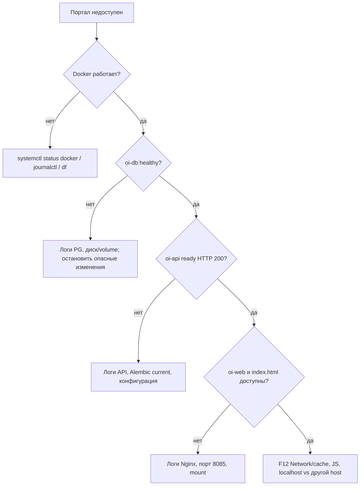
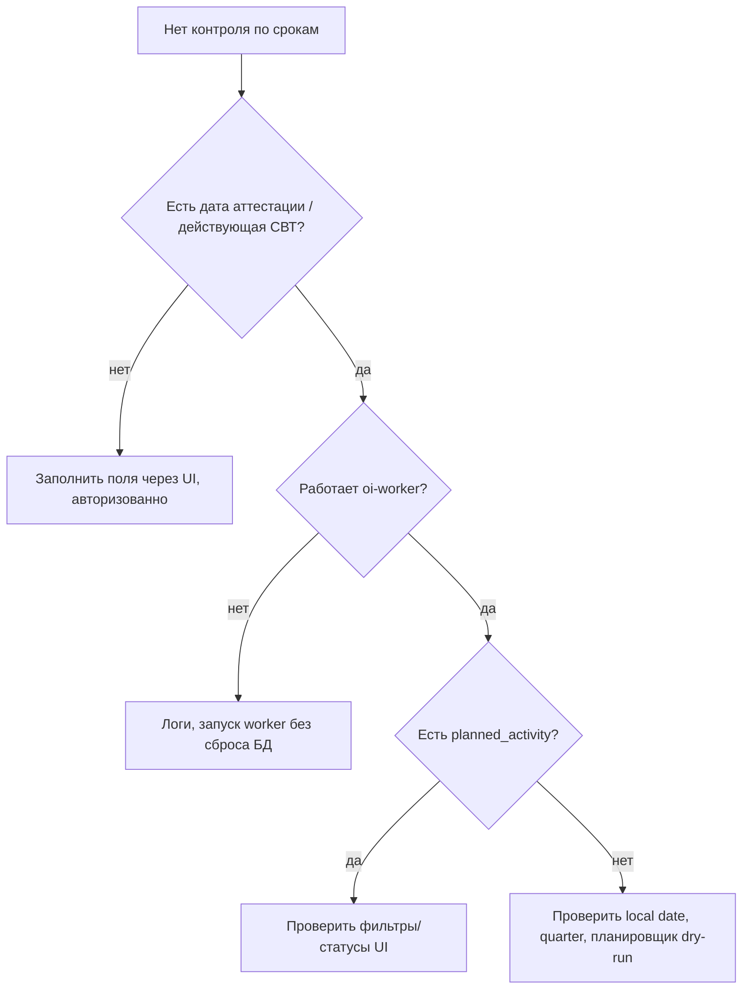
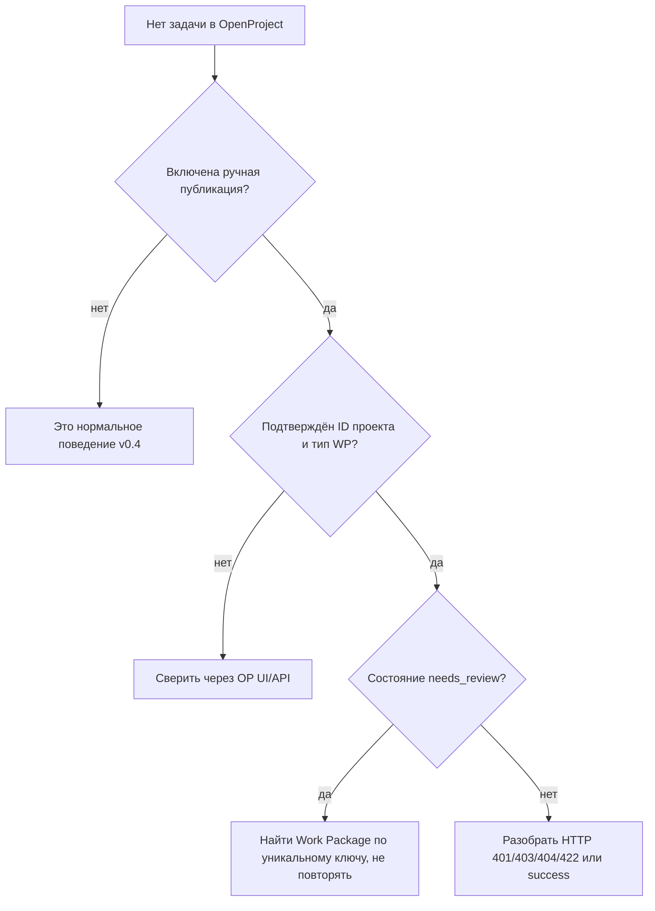

# Диагностические деревья (без Интернета)

## Минимальный набор диагностической информации для сменяющего администратора

Симптом, сервис, дата/время/часовой пояс, `docker compose ps`, `alembic current`, `HTTP code ready`, `systemctl` статус OpenProject, последняя успешная копия, последнее изменение Git, последнее изменение `.env` (**без содержимого**), копии логов в защищённой папке. Если в логах есть персональные данные, их не размещать в Git.
