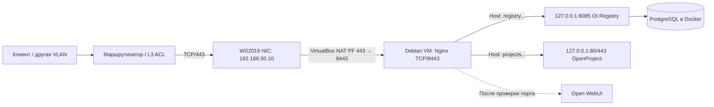
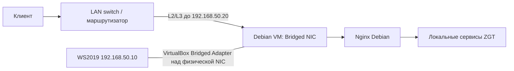

# ZGT: перенос Debian 13 / VirtualBox на Windows Server 2019 и публикация сервисов

**Тип:** самостоятельный эксплуатационный регламент / инструкция внедрения
**Редакция:** docs-ws2019-1.1 · 2026-10-18
**Кому:** системному администратору Windows Server 2019, Debian 13, виртуализации и сети
**Статус:** **[ПЛАН]** для целевого WS2019; состав сервисов — **[ФАКТ/ИСХОДНИК]** ZGT v0.4. **Не считать инструкцию подтверждением проведённого переноса.**
**Правило безопасности:** выполнять изменения на контрольном стенде и после согласования с администратором сети. Никогда не переносить реальную конфигурацию с паролями в Git.

## 0. Ответ за 60 секунд: какую схему выбрать

Для требуемой цепочки **Debian reverse proxy → проброс портов VirtualBox → физический интерфейс Windows Server → маршрутизатор/клиентская сеть** используйте **ВАРИАНТ А: NAT + Port Forwarding**. Windows Server будет иметь один адрес в LAN; VirtualBox направит TCP/443 с этого адреса в TCP/8443 Debian; Nginx Debian определит приложение по HTTP-заголовку Host (SNI), а внутренние приложения останутся на `localhost`.

**ВАРИАНТ Б: Bridged Adapter** — другой принцип: Debian получает **свой IP** в той же сети, что физический сервер. Клиенты и маршрутизатор идут напрямую к IP Debian; **правила Port Forwarding VirtualBox не нужны**. Одновременно включать NAT и bridged на одном виртуальном адаптере нельзя. Два адаптера допускаются по отдельному проекту, но требуют осторожной маршрутизации, DNS и firewall.

**Не нужно создавать Windows Network Bridge в оснастке `ncpa.cpl`**, если цель — обычный режим `Bridged Adapter` в VirtualBox. Это разные механизмы. Также не путайте «виртуальный сетевой мост VirtualBox» с внешним vSwitch Hyper-V и с физическим маршрутизатором.

### 0.1. Критическая проверка поддержки платформы

Официальное руководство **VirtualBox 7.0** включает **Windows Server 2019** в список *host OS*. В официальной документации **VirtualBox 7.1** Windows Server 2019 **не перечислен** среди поддерживаемых хостов (Windows Server 2022/2025 перечислены). Поэтому до ввода в эксплуатацию зафиксировать версию VirtualBox и проверить формальную поддержку именно выбранной версии, с учётом исправлений безопасности и режима лицензирования. Это не означает, что любой неподдерживаемый вариант технически не запустится; означает отсутствие обещанной поддержки. Не переносите рабочую систему в продуктив только на основании того, что ВМ стартует. [См. справочные URL в конце.]

Проверить, **не включён ли Hyper-V / VBS / Windows Hypervisor Platform**, препятствующий или ухудшающий работу VirtualBox. Oracle отмечает ухудшение производительности при совместном использовании VirtualBox и Hyper-V. **Не отключайте Hyper-V автоматически**: он может использоваться другими рабочими нагрузками WS2019; решение оформляет владелец сервера.

## 1. Известная текущая архитектура ZGT

| Компонент | Место / путь Debian | Фактический внешний доступ | Как проксировать |
|---|---|---|---|
| OI Registry v0.4 | `/home/admsec/ZGT/CMDB/oi-registry-v0.1/`, Docker `oi-web`, `oi-api`, `oi-db`, `oi-worker` | `127.0.0.1:8085` (контейнерный Nginx) | `https://registry.zgt.test` → Debian Nginx:8443 → `http://127.0.0.1:8085` |
| OpenProject 17.9.1 | пакет Debian, `openproject-web-1`, `openproject-worker-1`, `apache2`, отдельная БД | **[ПРОВЕРИТЬ]** `ss -lntp`: Apache HTTP/HTTPS | `https://projects.zgt.test` → Debian Nginx:8443 → фактический локальный Apache |
| IB Platform / AI Gateway / Open WebUI | `/home/admsec/ZGT/AI/ib-platform/`, Docker Compose несколько слоёв | API `127.0.0.1:8001` по исходнику; WebUI-порт **[ПРОВЕРИТЬ]** | `https://ai.zgt.test` → фактический *порт UI*, не прямой порт БД или Ollama |
| БД OI Registry | Docker network `oi_internal`, PostgreSQL 17 | Нет опубликованного 5432 | **Не публиковать** |
| БД IB Platform / Ollama | изолированные Docker networks | **[ПРОВЕРИТЬ]** | **Не публиковать** 5432/11434 |
| Резервные копии OI | `/home/admsec/ZGT/CMDB/BACKUPS/` | локальное хранилище | **Не публиковать**; отдельное защищённое копирование |

**Важно:** в GUI VirtualBox пробрасывается **один порт до reverse proxy**. Нет необходимости пробрасывать `8085`, `8001`, `5432`, `11434` отдельно. Для внешних пользователей `localhost` — это их собственный ПК, а не Debian.

## 2. Сетевая адресация (только демонстрационный пример)

**Это не реальные адреса ZGT.** Заменить значения по выданному сетевым администратором плану адресации.

| Узел | Вариант А: NAT | Вариант Б: Bridged |
|---|---|---|
| Windows Server 2019 (физический хост) | `192.168.50.10/24` | `192.168.50.10/24` |
| Debian VM | VirtualBox DHCP, обычно `10.0.2.15/24` | `192.168.50.20/24` (выделенный адрес) |
| Маршрутизатор / L3 шлюз LAN | `192.168.50.1` | `192.168.50.1` |
| Тестовая рабочая станция | `192.168.50.50` | `192.168.50.50` |
| DNS `registry.zgt.test` | `A 192.168.50.10` | `A 192.168.50.20` |
| DNS `projects.zgt.test` | `A 192.168.50.10` | `A 192.168.50.20` |
| DNS `ai.zgt.test` | `A 192.168.50.10` (только после проверки UI) | `A 192.168.50.20` |
| Внешняя точка HTTPS | Windows TCP/443 → VBox NAT → Debian TCP/8443 | Debian TCP/8443 **или** 443 напрямую |

Для документации использованы зарезервированные примерные имена `*.zgt.test`. Реальный DNS-суффикс должен быть согласован. У WS2019 назначить постоянный IP (или DHCP reservation); DNS может разрешать имена в отдельные VLAN по утверждённым правилам.

### 2.1. Схема NAT



Здесь **нет L3 маршрута к `10.0.2.15` с физического роутера**. Входящий пакет приходит на IP Windows Server, а VirtualBox выполняет перенаправление к гостю. Другой шлюз или маршрутизатор может маршрутизировать к подсети `192.168.50.0/24`, но не должен объявлять `10.0.2.0/24` как доступную сеть. Дополнительный DNAT на пограничном маршрутизаторе требуется **только** если есть отдельное правило трансляции из другого адресного пространства; это не обязательный этап доступа из локальной сети.

### 2.2. Схема Bridge



Сетевой адаптер гостя получает собственный MAC и IP. Проверьте ограничения коммутационного оборудования: port security, 802.1X, число разрешённых MAC, VLAN. Для маршрутизатора другие VLAN должны иметь **обычный маршрут к гостевой LAN** (и ACL), а не маршрут к виртуальному NAT-адресу. Если гостевая сеть — отдельная VLAN, потребуется маршрутизация к **этой VLAN** и отдельные политики, но сама VirtualBox bridge не является L3-роутером.

## 3. Перед переносом: обязательный чеклист

1. Получить согласование ИБ на публикацию интерфейсов. Проверить категорию информации в базе ОИ, разграничение доступа и TLS. При отсутствии согласования **не открывать систему в общий сегмент**.
2. Зарегистрировать версию VirtualBox, соответствие официальному списку поддерживаемых host OS (раздел 0.1), сетевые драйверы и наличие Hyper-V/VBS на WS2019.
3. Получить IP Windows, шлюз, DNS-зону, список разрешённых VLAN/клиентов, порты и запрет доступа из несанкционированных сетей.
4. Остановить изменение данных на время копирования и сделать **проверенные бэкапы** каждого слоя: OI Registry `/CMDB/BACKUPS`, **отдельно** OpenProject (`openproject run backup`), **отдельно** IB Platform + PostgreSQL + документные volumes/модели. Не считать ZIP исходников или OVA заменой прикладным копиям.
5. Проверить свободное место целевого диска и целостность копии `.vdi`/`.vbox`/`.ova` посредством SHA-256. Шифровать транспорт и хранение. Не копировать рабочий диск VM простым копированием, пока она пишет данные.
6. Выяснить, есть ли смонтированные VirtualBox Shared Folders (`/media/sf_`): после миграции их путь/источник может измениться. Продумать, куда будут попадать обновления и внешние бэкапы.
7. Убедиться, что **два клона одной VM не работают одновременно** в одной сети с одинаковым IP/hostname; при запуске тестовой копии использовать изолированную сеть.
8. Выделить окно обслуживания и план отката. Протоколировать результат в `docs/local/` или согласованном закрытом журнале.

### 3.1. Инвентаризация Debian без печати секретов

```bash
uname -a
cat /etc/debian_version
ip -br addr
ip route
sudo ss -lntp
sudo systemctl status apache2 openproject-web-1 openproject-worker-1 docker --no-pager
sudo docker ps --format 'table {{.Names}}\t{{.Status}}\t{{.Ports}}'
cd /home/admsec/ZGT/CMDB/oi-registry-v0.1
sudo docker compose ps
sudo docker compose exec -T oi-api alembic current
```

Возможные дополнительные проверки без раскрытия секретов: `findmnt`, `df -h`, `lsblk -f`; для IB Platform собрать активный перечень файлов Compose, но **не выполнять `docker compose config` с выводом в незашифрованную документацию**, так как он может раскрывать переменные окружения.

### 3.2. Инвентаризация Windows Server 2019 (PowerShell Administrator)

```powershell
Get-ComputerInfo | Select-Object WindowsProductName,WindowsVersion,OsBuildNumber
Get-NetAdapter | Format-Table Name,Status,LinkSpeed,InterfaceDescription
Get-NetIPAddress -AddressFamily IPv4 | Format-Table InterfaceAlias,IPAddress,PrefixLength
Get-NetRoute -AddressFamily IPv4 | Format-Table DestinationPrefix,NextHop,InterfaceAlias
Get-WindowsFeature -Name Hyper-V
Get-Service vmms -ErrorAction SilentlyContinue
Get-NetTCPConnection -State Listen | Where-Object { $_.LocalPort -in 80,443,8443,10443 } |
  Format-Table LocalAddress,LocalPort,OwningProcess
& 'C:\Program Files\Oracle\VirtualBox\VBoxManage.exe' --version
```

Не публиковать реальную адресацию и имена хостов в открытом Git. Пустой вывод VirtualBox означает, что путь/установка отличаются; выяснить до внесения правок.

## 4. Перенос виртуальной машины на Windows Server 2019

### 4.1. Подготовка исходной VM

- Зафиксировать состояние приложений/бэкапов, завершить работу сервисов штатно, затем **выключить гостевую ОС** (`sudo systemctl poweroff`). Не копировать VirtualBox-диск при активных транзакциях PostgreSQL.
- Сохранить файл конфигурации машины `.vbox`, виртуальные диски `.vdi`/`.vmdk` и сведения о snapshot chain. Если используются снапшоты, переносить **всю цепочку** или предварительно корректно консолидировать на тестовой копии. Скриншоты настроек сети и привязанных папок включить в закрытый акт.
- Для переноса через `OVA` можно экспортировать выключенную VM штатным мастером `File → Export Appliance`; при импорте могут потребовать корректировки контроллеров, MAC, сетевых режимов, shared folders, UEFI/BIOS и устройств.
- Для переноса родного VirtualBox-формата копировать корректную закрытую VM (конфигурацию и все диски), затем на Windows VirtualBox → **Machine → Add...** → `.vbox`. Не запускать старую и новую копию одновременно на одной сети.
- Операции делать из-под отдельной служебной учётной записи Windows с защищённым профилем. `VBoxManage` и `VirtualBox.exe` должны работать от **того же пользователя**, который зарегистрировал VM; зарегистрированные машины привязаны к пользовательской конфигурации VirtualBox.

### 4.2. Приёмка после импорта, ДО проброса портов

На Windows проверьте через GUI состояние VM и настройки: CPU/память/диск (без изменения по умолчанию), тип сетевого адаптера, путь к дискам, Shared Folders, контроллеры. На госте Debian: `ip -br a`, `ip route`, `systemctl --failed`, `docker ps`, `openproject` и порт `8085`.

**Если VirtualBox 7.0/7.1 различается между исходным и целевым сервером**, предварительно испытать импорт на стенде; несовместимые сохранённые состояния и изменение виртуального оборудования могут сорвать старт. Приложения OpenProject и PostgreSQL внутри Debian при этом не мигрируются отдельно: их сохраняет виртуальный диск; прикладные бэкапы нужны для защиты от логической порчи.

## 5. Debian: единый reverse proxy Nginx без перенастройки Docker

**Принцип:** оставить OI Registry на `127.0.0.1:8085`, OpenProject на текущем Apache, а Nginx на Debian слушает **`8443/tcp`**, чтобы не конфликтовать с существующим Apache на 80/443. VirtualBox транслирует Windows 443 → Debian 8443. TLS завершается в Nginx Debian. Выбор сайта по `Host`/TLS SNI. Не нужно перестраивать все Compose-проекты.

### 5.1. Порты и наличие Nginx

```bash
sudo ss -lntp | grep -E ':(80|443|8443|8085|8001)\b' || true
command -v nginx || true
sudo systemctl is-active apache2 || true
```

Если `nginx` на Debian отсутствует, поставьте его **из проверенного офлайн-репозитория Debian 13** или с утверждённого зеркала. У стандартной установки Nginx может быть сайт `default` на `:80`, который столкнётся с `apache2`. Поэтому **не переносите Apache наугад и не останавливайте OpenProject**: отключите только стандартный Nginx default-site и используйте отдельный порт `8443`.

```bash
sudo apt install nginx
# Если nginx из-за конфликта с Apache не стартовал — это не ошибка OpenProject:
sudo rm -f /etc/nginx/sites-enabled/default
sudo mkdir -p /etc/nginx/tls
sudo chmod 700 /etc/nginx/tls
```

Если на Debian уже запущен **другой host Nginx**, не перезаписывайте конфигурацию: добавьте отдельный virtual host после сверки `nginx -T` и свободного порта `8443`. Если образ Nginx есть только внутри Docker (`oi-web`), это **не** означает наличие системного Nginx Debian.

### 5.2. Внутренний CA и TLS сертификаты

Для продуктивного изолированного контура используйте **внутренний удостоверяющий центр** (например, PKI организации). Выдайте сертификат с SAN: `registry.zgt.test`, `projects.zgt.test`, `ai.zgt.test` (заменить домены на реальные) и установите корневой CA на клиентские машины по регламенту. На Debian поместите сертификат/цепочку в `/etc/nginx/tls/zgt.crt`, закрытый ключ в `/etc/nginx/tls/zgt.key` (`chmod 600`, root). **Ключи нельзя хранить в Git, Shared Folders и PDF-манифесте.**

Только для **изолированной пробной проверки** можно выпустить временный self-signed сертификат. Клиенты будут предупреждать о недоверенном сертификате, пока нет согласованной цепочки доверия; в продуктиве такой подход не использовать:

```bash
sudo openssl req -x509 -newkey rsa:3072 -sha256 -nodes \
  -days 7 -keyout /etc/nginx/tls/zgt.key \
  -out /etc/nginx/tls/zgt.crt \
  -subj '/CN=registry.zgt.test' \
  -addext 'subjectAltName=DNS:registry.zgt.test,DNS:projects.zgt.test,DNS:ai.zgt.test'
sudo chmod 600 /etc/nginx/tls/zgt.key
sudo chmod 644 /etc/nginx/tls/zgt.crt
```

Никогда не отключайте проверку сертификатов в системах обмена документами для «ускорения» развёртывания.

### 5.3. Конфигурация Nginx (тестовая стадия: Registry + OpenProject)

**Проверить Apache `127.0.0.1:80` перед включением OpenProject.** Если он обслуживает только HTTPS или переписывает URL — сначала см. п. 5.4. В примере нет публикации AI: порт WebUI не подтверждён.

```bash
sudo tee /etc/nginx/sites-available/zgt-edge.conf >/dev/null <<'NGINX'
# Внешний HTTPS на Debian:8443; VirtualBox NAT PF на Windows:443 -> Debian:8443
server {
    listen 8443 ssl;
    server_name registry.zgt.test;

    ssl_certificate /etc/nginx/tls/zgt.crt;
    ssl_certificate_key /etc/nginx/tls/zgt.key;
    ssl_protocols TLSv1.2 TLSv1.3;
    client_max_body_size 64m;  # Согласовать с лимитом документов OI

    location / {
        proxy_pass http://127.0.0.1:8085;
        proxy_http_version 1.1;
        proxy_set_header Host $host;
        proxy_set_header X-Real-IP $remote_addr;
        proxy_set_header X-Forwarded-For $proxy_add_x_forwarded_for;
        proxy_set_header X-Forwarded-Proto https;
        proxy_set_header X-Forwarded-Host $host;
        proxy_set_header X-Forwarded-Port 443;
        proxy_set_header Upgrade $http_upgrade;
        proxy_set_header Connection "upgrade";
        proxy_read_timeout 120s;
    }
}

# Включать ТОЛЬКО после проверки, что локальный Apache обслуживает HTTP на :80
server {
    listen 8443 ssl;
    server_name projects.zgt.test;

    ssl_certificate /etc/nginx/tls/zgt.crt;
    ssl_certificate_key /etc/nginx/tls/zgt.key;
    ssl_protocols TLSv1.2 TLSv1.3;
    client_max_body_size 64m;

    location / {
        proxy_pass http://127.0.0.1:80;
        proxy_http_version 1.1;
        proxy_set_header Host $host;
        proxy_set_header X-Real-IP $remote_addr;
        proxy_set_header X-Forwarded-For $proxy_add_x_forwarded_for;
        proxy_set_header X-Forwarded-Proto https;
        proxy_set_header X-Forwarded-Host $host;
        proxy_set_header X-Forwarded-Port 443;
        proxy_set_header Upgrade $http_upgrade;
        proxy_set_header Connection "upgrade";
        proxy_read_timeout 180s;
    }
}
NGINX

sudo ln -s /etc/nginx/sites-available/zgt-edge.conf /etc/nginx/sites-enabled/zgt-edge.conf
sudo nginx -t
sudo systemctl enable --now nginx
sudo systemctl reload nginx
sudo ss -lntp | grep ':8443'
```

**Перед тестом** заменить `*.zgt.test` на реальный внутренний DNS. Для промежуточного теста на Windows host TCP/**10443** вместо 443 настройте `X-Forwarded-Port 10443` и обратите внимание на абсолютные ссылки/переадресации. Конечный вариант — TCP/443 с корректным FQDN.

**Важно для аудита:** нельзя автоматически доверять заголовку `X-Forwarded-For`, когда Nginx доступен напрямую из других сегментов и неизвестно, кто стоит перед ним. Для реального IP в журналах составьте список доверенных прокси и установите `real_ip_header`/`set_real_ip_from` только для них. При NAT/Port Forwarding реальный клиентский IP в гостевой системе может отличаться от первоначального из-за трансляции; **настройку нужно проверить тестовым соединением**, а не считать наличие `X-Forwarded-For` доказательством идентичности пользователя.

### 5.4. Важные нюансы OpenProject

Поскольку OpenProject установлен через **пакет Debian с Apache**, сначала выяснить реальное состояние:

```bash
sudo ss -lntp | grep -E ':(80|443)\b' || true
sudo apache2ctl -S
curl -sSI http://127.0.0.1/ | head -n 15
sudo systemctl status openproject-web-1 openproject-worker-1 apache2 --no-pager
```

Если Apache возвращает 301/302 на другое имя или с `http` на `https`, сначала настроить публичный host name/протокол в OpenProject и штатной конфигурации пакетной установки, а уже затем повторить тест с прокси. Применяйте **документированный для установленного OpenProject 17.9.1 механизм конфигурирования**, не редактируйте внутренние Ruby-файлы. При наличии локального HTTPS Apache необходимо выбрать отдельный корректный upstream и проверить цепочку его сертификата; не отключайте проверку upstream в продуктиве. Cookie Secure/CSRF/WebSocket и абсолютные URL проверять отдельно.

**Не открывать OpenProject наружу, пока проверочный доступ не прошёл аутентификацию, создание задачи и загрузку вложения.**

### 5.5. Прокси для IB Platform и Open WebUI

**Точный UI-порт неизвестен.** Не подменять его API `8001` или Ollama `11434`. На Debian выяснить:

```bash
sudo docker ps --format 'table {{.Names}}\t{{.Ports}}'
sudo ss -lntp
```

Если Open WebUI опубликован на `127.0.0.1:<APPROVED_PORT>`, добавьте третий Nginx `server` для `ai.zgt.test`, аналогичный Registry, со своим upstream. Для длительных ответов модели используйте обоснованный `proxy_read_timeout` (например, 600 секунд), WebSocket headers и корректную настройку базового URL WebUI. **Открывать генеративный интерфейс/нормативный корпус можно только после проверки ACL и политики разрешённых данных**, а не автоматически вместе с Registry.

### 5.6. Debian firewall

При NAT доступ к Nginx должен быть разрешён только через интерфейс VirtualBox и утверждённые источники; при Bridged — через сетевой интерфейс гостя. Сначала выяснить текущую реализацию (`nftables`, UFW, другой межсетевой экран):

```bash
sudo nft list ruleset
sudo ufw status verbose 2>/dev/null || true
sudo ss -lntp | grep ':8443'
```

**Не применяйте бездумно новые правила `nft flush ruleset`** и не отключайте firewall. Добавление конкретного правила зависит от существующих цепочек, политики DROP/ACCEPT и IP гостя. В тесте не открывать 5432, 11434, 8000, 8001, 8085 на интерфейсе LAN.

### 5.7. Сессии OI Registry: Secure cookie и HTTPS

`compose.yaml` OI Registry использует переменную `OI_COOKIE_SECURE`, по умолчанию `false`. Перед публикацией через TLS требуется плановая установка `true` в существующем защищённом `.env`, контроль загрузки переменной и проверка авторизации/CSRF в браузере. Параметр меняется штатным обновлением API, **не путать с изменением базы**. Изменение может потребовать повторного входа пользователей. Также проверить поддержку reverse proxy headers в приложении.

## 6. ВАРИАНТ А: VirtualBox NAT + port forwarding (основной для требования)

### 6.1. Настройка в VirtualBox GUI на WS2019

1. **Выключить VM** перед изменением типа адаптера (надёжнее для миграции). VirtualBox Manager → **Settings → Network → Adapter 1**.
2. `Enable Network Adapter`: включён. `Attached to`: **NAT** (именно обычный NAT; **NAT Network** использует другой механизм управления правилами).
3. `Advanced → Port Forwarding` → добавить строку:

| Имя | Protocol | Host IP | Host Port | Guest IP | Guest Port |
|---|---|---|---|---|---|
| `zgt-https` | TCP | `192.168.50.10` | `443` | **пусто** (если VirtualBox DHCP) | `8443` |

**Host IP** — адрес физического Windows Server, **не** 127.0.0.1 и **не** адрес Debian. Пустой `Guest IP` допустим при стандартном VirtualBox NAT DHCP; если в госте установлен нестандартный статический адрес, указывать фактический IP по требованиям версии VirtualBox.

При занятом TCP/443 используйте **временный** Host Port `10443` для диагностики (URL `https://registry.zgt.test:10443`), не занимайте чужой порт IIS/другого сервиса.

### 6.2. То же через VBoxManage (если необходимо)

**Выполнять в Windows PowerShell** из контекста владельца зарегистрированной VM; имя VM получить через `list vms`. Сначала выключить VM.

```powershell
$VBox = 'C:\Program Files\Oracle\VirtualBox\VBoxManage.exe'
& $VBox list vms
& $VBox showvminfo 'ZGT-Debian13' --details
& $VBox modifyvm 'ZGT-Debian13' --natpf1 'zgt-https,tcp,192.168.50.10,443,,8443'
```

Если правило уже существует — **не выполнять второй раз**; сначала проверить `showvminfo`. Удаление только конкретного правила, в согласованное окно:

```powershell
& $VBox modifyvm 'ZGT-Debian13' --natpf1 delete 'zgt-https'
```

> Примечание: точное название VM в примере вымышлено. Для сетевого адаптера №2 применяется суффикс `2`. Документация Oracle отдельно описывает правила **NAT Network** — не заменять ими синтаксис обычного NAT.

### 6.3. Windows Defender Firewall WS2019

**Только после проверки**, что указанное имя сетевого интерфейса/IP соответствует заданию. Пример разрешает TCP/443 только клиентам VLAN `192.168.50.0/24`:

```powershell
New-NetFirewallRule -DisplayName 'ZGT Debian HTTPS via VirtualBox' `
  -Direction Inbound -Action Allow -Enabled True `
  -Protocol TCP -LocalAddress 192.168.50.10 -LocalPort 443 `
  -RemoteAddress 192.168.50.0/24 -Profile Domain,Private
```

Перед добавлением проверить возможную существующую блокировку в GPO и профили `Get-NetConnectionProfile`. Не менять DefaultInboundAction всей машины. Если Windows Server подключён к домену, политика домена может переопределять локальное правило. Проверить:

```powershell
Get-NetFirewallRule -DisplayName 'ZGT Debian HTTPS via VirtualBox'
Get-NetTCPConnection -LocalPort 443 -State Listen -ErrorAction SilentlyContinue
```

Запрещается делать правило `-RemoteAddress Any` для публикации внутренних сервисов без утверждённого сетевого периметра.

### 6.4. Маршрутизатор, физический мост и доступ из других сетей

**Если клиент и Windows Server находятся в одной подсети:** достаточно ARP/L2 до Windows + Windows firewall + NAT forwarding. Маршрутизатор для внутриподсетного потока вообще может не участвовать.

**Если клиент в другой VLAN:** у L3 маршрутизатора должны быть маршруты **между сетями клиентов и `192.168.50.0/24`** и ACL, разрешающая TCP/443 к `192.168.50.10`. Ответный маршрут/фильтр тоже должен работать. Не настраивать маршрут к приватной NAT-сети VirtualBox `10.0.2.0/24`.

**Если хотят DNAT на физическом маршрутизаторе:** это отдельная административная политика — например, вход с разрешённого сегмента `routerVIP:443` → `192.168.50.10:443`. После неё VirtualBox всё равно PF до Debian:8443. Проверьте TLS SNI/Host, журналирование и антидублирование трансляций. Не делать публикацию из Интернета/внешнего WAN по умолчанию: сведения ОИ/ИБ не предназначены для публичного веб-доступа.

**Если WS2019 имеет два физических сетевых адаптера:** не создавайте Windows OS Network Bridge «на всякий случай». NIC teaming, подключение к VLAN, NAT/маршрутизация между интерфейсами и требования портовой безопасности должны проектироваться отдельно; при ошибке может нарушиться доступ к самому Windows Server.

### 6.5. Тест по уровням (не перескакивать)

| Уровень | Где тест | Команда / результат |
|---|---|---|
| 1. Приложение | Debian | `curl -fsS http://127.0.0.1:8085/api/health/ready` → `ready` |
| 2. TLS reverse proxy | Debian | `curl -kI --resolve registry.zgt.test:8443:127.0.0.1 https://registry.zgt.test:8443/` → ответ Nginx (проверка `-k` только для временного self-signed) |
| 3. Правило VBox | WS2019 | `Test-NetConnection 192.168.50.10 -Port 443` (локальный тест хоста не доказывает доступность извне) |
| 4. Путь LAN | иной компьютер | `Test-NetConnection 192.168.50.10 -Port 443` → `TcpTestSucceeded=True` |
| 5. DNS / TLS | клиент | `Resolve-DnsName registry.zgt.test`; `https://registry.zgt.test` — валидный сертификат и вход |
| 6. Функциональность | клиент | Войти, открыть тестовый ОИ, безопасно выполнить чтение и проверить журналы |

Для `curl -k` требуется отдельная **тестовая** проверка. После установки доверенного CA выполнить `curl` **без** `-k` и убедиться, что сертификат проверяется. При публикации OpenProject — аналогичный сценарий со входом и разрешённым тестовым Work Package.

## 7. ВАРИАНТ Б: Bridged Adapter в VirtualBox

**Выбирать, если нужен отдельный IP Debian в LAN.** NAT-пересылка для входящих веб-запросов в таком режиме не нужна.

### 7.1. GUI

1. Выключить VM; VirtualBox → Settings → Network → Adapter 1 → `Attached to: Bridged Adapter`.
2. `Name`: **физический Ethernet-адаптер** Windows Server 2019, подключённый к нужному LAN/VLAN (не случайный VPN или vEthernet Hyper-V).
3. `Cable Connected`: включён. Promiscuous Mode по умолчанию **Deny**, если сетевым проектом не требуется иное.
4. В Debian назначить **согласованный** статический IP `192.168.50.20/24` с GW `192.168.50.1` и DNS; делать это по текущему сетевому менеджеру Debian (NetworkManager, systemd-networkd или ifupdown), не писать вслепую в `/etc/network/interfaces`.
5. Убедиться, что IP не занят, шлюз доступен, DNS разрешается, и физический коммутатор допускает второй MAC на порту.
6. Разрешить в Debian firewall **только Nginx TCP/8443 либо 443** от согласованных источников. Дальше браузер идёт к **IP Debian**, а не к Windows Server. Правило TCP/443 Windows из варианта А не требуется.

### 7.2. Порт клиента и прокси

Если Debian Nginx продолжает слушать `8443` (потому что Apache использует 443), URL будет `https://registry.zgt.test:8443/`. Для доступа без порта `:8443` требуются проектные изменения: перенести Apache на loopback/нестандартный порт, выделить Debian `443` под Nginx и согласовать публичный URL в OpenProject. **Не изменять Apache без проверки**, иначе можно отключить OpenProject.

### 7.3. Диагностика

```bash
ip -br addr
ip route
ping -c 2 192.168.50.1
sudo ss -lntp | grep ':8443'
sudo tcpdump -ni <GUEST_ETHERNET_IFACE> tcp port 8443
```

Вместо `<GUEST_ETHERNET_IFACE>` укажите фактическое имя интерфейса Debian (например, `enp0s3`), не копируйте угловые скобки в shell. Для `tcpdump` нужна разрешённая процедура и согласование, чтобы не собирать лишние персональные данные. Если WinServer связан с управляемым vSwitch, NIC Teaming, VLAN trunk или 802.1X — диагностировать ограничения сети, а не менять режим без уведомления владельца.

## 8. Автоматический запуск VM и приложений после перезагрузки WS2019

После сбоя питания порт не станет доступен до запуска **VirtualBox VM, Debian, Docker, OpenProject, Nginx**. Перезапуск контейнеров `restart: unless-stopped` зависит от того, запустился ли Docker в Debian.

**Предпочтительный способ:** контролируемый headless-старт зарегистрированной VM **через Планировщик заданий Windows (Task Scheduler)** от специально выделенного пользователя с правом запуска VirtualBox, доступом к файлам VM и опцией «Выполнять независимо от входа пользователя». Создавать задание после теста `VBoxManage startvm` вручную под **тем же аккаунтом**. Не регистрировать VM от одного пользователя, а задачу запускать от `SYSTEM`: тогда пользовательский реестр машин может отличаться. Учитывать политику хранения секретов планировщика, EDR и восстановление после внезапного выключения.

**Пример команды действия (не создавать автоматически на проде):**

```powershell
# Протестировать от имени владельца VM; VM должна быть выключена.
& 'C:\Program Files\Oracle\VirtualBox\VBoxManage.exe' startvm 'ZGT-Debian13' --type headless
```

Приёмка: перезагрузить WS2019 в окно, проверить `VBoxManage list runningvms`, консоль Debian, `docker compose ps`, `systemctl status apache2 nginx ...`, контроль TLS и расписание `oi-worker`. **Обновление Windows Server, перезапуск ночью и лицензия VirtualBox Extension Pack** должны быть включены в эксплуатационный регламент.

## 9. Вопросы изолированного контура

- VirtualBox installer, расширения (если вообще необходимы), Debian пакеты Nginx/OpenSSL, корневой CA и сертификаты, документацию Oracle/Microsoft сохранить в утверждённом offline software repository до изоляции. Не требовать доступ к внешнему CA, CRL, OCSP и DNS, если их невозможно обслуживать; организовать внутренние точки проверки отзыва сертификатов.
- Логирование TLS-proxy в Debian должно быть настроено без cookie/password в логах, с ротацией и контролем доступа. Сопоставлять время Windows, Debian и приложений по доверенному локальному NTP; иначе недельные отчёты и события аттестации будут несопоставимы.
- Сетевую поверхность ограничить HTTPS и строго необходимыми административными портами через отдельную управляемую сеть или jump host. Не открывать SSH, OpenProject PostgreSQL, Ollama, Docker socket в пользовательские VLAN.
- Убедиться, что прокси не ломает ACL: requester/editor/admin OI, права OpenProject и роль Open WebUI проверять под тестовыми аккаунтами. Наличие TLS не заменяет разграничение доступа.
- Согласовать вывоз архивов `CMDB/BACKUPS` на независимое защищённое хранилище; **полное восстановление всех трёх систем** проверить отдельно от миграции VM. Не переносить документы ограниченного доступа в VirtualBox Shared Folder, если это запрещено регламентом.

## 10. Диагностическое дерево неисправности

| Симптом | На что смотреть сначала | Безопасные команды |
|---|---|---|
| Клиент не находит имя | DNS A указывает на Windows (NAT) или Debian (Bridge)? | `Resolve-DnsName registry.zgt.test`, `nslookup` |
| Клиент не подключается TCP/443 | Роутер ACL, Windows firewall, VBox PF, VM выключена | `Test-NetConnection <HOST_IP> -Port 443`; `VBoxManage showvminfo` |
| TCP есть, HTTPS не устанавливается | Debian Nginx 8443, TLS SAN/CA, режим VirtualBox | `sudo nginx -t`, `journalctl -u nginx`, `openssl s_client -connect ... -servername ...` |
| HTTPS 404/не тот сайт | `Host`/SNI, DNS, `server_name`, default_server | `curl --resolve`, `sudo nginx -T` |
| HTTPS 502/504 | upstream `127.0.0.1:8085`, Apache, AI UI, таймауты | `ss -lntp`, `docker compose ps`, `systemctl status apache2` |
| Registry 200, но не входит | Secure cookie, domain/proto, CSRF, reverse proxy headers | браузер DevTools, `docker compose logs oi-api` |
| OpenProject перекидывает на localhost | canonical URL / host header / Apache redirect / CSRF | `curl -I`, настройки публичного host OpenProject |
| Только одна VLAN видит сервис | L3 ACL, обратная маршрутизация, Windows firewall RemoteAddress | `tracert`, `route print`, `Get-NetFirewallRule` |
| Bridged VM не получает IP | коммутатор запрещает второй MAC, VLAN, DHCP, bridge-драйвер | `Get-NetAdapter`, `ip link`, оснастка VirtualBox |
| После перезагрузки пропало всё | задача старта VM, статус Docker и сервисов | `VBoxManage list runningvms`; `systemctl --failed` |

**Правильная последовательность:** клиент DNS → маршрутизатор/ACL → Windows NIC/firewall → VirtualBox NAT PF (только вариант A) → Debian NIC/firewall → Nginx:8443 → локальный upstream → приложение/БД. Не исправлять схему запуска удалением volumes и не использовать `docker compose down -v`.

## 11. План отката

1. До переключения DNS и firewall сохранить прежние настройки сетевых адаптеров VM, экспорт правил VBox, бэкап конфигурации Nginx и безопасную копию `/etc/nginx/sites-available/zgt-edge.conf`.
2. При ошибке прекратить трафик внешних клиентов (закрыть специально созданное правило Windows firewall и/или отменить изменение DNS), сохраняя локальную работоспособность Debian.
3. В варианте NAT удалить только правило `zgt-https` VirtualBox; для Windows firewall удалить только созданное именованное правило (после проверки в журнале изменений):

```powershell
# Выполнять только в рамках формального rollback:
Remove-NetFirewallRule -DisplayName 'ZGT Debian HTTPS via VirtualBox'
```

4. На Debian отключить только созданный proxy vhost: `sudo rm /etc/nginx/sites-enabled/zgt-edge.conf; sudo nginx -t; sudo systemctl reload nginx` — **лишь если иных ссылок на него нет и конфигурация тестируется успешно**. OpenProject, PostgreSQL и Docker volumes не трогать.
5. Не запускать старый клон одновременно с новым: разделите сеть или выключите новый инстанс. После отката проверить логины и консистентность данных: миграция двух активных копий VM может привести к расхождению учётных сведений.

## 12. Приёмочные испытания и акт внедрения

| № | Критерий | Что фиксировать |
|---|---|---|
| 1 | Версия VirtualBox поддерживает WS2019 как host или риск явно согласован | Версия, источник, документ согласования |
| 2 | Hyper-V / VBS совместим с выбранным вариантом | Вывод Windows inspection и результат теста |
| 3 | Перенос VM без двойного запуска и с восстановимым backup | Хэши диска/OVA и журнал контрольного запуска |
| 4 | Схема сети соответствует одной из двух топологий | NAT PF **или** Bridge, IP, маршруты, firewall |
| 5 | `registry` доступен клиентам только через TLS | Валидный SAN, CA, login, API ready |
| 6 | `projects` работает с proxy и правильным canonical URL | Вход и тестовая задача OpenProject |
| 7 | `ai` включён только по отдельному допуску | UI порт, ACL, тест чувствительных данных |
| 8 | БД и Ollama недоступны из клиентского сегмента | Отрицательные сетевые тесты |
| 9 | Смена прав/документов отражается в аудите | Тестовая операция без экспонирования сведений |
| 10 | Перезапуск Windows не нарушает доступность | Планировщик, headless VM, все службы |
| 11 | Проверено восстановление приложений на отдельном стенде | Протокол OI/OpenProject/IB backups |
| 12 | Документы и Git отражают итоговую схему | Обновлены README, TOPOLOGY, CHANGELOG, RELEASES, акт |

Перед передачей в эксплуатацию заполнить [сетевой паспорт](../templates/WS2019-NETWORK-PASSPORT.md), даты, версии, владельцев, RTO/RPO и результат теста отказа. Фактические IP и сертификаты — только в разрешённой локальной документации, не в публичном Git.

## 13. Как обновлять при новых версиях ZGT

Любое изменение опубликованных UI-портов, имён, TLS, схемы NAT/Bridge, Hyper-V/VirtualBox, Compose, настроек OpenProject, механизма старта VM и firewall **обязательно** отражать:

- в этом мануале — что теперь реально работает;
- в `docs/02-TOPOLOGY.md` и `docs/diagrams/04-ws2019-publication.mmd` — новая сеть и точки отказа;
- в `docs/CHANGELOG.md` и `docs/RELEASES.md` — версия, изменение, тест, откат;
- в закрытом сетевом паспорте `docs/local/` — реальные IP, номера интерфейсов, DNS, согласования;
- в тестах `python3 docs/scripts/verify_docs.py` и в протоколе ручных проверок по п. 12.

Коммит исходников и документации проводить совместно по `docs/DOCUMENTATION-POLICY.md`; Git не является хранилищем сертификатов/бэкапов.

## 14. Первоисточники для проверки версии (справка, не необходимы для офлайн-исполнения)

Руководство полностью самодостаточно при исполнении в изолированном контуре. URL ниже — **справочная библиотека**, которую следует сохранить в разрешённый офлайн-архив перед изоляцией:

1. Oracle VirtualBox 7.0, *Supported Host Operating Systems*: https://docs.oracle.com/en/virtualization/virtualbox/7.0/user/Introduction.html
2. Oracle VirtualBox 7.1, *Available Installation Packages*: https://docs.oracle.com/en/virtualization/virtualbox/7.1/user/Introduction.html
3. Oracle VirtualBox 7.1, *Virtual Networking / NAT Port Forwarding / Bridged*: https://docs.oracle.com/en/virtualization/virtualbox/7.1/user/networkingdetails.html
4. Oracle VirtualBox 7.1, *Known Limitations (Hyper-V)*: https://docs.oracle.com/en/virtualization/virtualbox/7.1/user/KnownIssues.html
5. Microsoft, `New-NetFirewallRule` RemoteAddress/LocalAddress/Port: https://learn.microsoft.com/en-us/powershell/module/netsecurity/new-netfirewallrule
6. Microsoft, Windows Server 2019 Hyper-V требования: https://learn.microsoft.com/en-us/windows-server/virtualization/hyper-v/host-hardware-requirements

**Редакторская пометка:** все IP/домены/имя VM в примерах вымышлены. Настройка VirtualBox на WS2019, существование физического моста и фактические корпоративные маршруты **не подтверждены** предоставленными журналами.

### Дополнение: когда действительно нужен статический маршрут к Debian через Windows Server

**ВАРИАНТ В — отдельная маршрутизируемая сеть Host-Only + Windows RRAS** (*не рекомендован для первой установки*). Если по архитектуре нужно обращаться **не к IP Windows и проброшенному порту**, а напрямую к выделенной сети VM, проект может выглядеть так: маршрутизатор хранит маршрут к `172.27.10.0/24` через `192.168.50.10` (WS2019); Windows RRAS пересылает пакеты с физической NIC на VirtualBox Host-Only `172.27.10.1`; Debian использует `172.27.10.20` и обратный маршрут через Windows. Это требует роли **Remote Access / Routing (RRAS)**, реального разрешения IP forwarding, запрета несанкционированного транзита, firewall обеих ОС и согласования обратных маршрутов. **Ни обычная Windows Network Bridge, ни NAT port forwarding в этом варианте не нужны.** Не включать RRAS на доменном/прикладном сервере без отдельной оценки рисков.

Для текущей задачи ZGT единая HTTPS-точка на NAT PF (Вариант А) проще, изолирует DB и оставляет на Windows только один опубликованный входящий порт; на Bridge (Вариант Б) проще добиться отдельного IP гостя без двойной трансляции.
